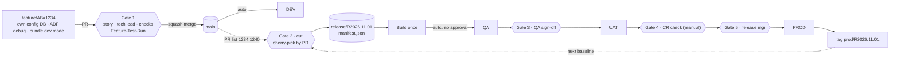
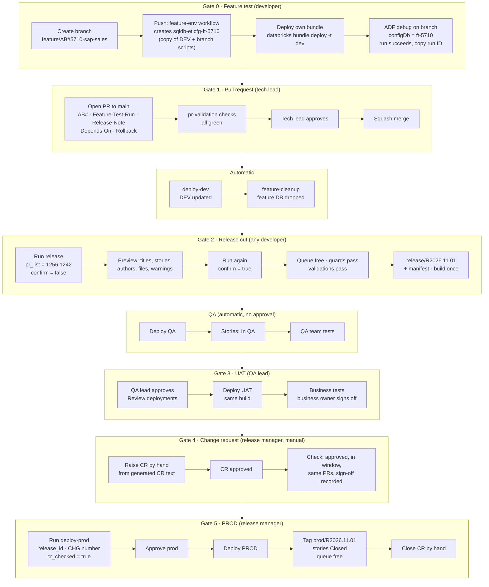
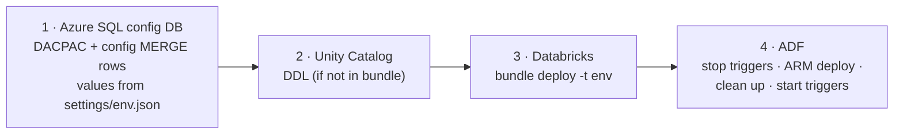
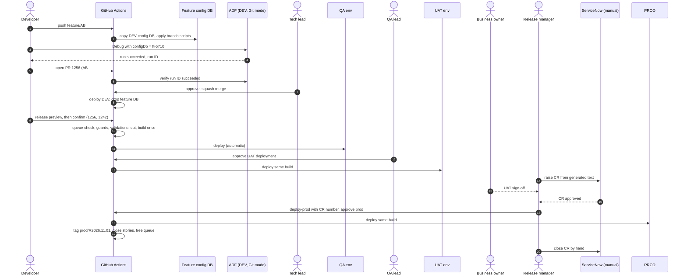

# Shell Data Platform CI/CD: Handoff for the Local Coding Agent

Version 1.5 · 25 Oct 2026 · Owner: Vamshi Singam (lead)

This file is **self-contained**. It holds the full context, target architecture, specifications, conventions,
access requirements and reference code. No other repository or document is needed.

---

## 0. How to use this document

**For Vamshi:** put this file at `PDX_Projects/devops-cicd/HANDOFF.md`, open `PDX_Projects/devops-cicd` in VS Code,
choose Copilot Chat **Agent** mode with your Claude model, and send:

> Read HANDOFF.md completely. Then do Phase 1 only and stop for my review.

After each phase, review and say "Proceed to Phase N".

**For the agent:** work strictly phase by phase (§4). Do not start a phase until the previous one is reviewed.
Section 5 is the target design: implement it, do not redesign it. Appendix G is the team-facing summary of the whole process (all gates, sunny-day flow, edge cases). If the real environment contradicts it,
record the conflict in `DECISIONS.md` and ask.

---

## 1. Mission

Build a new, parallel CI/CD process for a data platform team whose current DevOps process has broken down.
Developers will build on it under Vamshi's lead.

**Three project types, one repository:**

| Type | What it is | Build artifact |
|---|---|---|
| Azure Data Factory (ADF) | Metadata-driven pipelines reading configuration from an Azure SQL DB | ARM template |
| Azure SQL config DB | Standalone Azure SQL database holding ETL configuration (sources, mappings, flags) | DACPAC + idempotent config data scripts |
| Databricks | Notebooks, jobs and Unity Catalog objects; the team already uses Databricks Asset Bundles | Bundle |

**Environments:** DEV, QA (a dedicated QA team tests), UAT (business users test), PROD. Each has its own factory,
config DB and Databricks workspace.

**Platform services:** GitHub + GitHub Actions (CI/CD), Azure Boards (stories), ServiceNow (change requests for
PROD), Microsoft Entra ID (existing managed identities must be reused).

### Problems to fix

1. Everything merges to `main` and is tested on `main`. Then all of `main` moves forward, so one failed story blocks everyone.
2. Cherry-picking to higher environments is done per commit, which is error-prone.
3. Azure SQL config scripts reach a database only after merging to `main`. ADF pipelines that need new config therefore
   cannot be tested end-to-end on a feature branch, and untested work lands in `main`.

### Principles

- **Every feature is fully tested on its own feature branch, isolated per developer.** Only approved, tested PRs reach `main`.
- **A release is a list of PRs**: never individual commits, never all of `main`.
- **Build once, deploy many**: QA, UAT and PROD receive the identical artifact.
- **No Azure secrets in GitHub**: OIDC federated credentials on the existing managed identities.
- Every PR is linked to an Azure Boards story; every PROD deployment is tied to an approved ServiceNow CR (raised and checked by hand; no integration).

---

## 2. Rules for the agent (always)

1. **Read-only by default.** Discovery commands (`az … list/show`, `gh api` GET, `databricks … list/get`, `SELECT`)
   are fine. Ask before any command that creates, changes or deletes anything in Azure, Databricks, GitHub settings or a database.
2. **Never touch QA, UAT or PROD resources directly.** They change only through approved release workflows.
3. **Do not grant access** (role assignments, federated credentials, SQL users, Databricks principals, GitHub settings).
   Admins do that. Record what is missing in `environment/ACCESS_GAPS.md`.
4. **No secrets** in files, commits, logs or chat. Redact anything secret-looking you encounter.
5. **All code through branches and PRs.** Branches: `feature/AB#<id>-<desc>` or `chore/<desc>`. Never push to `main`.
6. **Evidence over assumptions.** Every fact you rely on goes in `environment/ENVIRONMENT_FACTS.md` with its source
   (command or file, and date). Unknown → write `UNKNOWN` and ask. Never invent resource names.
7. **Small reviewable steps.** At the end of each phase or step: update `STATUS.md`, list what changed, then stop.
8. Use official CLIs: `az`, `gh`, `databricks`, `sqlpackage`, `dotnet`, `npm`. Pin GitHub Action versions.
9. Do not move, rename or delete existing files in `PDX_Projects/devops-cicd/`; they hold earlier discovery work.

---

## 3. Workspace layout

```
PDX_Projects/devops-cicd/
├── HANDOFF.md                      ← this file (do not edit; propose changes in DECISIONS.md)
├── <existing discovery files>      ← gathered earlier; read, never delete
├── .github/
│   ├── copilot-instructions.md     ← created in Phase 1 from Appendix E
│   └── prompts/                    ← created in Phase 1 from Appendix F
├── STATUS.md                       ← living: done / in progress / blocked / next
├── DECISIONS.md                    ← append-only: date, decision, reason
├── environment/
│   ├── INVENTORY.md                ← Phase 1: what already exists in this folder
│   ├── ENVIRONMENT_FACTS.md        ← Phase 2: discovered facts with evidence
│   ├── CURRENT_PROCESS.md          ← Phase 2: how the team builds and deploys today
│   ├── REQUIREMENTS.md             ← Phase 3: requirement → current state → gap → work item
│   └── ACCESS_GAPS.md              ← Phase 3: needed vs existing access + short admin email
└── shell-data-platform/            ← Phase 4: the new platform repository (git)
```

---

## 4. Phase plan (in order)

### Phase 1: Set up the workspace

1. List every file and folder already in `PDX_Projects/devops-cicd/`. Summarise each in `environment/INVENTORY.md`
   (what it contains, which environment, how current). Note where it already answers a question from §6.
2. Create `STATUS.md`, `DECISIONS.md` and the `environment/` folder if missing.
3. Create `.github/copilot-instructions.md` from Appendix E and the prompt files from Appendix F.
   If a `copilot-instructions.md` already exists, append ours under a heading `## Shell CI/CD handoff`.
4. Stop. Report: the inventory summary, which open questions (§6) already look answered, and what is missing.

### Phase 2: Discover the existing environment (read-only)

Fill `environment/ENVIRONMENT_FACTS.md` with one section per environment (DEV, QA, UAT, PROD), as tables.
Combine the existing files with fresh read-only checks. Record the source for every value.

| Area | Collect | Example commands |
|---|---|---|
| Tenant / subscriptions | tenant ID, subscription per env, resource groups | `az account show`, `az account list`, `az group list` |
| Data Factory | name, RG, location, Git config (repo, collaboration branch, root folder), global parameters, linked services (esp. the config DB one), integration runtimes (Azure / self-hosted / shared), triggers, managed identity type + IDs | `az datafactory list`, `az datafactory show`, `az datafactory linked-service list`, `az datafactory integration-runtime list`, `az datafactory trigger list` |
| Azure SQL config DB | server, database, tier, Entra admin, public network access / firewall / private endpoint, elastic pools, principals in the DB, schema objects, which tables are config vs runtime state | `az sql server list/show`, `az sql db list`, `az sql elastic-pool list`, `az sql server ad-admin list`, `SELECT name,type_desc FROM sys.database_principals`, `SELECT s.name,t.name FROM sys.tables t JOIN sys.schemas s ON s.schema_id=t.schema_id` |
| Databricks | workspace URL per env, metastore, catalogs/schemas per env, SQL warehouses, serverless availability, cluster policies, existing bundles (location, targets, run_as), service principals, Git folder settings | `az databricks workspace list`, `databricks catalogs list`, `databricks warehouses list`, `databricks cluster-policies list`, `databricks service-principals list`, `databricks bundle validate` in existing bundle folders |
| Identities | every managed identity the team uses: name, client ID, object ID, **user- vs system-assigned**, role assignments, existing federated credentials | `az identity list`, `az role assignment list --assignee <objectId> --all`, `az identity federated-credential list` |
| Network | private endpoints, VNets, self-hosted IRs, whether GitHub-hosted runners can reach SQL/Databricks/ARM | `az network private-endpoint list`, `az sql server show --query publicNetworkAccess` |
| Key Vault | vaults used by linked services, access model (RBAC vs policies) | `az keyvault list`, `az keyvault show` |
| GitHub | org, plan (Enterprise?), existing repos for this team, Actions policy, existing workflows, rulesets/branch protection, environments, installed apps (Azure Boards, ADF, Databricks) | `gh api orgs/<org>`, `gh repo list <org>`, `gh api repos/<o>/<r>/rulesets`, `gh api repos/<o>/<r>/environments`, `gh workflow list -R <o>/<r>` |
| Azure Boards | org, project, area path, work-item types and **state names** | `az boards work-item show`, `az devops project show` |
| ServiceNow (manual) | change model, CR template, who approves, typical lead time, change windows; no API integration (D-27) | ask Vamshi / the team |
| Environment-specific values | every value that differs per environment: source server names (QA reads the test source, UAT the UAT source, …), storage accounts and paths, Databricks workspace and catalog, Key Vault names, integration runtime names. Record where each lives today (ADF parameter files, global parameters, config DB rows, bundle files, pipeline variables) | ADF ARM parameter files and global parameters, `SELECT` on config tables, bundle `targets`, existing pipeline variables |
| Feature-run outputs | where ADF/Databricks runs write data in DEV (lake paths, catalogs/schemas) and whether developers share the same targets | linked services, datasets, bundle variables; ask the team |

Also write `environment/CURRENT_PROCESS.md`, covering how the team works today:
- the existing repos and pipelines and their triggers
- how ADF is published
- how the SQL config scripts are deployed (DACPAC? numbered scripts? what tool?)
- how Databricks bundles are deployed
- how promotions and cherry-picks happen today
- pain points seen in pipeline history

At the top of `ENVIRONMENT_FACTS.md`, answer each open question in §6 with: answer, evidence, confidence.
Stop. Report the answers, the top 5 risks, and anything you could not access.

### Phase 3: Requirements and gap analysis

1. Write `environment/REQUIREMENTS.md`: one row per requirement R-01 … from §5 (gates, feature isolation per project type,
   release-by-PR, environments/approvals, ServiceNow, Boards, identities, deploy order). Columns:
   requirement · current state (from Phase 2) · gap · proposed work item · depends on (access / decision).
2. Write `environment/ACCESS_GAPS.md`. For every item in §5.12, check the live state where possible and mark it
   Exists / Missing / Cannot check, with evidence. Then add a **one-page admin email** listing only the
   Missing items, grouped by admin, using real resource names. DEV items come first.
3. List the decisions needed from Vamshi (e.g. reuse the existing repo or create a new one; DACPAC vs existing script tooling;
   self-hosted runners). Record proposals in `DECISIONS.md` as "Proposed".
4. Stop for review.

### Phase 4: Development (each step is a branch + PR; stop after each)

| Step | Deliverable | Acceptance |
|---|---|---|
| 4.1 Repo scaffold | `shell-data-platform` repo layout per §5.2 using real names; import existing ADF/Databricks/SQL content as found in Phase 2; `settings/<env>.json` per §5.13 plus a script that renders ADF ARM parameters, bundle variables and SQLCMD variables from it; CODEOWNERS; PR template; README | Builds locally: `dotnet build sqlconfig`, `databricks bundle validate -t dev`, ADF `npm run build validate` |
| 4.2 Release tool | Port Appendix A to `scripts/release/`, add the **GitHub provider** (§5.7); port the tests (Appendix B) and add GitHub-provider tests with a mocked API | `pytest` green |
| 4.3 PR validation | `.github/workflows/pr-validation.yml` per §5.6; `docs/branch-protection.md` with the ruleset to request | Workflow green on a test PR; fails without AB# or Feature-Test-Run |
| 4.4 Feature environment | `feature-env.yml`, `feature-cleanup.yml`; ADF `configDb` parameterisation (§5.4); `docs/feature-testing.md` | One branch gets its own DB; ADF debug against it succeeds; DB dropped after PR close |
| 4.5 Deploy DEV | reusable `deploy-env.yml` + `deploy-dev.yml` (§5.6, §5.10) | Merge to main deploys DEV in the right order |
| 4.6 Release | `release.yml` (preview + confirm, queue, cut guards, CR text), `deploy-prod.yml` and `drop-release.yml` (§5.6–5.9, §5.7a–d). Do **not** port Appendix C (ServiceNow integration deferred) | Dry-run (`plan`) correct; a real release of one PR reaches QA |
| 4.7 Pilot | One real story end-to-end; `pilot/PILOT_REPORT.md` | Story reaches QA (and UAT if approvers are available) through the new path |

---

## 5. Target architecture (implement this)

### 5.1 Overview



**Service-to-service authentication**

| # | From → To | How | Permission needed |
|---|---|---|---|
| 1 | GitHub workflow → Entra ID | OIDC token exchanged for the environment's **user-assigned** managed identity (federated credential subject `repo:<org>/<repo>:environment:<env>`) | Federated credential on the identity |
| 2 | Deploy identity → ADF | ARM deployment, trigger stop/start | Data Factory Contributor on the factory's RG |
| 2 | Deploy identity → Azure SQL | Entra token (`sqlpackage /AccessToken` or `azure/sql-action`) | Contained user, `db_owner` in the config DB |
| 2 | Deploy identity → Databricks | Databricks CLI `azure-cli` auth after `azure/login` | Workspace service principal; CAN MANAGE on bundle root; UC privileges; CAN USE warehouse |
| 3 | ADF Studio (DEV) / Databricks Git folders ↔ GitHub | Org-approved GitHub apps, per-developer sign-in | Org owner approves apps |
| 4 | Factory MI (existing) → config DB / Databricks / ADLS / Key Vault | Managed identity at runtime | db_datareader/writer + EXECUTE; CAN MANAGE RUN on jobs; Storage Blob Data Contributor; Key Vault Secrets User |
| 5 | Azure Boards ↔ GitHub | Azure Boards app; `AB#<id>` in PR links the story | App installed + project connected |
| 6 | Release workflow → Azure Boards API | Managed identity added to the Azure DevOps org; token for resource `499b84ac-1321-427f-aa17-267ca6975798` | Basic access + Contributor on project/area |
| 7 | ServiceNow | **No integration (D-27).** The release manager raises and checks the CR by hand; the workflow only produces the CR text and records the CR number | None now |
| 8 | release-bot GitHub App → repo | App installation token (`actions/create-github-app-token`) | Contents RW; ruleset bypass for `release/*` and `prod/*` |

### 5.2 Repository layout

```
shell-data-platform/
├── settings/{dev,qa,uat,prod}.json   single source of environment-specific values (§5.13)
├── adf/                         ADF Git root of the DEV factory (pipeline/, dataset/, linkedService/, trigger/, …)
│   ├── package.json             @microsoft/azure-data-factory-utilities
│   ├── arm-template-parameters-definition.json
│   └── arm-parameters/{dev,qa,uat,prod}.json
├── databricks/                  Databricks Asset Bundle (databricks.yml, resources/, src/)
├── sqlconfig/                   SQL project for the config DB
│   ├── EtlConfig.sqlproj
│   ├── Tables/ Procs/ Views/    schema (DACPAC)
│   ├── Data/<area>/<KEY>.sql    one idempotent MERGE per config key
│   └── Scripts/Script.PostDeployment.sql   :r includes for Data files
├── scripts/release/             build_release.py (+ GitHub provider); cr_gate.py only if ServiceNow integration is approved later
├── tests/
├── releases/                    manifests (only on release/* branches)
├── docs/
└── .github/ (workflows/, CODEOWNERS, pull_request_template.md)
```

### 5.3 Branching and gates

| Gate | When | Checks | Enforced by |
|---|---|---|---|
| 0 Feature test | Before PR | Branch tested end-to-end: ADF debug against the branch's own config DB and the developer's bundle. Evidence = the ADF debug **run ID** in the PR | `feature-env` workflow + PR check |
| 1 PR → main | Every PR | See "Gate 1 checks" below | Ruleset on `main` + `pr-validation` |
| — | Merge to main | Deploys DEV (integration check, not the first test) | `deploy-dev` |
| 2 Release cut | Manual, **any developer** for their own PRs | **Release queue: refused if another release is in progress** (§5.7a); listed PRs merged, squash, linked, not in prod; ordered by merge; cherry-picked onto the latest `prod/*` tag; dependency/conflict check | `release` → `build_release.py` |
| — | After cut | **Deploys to QA automatically, no approval** (decision D-17) | `release` → `deploy-env` |
| 3 UAT | After QA | QA lead signs off by approving the `uat` deployment ("Review deployments" on the paused run); GitHub records who and when | GitHub Environment |
| 4 Change (manual) | Before PROD | **No ServiceNow integration.** The CR is raised by hand. The release manager checks in ServiceNow that the CR is approved, inside its window, lists the same PRs as the manifest, and that UAT business sign-off is recorded; then enters the CR number when starting `deploy-prod` | Release manager + `deploy-prod` inputs |
| 5 PROD | After CR check | Release manager approves the `prod` environment on the `deploy-prod` run | GitHub Environment |

**Where the Gate 0 run ID comes from.** When the developer clicks **Debug** in ADF Studio (Git mode, on their branch), the run
appears in the Output tab with its run ID. It is also under **Monitor → Pipeline runs → Debug**. The developer copies it into the PR
as `Feature-Test-Run: <run id>`. The `pr-validation` check calls the ADF API for that run ID in the DEV factory and fails unless the
run exists, **succeeded**, and is recent (debug runs are kept only for a limited time). The tech lead can open the run in Monitor.

**Gate 1 checks (all required on every PR to `main`)**
1. **Description** follows the PR template: what changed, why, how it was tested, per project type touched (ADF / Databricks / SQL config).
2. **Linked story**: `AB#<id>` from Azure Boards, one story per PR.
3. **Feature test proof**: `Feature-Test-Run: <run id>`, verified by the pipeline as a successful ADF run (above).
4. **Reviewer**: tech lead from CODEOWNERS approves; the author cannot approve their own PR; new pushes after approval reset it.
5. **Automated checks pass**: ADF validate, `databricks bundle validate`, SQL project (DACPAC) build, unit tests, settings files have identical keys (§5.13).
6. **No secrets and no hardcoded environment values** (server names, storage accounts, URLs) in code: a scan blocks the PR.
7. **Release notes line** in the description (`Release-Note: …`); it feeds the release manifest and the ServiceNow CR.
8. **Dependencies called out**: `Depends-On: #<pr>` when this PR needs another PR released first (or `Depends-On: none`).
9. **Rollback note** for any config or schema change (`Rollback: …`).
10. Branch **up to date with main**, all conversations resolved, then **squash merge only**; no force-push.

**Gate 2: who can cut.** Developers are empowered to cut a release for their own PRs; it is **not** restricted to release managers
(decision D-20). The release queue (§5.7a) prevents parallel releases from colliding.

**Gate 2 proposal (not yet confirmed; ask before implementing):** check that every listed PR has a recorded feature test.

Branch names: `feature/AB#<id>-<desc>`, `bugfix/AB#<id>-<desc>`, `hotfix/AB#<id>-<desc>` (branched from the latest `prod/*` tag,
PR into main, then released alone with an emergency CR). `release/<id>` and `prod/<id>` are created only by the release-bot app.

### 5.4 Feature-branch isolation (the key change)

**Azure SQL config DB**
- On push to `feature/**` or `bugfix/**` that touches `sqlconfig/**` (or on manual dispatch), the `feature-env` workflow:
  1. derives `<id>` from `AB#<id>` in the branch name (fails if absent)
  2. drops `sqldb-etlcfg-ft-<id>` if present, then `az sql db copy` from the DEV config DB into it. Use the
     `pool-etlcfg-feature` elastic pool on the DEV server, and tag the copy with `branch` and `createdBy`.
     DEV always equals `main`, so the copy contains every merged change.
  3. builds the branch DACPAC and publishes it to the copy with DEV SQLCMD values (`/p:BlockOnPossibleDataLoss=true`)
  4. grants the developers group `db_datawriter` on the copy. The deploy identity is `db_owner` in DEV, and that user is copied too.
  5. prints the ADF debug parameters to use
- `feature-cleanup` runs on `pull_request: closed` and nightly. It drops `sqldb-etlcfg-ft-*` whose branch is gone or that are older than 14 days.
- Database users created `FROM EXTERNAL PROVIDER` are copied with the DB, so the factory MI keeps access to the copy.

**How the feature copy behaves (read before building)**
- The database itself never branches; only the scripts in Git do. The copy is a snapshot of DEV *at the moment it is taken*:
  source system details, column lists, flags **and the current watermarks**. The branch's schema changes and config MERGE
  scripts are applied on top.
- While testing, ADF debug runs read and advance watermarks **only in the copy**. DEV's watermarks are never touched.
- At merge, **nothing flows back from the copy**. Only the scripts merge to `main` and are applied to DEV by `deploy-dev`.
  The copy is then dropped.
- **Watermarks may need resetting.** The copy starts where DEV left off, so a feature run can pull zero rows.
  `docs/feature-testing.md` must show developers how to set a watermark back in their copy to test a real load.
- **Copies go stale.** A copy does not see config changes merged after it was taken. Re-run `feature-env` (manual dispatch)
  to refresh it on long-lived branches.
- **Only the config is isolated, not where data lands.** If feature runs write to the same DEV lake paths or tables as everyone
  else, they collide. Feature runs must write to a per-branch or per-developer target (e.g. lake folder `…/_feature/<storyId>/`
  and the developer's `dev_<user>` schema), passed as pipeline parameters. Open question OQ-09.
- **Runtime tables (watermarks, run logs) must never appear in deploy scripts**, or a release would overwrite QA/UAT/PROD state.

**ADF**
- Only the DEV factory is Git-connected (collaboration branch `main`, root folder `/adf`), with **Disable publish** ON.
- The config DB linked service is parameterised: `"parameters": {"dbName": {"type":"String","defaultValue":"<dev config db>"}}`
  and `Initial Catalog=@{linkedService().dbName}`. Every pipeline that reads config has a `configDb` parameter
  (default = DEV DB) passed through datasets to the linked service. QA/UAT/PROD values come from ARM parameter files.
- Developers debug in ADF Studio on their branch with `configDb = sqldb-etlcfg-ft-<id>`, and paste the run id into the PR.

**Databricks**
- Developers run `databricks bundle deploy -t dev` themselves. The `dev` target uses `mode: development`, which prefixes
  jobs with `[dev <user>]` and uses schema `dev_${workspace.current_user.short_name}`.
- ADF debug runs point the notebook/job path parameter at the developer's deployed bundle.

### 5.5 Azure SQL config DB conventions

| Kind | Location | Deployed by |
|---|---|---|
| Schema (tables, procs, views) | `Tables/`, `Procs/`, `Views/` | DACPAC (`dotnet build` → `sqlpackage /Action:Publish`) |
| Config data | `Data/<area>/<KEY>.sql`: one MERGE per config key; env values via SQLCMD variables (`$(Env)`, etc.) | Post-deployment script, every deploy, idempotent |
| Runtime state (watermarks, run logs) | schema only | **Never** deployed or overwritten |

One file per config key means two PRs rarely touch the same file, so releases cherry-pick cleanly.
**Config rows contain environment-specific values** (for example source server names: QA reads the test source, UAT the UAT
source). Never hardcode them in MERGE files. Use SQLCMD variables whose values come from `settings/<env>.json` (§5.13).
If the team's current tooling is not DACPAC (Phase 2), keep the same three-way split with a migration runner and
record the choice in `DECISIONS.md`. Examples are in Appendix D.

### 5.6 GitHub workflows

| Workflow | Trigger | Environment | Identity | Steps |
|---|---|---|---|---|
| `pr-validation` | `pull_request` → main | none | CI identity (federated subject `…:pull_request`) | pr-template fields (Release-Note, Depends-On, Rollback) · story-link (AB#) · feature-test-evidence (ADF API: run succeeded) · secrets/hardcoded-values scan · settings-keys-match · adf-validate (`npm run build validate`) · bundle-validate · sql-build (DACPAC) · unit-tests · aggregate job `pr-validation` = required check. Path filters per folder. Permissions `id-token: write`, `contents: read`. |
| `feature-env` | push `feature/**`, `bugfix/**` (sqlconfig changes) + dispatch | `dev-feature` | DEV deploy identity | §5.4 |
| `feature-cleanup` | `pull_request: closed` + nightly | `dev-feature` | DEV deploy identity | §5.4 |
| `deploy-dev` | push main (ignore docs/**) | `dev` | DEV deploy identity | calls `deploy-env` with `env: dev` |
| `deploy-env` (reusable) | `workflow_call` (input `env`) | the env | that env's identity | §5.10 order |
| `drop-release` | `workflow_dispatch`: `release_id`, `reason` | `release-cut` | release-bot | tag `dropped/<id>`, delete `release/<id>`, comment on stories, free the queue (§5.7a) |
| `release` | `workflow_dispatch`: `pr_list` (required), `release_id` (default `R<yyyy.MM.dd>`), `strict_dependencies` (default true), `confirm` (default false = preview only, §5.7b) | `release-cut`, `qa`, `uat` | per env + release-bot | queue check (§5.7a) and cut guards (§5.7b), then jobs: `cut` → `build` → `deploy-qa` (automatic) → `deploy-uat` (QA lead approval). Job summary shows the PR table and a **ready-to-paste CR description** (§5.8). Stories moved per stage. The run ends after UAT |
| `deploy-prod` | `workflow_dispatch`: `release_id` (required), `change_request` (required, format `CHG` + digits), `cr_checked` (boolean: "CR approved, in window, PR list matches, business sign-off recorded", must be true) | `prod` (release managers) | PROD identity + release-bot | verify the release is in UAT and its baseline is the latest `prod/*` tag → wait for `prod` approval → deploy-env → tag `prod/<id>` (CR number in the tag message and manifest) → stories Closed → summary with CR number for the release manager to close the CR by hand |

GitHub Environments: `dev-feature` (branches `feature/**`, `bugfix/**`), `dev` (main), `release-cut` (main),
`qa`, `uat`, `prod` (branches `release/*`). Required reviewers: **none on `qa`** (QA deploys automatically after the cut), `uat` = QA lead, `prod` = release managers.
PROD is a separate workflow (`deploy-prod`) because CR approval and scheduling can take days, longer than a run should wait.

### 5.7 Release mechanism (cherry-pick by PR)

Implemented in Appendix A (tested). Behaviour:
1. Parse `pr_list` (comma/space separated). Reject empty or duplicate IDs.
2. Baseline = newest `prod/*` tag (or `--baseline` for the very first release).
3. For each PR, the provider returns: merge commit (must be a single-parent squash commit on main's first-parent history),
   status merged/completed, linked work items, files changed, and position in main's history.
   Fail if not merged, not squash, no work item, or already in production. "Already in production" means the commit is an
   ancestor of the baseline, or it appears in the baseline's `(cherry picked from commit <sha>)` trailers.
4. Sort by merge order on main (typed order is ignored).
5. Dependency check: warn (or fail with `--strict-deps`) when a selected PR touches files changed by an **earlier, unreleased,
   unselected** PR.
6. `git checkout -B release/<id> <baseline>`, then `git cherry-pick -x <commit>` per PR. On conflict: abort cleanly,
   exit 2, and name the likely missing predecessor PRs.
7. Write and commit `releases/<id>/manifest.json`, then optionally push.
8. Exit codes: 0 ok · 1 gate failure · 2 conflict · 3 usage/config error. Under GitHub Actions, write outputs to `$GITHUB_OUTPUT`
   (Appendix A writes Azure DevOps `##vso` lines; replace them).

**GitHub provider (to add in step 4.2).** `GET /repos/{o}/{r}/pulls/{n}` must have `merged == true`, `base.ref == "main"`;
use `merge_commit_sha`. Work items come from `AB#(\d+)` in the title and body. Files come from `GET …/pulls/{n}/files` or `git show`.
GitHub's default squash title is `<title> (#<n>)`, so the offline git provider should also parse `\(#(\d+)\)$`
on the first line, with `AB#` in the body.

Manifest schema:
```json
{ "release_id": "R2026.11.01", "branch": "release/R2026.11.01",
  "baseline": {"ref": "prod/R2026.10.15", "sha": "<sha>"},
  "created_at": "<iso>", "created_by": "<user>",
  "pr_ids": [1234, 1240], "work_items": [5678, 5690],
  "pull_requests": [{"id":1234,"title":"…","merge_commit":"<sha>","squash":true,"work_items":[5678],"files":["…"],"main_position":12,"cherry_sha":"<sha>"}],
  "dependency_warnings": [{"pr":1245,"depends_on_unselected_pr":1234,"title":"…","files":["…"]}],
  "change_request": null, "promotions": [] }
```

### 5.7a Release queue (decision D-21): one release in progress at a time

Rule, stated explicitly:
1. A release is **in progress** from the moment it is cut until it is **tagged in PROD** (`prod/<id>`) or **dropped**.
2. **If a release is in progress, a new cut is refused**, with a message naming the in-progress release, its PRs and who started it.
   The developer runs the cut again after that release ships or is dropped. Cuts are refused, never left waiting: GitHub keeps only
   one pending run per concurrency group and cancels older pending runs, so silent waiting would lose people's requests.
3. **Every cut starts from the latest `prod/*` tag**, so PROD never goes backwards.
4. Safety net: the UAT and PROD deploy jobs stop if the release's baseline is no longer the latest `prod/*` tag.

Implementation:
- The `cut` job runs under `concurrency: { group: release-cut, cancel-in-progress: false }`, so two cuts started at the same moment run
  one after the other; the second then finds the first in progress and is refused.
- "In progress" = a `release/<id>` branch exists with no matching `prod/<id>` tag and no `dropped/<id>` tag.
- **Dropping** a release (e.g. a story failed QA or UAT): a `drop-release` workflow (`workflow_dispatch`, input `release_id`, reason)
  pushes tag `dropped/<id>` via the release-bot app, deletes `release/<id>`, comments on the stories, and frees the queue.
  The PRs that passed are then cut again in a new release without the failed PR.
- Because only one release exists at a time, QA is never overwritten by a second release.

### 5.7b Cut guards against human error (decision D-26)

People mistype PR numbers and pick the wrong PRs. The cut catches this instead of relying on a release manager's memory:
1. **Preview first (blocking).** `release` with `confirm=false` (the default) only runs `plan`: it shows each listed PR's number,
   title, story, author, merge date, files and any dependency warnings, and cuts nothing. The developer reads it and re-runs with
   `confirm=true`. This catches a typo like 1240 instead of 1204.
2. **Failed PRs are blocked (blocking).** When a release is dropped because a PR failed QA or UAT, that PR gets the GitHub label
   `failed-qa` or `failed-uat`. The cut refuses a labelled PR unless its fix PR (one whose body says `Depends-On: #<that PR>`) is in the same
   list. The label is removed when the fix ships to PROD or the PR is reverted.
3. **Ownership check (warning only).** If the person cutting is not the author of a listed PR, or its story is not in the current
   sprint, the preview shows a warning that must be acknowledged. Developers can still release a teammate's PR when it makes sense.

### 5.7c Failures, rework and reverts (decisions D-23 to D-25)

**A story fails QA or UAT.** Drop the release (`drop-release`, which labels the failed PRs). Cut the remaining PRs again from the
latest `prod/*` tag. The cut proves the remaining PRs do not depend on the failed ones; if one does, it stops and names the failed
PR. The new build goes to QA automatically and QA re-checks it before approving UAT, because it is a different build.

**Rework.** The failed PR is already merged into `main`, so it is never reopened or edited. The developer opens a **new fix PR**
from `main`, linked to the same story, with `Depends-On: #<old PR>`. It goes through Gate 0 and Gate 1 again. The next release lists
**both** PRs; listing only the fix fails the cut (dependency check). The story stays open in Azure Boards until both ship.

**Fix forward by default; revert only when:**
1. the story is abandoned for good,
2. the PR breaks DEV for other developers, or
3. it blocks another developer's cut (their PR needs the same files).
A PR left on `main` is harmless to QA/UAT/PROD because releases only take listed PRs (and the failed label blocks it).
Suggested target, to confirm with the team: a failed PR gets a fix or a revert within about a week.

**How a revert works.** Use GitHub's **Revert** button on the merged PR. It opens a new PR containing the exact opposite change
(one squash commit, so it reverts cleanly). It goes through Gate 1 and is squash-merged; DEV then returns to its previous state.
History keeps both the change and its undo. If later PRs touched the same files, the revert must be resolved by hand.
**Config DB rows do not undo themselves:** removing a MERGE file only stops future deploys. If rows were already applied, the revert
PR must include a script that deletes them. That is what the PR's `Rollback:` line is for.

### 5.7d UAT working assumptions (decision D-22; confirm with the team in Phase 2)

The current UAT practice is not yet known, so build on these defaults and record what the team actually does in `CURRENT_PROCESS.md`:
1. The **QA lead** approves the move to UAT (Gate 3).
2. **Business users** test in UAT and a **named business owner** signs off (recorded in the stories or the CR).
3. The **CR is raised by hand during UAT**; PROD cannot start until business sign-off is recorded.
4. A story that **fails UAT** is handled like a QA failure: drop, re-cut without it, back through QA.

### 5.8 Change request (manual; decision D-27)

There is **no ServiceNow integration**. Integrating ServiceNow with the CI/CD platform takes too long at Shell, so CRs are raised and
approved by hand, and the check before PROD is done by a person:
- The `release` run summary produces a **ready-to-paste CR description** from the manifest: release id, PR list, stories,
  each PR's `Release-Note`, `Rollback` notes, components (ADF / Databricks / SQL config) and the QA/UAT run links.
- The release manager raises the CR in ServiceNow with that text and gets it approved.
- Before PROD, the release manager confirms in ServiceNow that the CR is **approved, inside its change window, lists exactly the
  release's PRs, and has UAT business sign-off**, then starts `deploy-prod` with the CR number and `cr_checked=true`.
- After PROD, the workflow summary shows the result and evidence; the release manager closes the CR by hand.
- Appendix C (`cr_gate.py`) is kept **for later**, if ServiceNow integration is approved. Do not build it now.

### 5.9 Azure Boards

- The Azure Boards app connects the project to the repo; `AB#<id>` links PRs and commits.
- The release workflow moves stories: after QA deploy → state for "Ready for QA"; after UAT → "Ready for UAT";
  after PROD → "Closed" plus tag `Released-<id>`. Use the real state names from Phase 2.
  Use `az boards work-item update` with `AZURE_DEVOPS_EXT_PAT` set to the managed identity's token for resource `499b84ac-1321-427f-aa17-267ca6975798`.

### 5.10 Deployment order (every environment, from the one build artifact)

1. **Azure SQL config DB**: `sqlpackage /Action:Publish` DACPAC with env SQLCMD values, `/p:BlockOnPossibleDataLoss=true`.
2. **Unity Catalog** DDL, if not managed by the bundle.
3. **Databricks**: `databricks bundle deploy -t <env>` (qa/uat/prod = `mode: production`, `run_as` the env's service principal,
   `permissions` granting the factory MI `CAN_MANAGE_RUN`).
4. **ADF**: export ARM (`npm run build export …` on the build job) → `PrePostDeploymentScript.Ver2.ps1 -predeployment $true`
   (stop triggers) → ARM deployment, incremental, `arm-parameters/<env>.json` → script with `-predeployment $false -deleteDeployment $true`
   (clean up deleted resources, start triggers).
After PROD succeeds, tag `prod/<id>` on `release/<id>`. Rollback = redeploy the previous `prod/*` artifact (ARM is incremental and
config MERGEs are idempotent; destructive SQL needs a backout script attached to the CR).

### 5.11 Naming conventions (adjust to real names found in Phase 2)

| Item | Pattern |
|---|---|
| Feature config DB | `sqldb-etlcfg-ft-<storyId>` |
| Feature elastic pool | `pool-etlcfg-feature` (DEV SQL server) |
| Release id / branch / tag | `R<yyyy.MM.dd>[.n]` · `release/<id>` · `prod/<id>` |
| GitHub environments | `dev-feature`, `dev`, `release-cut`, `qa`, `uat`, `prod` |
| ADF objects | `pl_`, `ds_`, `ls_`, `tr_` prefixes |
| PR body lines | `AB#<id>`, `Feature-Test-Run: <ADF run id>` |
| CR lines | `Release-Id: <id>`, `Release-PRs: <comma list>` |

### 5.12 Access requirements (checklist for Phase 3)

Phase: P1 = needed to start building (DEV), P2 = before the first QA/UAT release, P3 = before the first PROD release.


**GitHub org owner**

| ID | Principal / target | Env | Permission / action | Why | Phase |
|---|---|---|---|---|---|
| GH-01 | Vamshi Singam (lead) | — | Create private/internal repo <shell-org>/shell-data-platform; give the lead Admin role on it during setup | New parallel process needs its own repo with ADF, Databricks and SQL projects side by side | P1 |
| GH-02 | GitHub teams: developers, tech-leads, release-managers, qa-leads, uat-signoff | — | Create or map teams (ideally synced from Entra groups); repo roles: developers = Write, tech-leads = Maintain, release-managers = Maintain | Drives CODEOWNERS review and environment approvers | P1 |
| GH-03 | Repo settings | — | Allow squash merge only (disable merge commits and rebase merge); auto-delete head branches | One PR = one commit on main, which makes releases selectable by PR number | P1 |
| GH-04 | Ruleset on main | — | Require PR; 1 approval from CODEOWNERS (tech-leads); dismiss stale approvals; require status check 'pr-validation'; require conversation resolution; block force-push and deletion; no bypass except org admins | Gate 1: only reviewed, tested PRs reach main | P1 |
| GH-05 | Ruleset on release/* branches and prod/*, dropped/* tags | — | Restrict create/update/delete; bypass list = release-bot GitHub App only | Nobody hand-edits a release branch or moves a production tag | P2 |
| GH-06 | GitHub App 'shell-data-release-bot' | — | Create app (Contents: read & write, Pull requests: read, Metadata: read), install on the repo only; give its App ID and private key to the lead for the 'release-cut' environment secret | Cuts release/<id> branches and pushes prod/<id> and dropped/<id> tags past the ruleset in GH-05 | P2 |
| GH-07 | GitHub Actions policy | — | Enable Actions on the repo; allow actions: actions/*, azure/login, databricks/setup-cli, Azure/arm-deploy, Azure/sql-action (or allow 'verified creators') | Workflows for validation, feature environments and releases | P1 |
| GH-08 | Workflow permissions / OIDC | — | Default GITHUB_TOKEN = read; workflows may request id-token: write (OIDC). Confirm no org policy blocks OIDC | Passwordless sign-in to Azure with the existing managed identities | P1 |
| GH-09 | GitHub Environments | DEV, QA, UAT, PROD | Create environments: dev-feature, dev, release-cut, qa, uat, prod. Required reviewers: none on qa (auto-deploy after the cut), uat = QA sign-off group, prod = release-managers. Deployment branches: dev-feature = feature/**, bugfix/**; dev = main; release-cut = main; qa/uat/prod = release/* _(Note: Org is on GitHub Enterprise (confirmed))_ | UAT (Gate 3) and PROD (Gate 5) are environment approvals; QA deploys without approval | P1 |
| GH-10 | Environment secrets | UAT, PROD | Store ServiceNow integration credentials as secrets in the 'prod' environment only (and 'uat' if the CR is checked before UAT) _(Note: NOT NEEDED NOW: ServiceNow integration deferred; CRs are manual (D-27))_ | Gate 4 reads and updates the change request | P3 |
| GH-11 | Third-party app access | DEV | Approve the 'Azure Data Factory' and 'Databricks' GitHub apps / OAuth apps for the org (if OAuth app access restrictions are on) _(Note: Blocking for feature testing)_ | DEV factory Git mode and Databricks Git folders must read feature branches: this is what makes feature-branch testing possible | P1 |
| GH-12 | GitHub Actions runners | DEV, QA, UAT, PROD | GitHub-hosted runners if Azure endpoints are public. If ADF/SQL/Databricks are private: self-hosted runners in a VNet with line of sight (or GitHub-hosted runners with Azure private networking), registered to this repo _(Note: Depends on OQ-03)_ | Runners must reach SQL (DACPAC), Databricks and ARM endpoints | P1 |

**Entra ID admin / identity owner**

| ID | Principal / target | Env | Permission / action | Why | Phase |
|---|---|---|---|---|---|
| ID-01 | Existing managed identities | DEV, QA, UAT, PROD | Confirm each identity we reuse is USER-assigned and give: name, client ID, object ID, resource group, tenant ID _(Note: If they are system-assigned, request one user-assigned identity per environment instead (see OQ-04))_ | GitHub can only sign in through a user-assigned identity (or app registration); system-assigned identities (for example the factory's own) cannot take federated credentials | P1 |
| ID-02 | Deploy identity – DEV | DEV | Add federated credentials: issuer https://token.actions.githubusercontent.com, audience api://AzureADTokenExchange, subjects repo:<shell-org>/shell-data-platform:environment:dev and …:environment:dev-feature _(Note: Needs Contributor/Owner on the identity to add)_ | deploy-dev and feature-env workflows | P1 |
| ID-03 | CI identity (read-only) – DEV | DEV | Federated credential subject repo:<shell-org>/shell-data-platform:pull_request (a separate low-privilege identity is preferred; DEV deploy identity acceptable) | pr-validation runs ADF validate and bundle validate against DEV | P1 |
| ID-04 | Deploy identity – QA, UAT | QA, UAT | Federated credentials with subjects …:environment:qa and …:environment:uat (on each environment's identity) | release workflow QA and UAT jobs | P2 |
| ID-05 | Deploy identity – PROD | PROD | Federated credential with subject …:environment:prod | release workflow PROD job (runs only after release-manager approval) | P3 |
| ID-06 | Entra security groups | — | Create or confirm groups: grp-data-developers, grp-data-techleads, grp-data-qa, grp-data-uat-signoff, grp-data-release-managers | Used for Azure RBAC, SQL, Databricks and GitHub team sync | P1 |

**Azure subscription owner (RBAC)**

| ID | Principal / target | Env | Permission / action | Why | Phase |
|---|---|---|---|---|---|
| AZ-01 | Deploy identity – each env | DEV, QA, UAT, PROD | Data Factory Contributor on the resource group that holds that environment's factory | ARM template deployment, stop/start triggers, delete removed pipelines | P1 DEV · P2 QA/UAT · P3 PROD |
| AZ-02 | Deploy identity – DEV | DEV | SQL DB Contributor on the DEV SQL logical server _(Note: DEV only)_ | Create, copy and drop feature databases sqldb-etlcfg-ft-<story> | P1 |
| AZ-03 | DEV SQL logical server | DEV | Create elastic pool 'pool-etlcfg-feature' (small, e.g. GP 2 vCore or 50–100 eDTU) on the DEV server; name a cost owner _(Note: Sizing/cost decision (OQ-05))_ | Feature databases share one capped pool; nightly cleanup keeps it small | P1 |
| AZ-04 | Deploy identity – each env | DEV, QA, UAT, PROD | Reader on the environment's data-platform resource group(s) | Look up resource IDs, run ARM what-if | P1 DEV · P2 QA/UAT · P3 PROD |
| AZ-05 | grp-data-developers | DEV | Data Factory Contributor on the DEV factory only _(Note: No write access to QA/UAT/PROD factories)_ | Author in Git mode and debug pipelines on feature branches | P1 |
| AZ-06 | grp-data-developers | QA, UAT, PROD | Reader (or Data Factory monitoring via Reader) on QA/UAT/PROD factories | Monitor runs without changing anything | P2 |
| AZ-07 | Factory managed identity (existing) – each env | DEV, QA, UAT, PROD | Verify existing: Storage Blob Data Contributor on ADLS; Key Vault Secrets User on the Key Vault used by linked services _(Note: Verification only)_ | Pipelines keep working after deployments | P1 |
| ADF-01 | DEV factory | DEV | Connect the DEV factory to GitHub: repo shell-data-platform, collaboration branch main, root folder /adf; turn ON 'Disable publish' (automated publish) _(Note: Done by the lead once AZ-05 and GH-11 are granted)_ | Feature branches can be debugged; main is deployed by the pipeline, not the Publish button | P1 |

**Azure SQL server Entra admin**

| ID | Principal / target | Env | Permission / action | Why | Phase |
|---|---|---|---|---|---|
| SQL-01 | Each config SQL logical server | DEV, QA, UAT, PROD | Confirm Microsoft Entra admin is set and Entra authentication is enabled; give server and database names | Identities sign in without passwords | P1 |
| SQL-02 | Deploy identity – each env | DEV, QA, UAT, PROD | In the config DB: CREATE USER [<deploy-identity>] FROM EXTERNAL PROVIDER; ALTER ROLE db_owner ADD MEMBER [<deploy-identity>] _(Note: In DEV this user is copied into every feature DB automatically)_ | DACPAC deploys schema, permissions and config rows | P1 DEV · P2 QA/UAT · P3 PROD |
| SQL-03 | Factory managed identity (existing) – each env | DEV, QA, UAT, PROD | Verify it is a user in the config DB with db_datareader, db_datawriter and EXECUTE _(Note: Verification only)_ | ADF reads config and writes watermarks; copied into feature DBs automatically | P1 |
| SQL-04 | grp-data-developers | DEV | db_datareader on sqldb-etlcfg-dev | Inspect config; the feature-env workflow grants write access on each feature DB itself | P1 |

**Databricks account admin**

| ID | Principal / target | Env | Permission / action | Why | Phase |
|---|---|---|---|---|---|
| DBX-01 | Deploy identity – each env | DEV, QA, UAT, PROD | Add the identity (by client ID) as a service principal in the Databricks account; assign it to that environment's workspace with 'Workspace access' | Databricks CLI deploys asset bundles as this identity | P1 DEV · P2 QA/UAT · P3 PROD |

**Databricks workspace admin / UC catalog owner**

| ID | Principal / target | Env | Permission / action | Why | Phase |
|---|---|---|---|---|---|
| DBX-02 | Deploy identity – each env | DEV, QA, UAT, PROD | CAN MANAGE on the bundle root folder (e.g. /Workspace/Shared/shell-data); allowed to create jobs | bundle deploy creates and updates jobs, notebooks and pipelines | P1 DEV · P2 QA/UAT · P3 PROD |
| DBX-03 | Deploy identity – each env | DEV, QA, UAT, PROD | CAN USE on the job cluster policy, or serverless jobs enabled _(Note: Depends on OQ-02)_ | Jobs defined in the bundle can start compute | P1 DEV · P2 QA/UAT · P3 PROD |
| DBX-04 | Deploy identity – each env | DEV, QA, UAT, PROD | If jobs run as an existing run-as service principal: 'Service Principal: User' role on that principal | Bundle sets run_as on production jobs | P2 |
| DBX-05 | Deploy identity – each env | DEV, QA, UAT, PROD | Unity Catalog on the environment catalog: USE CATALOG, USE SCHEMA, CREATE SCHEMA, CREATE TABLE, CREATE FUNCTION, CREATE VOLUME, MODIFY, SELECT (or ownership of bundle-managed schemas) | Bundle-managed DDL and grants | P1 DEV · P2 QA/UAT · P3 PROD |
| DBX-06 | Deploy identity – each env | DEV, QA, UAT, PROD | CAN USE on one SQL warehouse | Run UC SQL steps during deployment | P1 DEV · P2 QA/UAT · P3 PROD |
| DBX-07 | Factory managed identity (existing) – each env | DEV, QA, UAT, PROD | Verify it is a workspace service principal; give its client ID so the bundle grants it CAN MANAGE RUN on the jobs it triggers _(Note: Verification + information)_ | ADF triggers Databricks jobs after every deployment | P1 |
| DBX-08 | grp-data-developers | DEV | DEV workspace access; serverless/cluster use; on dev catalog: USE CATALOG, CREATE SCHEMA (personal dev_<user> schemas) | Developers deploy bundles in development mode: resources prefixed with their name, isolated per developer | P1 |
| DBX-09 | DEV workspace – Git integration | DEV | Allow Git folders to the GitHub org (add repo to the Git allowlist if restricted) | Developers work on feature branches inside the workspace | P1 |

**Azure DevOps (Boards) project admin**

| ID | Principal / target | Env | Permission / action | Why | Phase |
|---|---|---|---|---|---|
| ADO-01 | Azure Boards app | — | Install the Azure Boards app on the GitHub org and connect the ADO project to shell-data-platform (needs ADO project admin + GitHub org owner) | AB#1234 in a PR links it to the story; PR check blocks merges without a story | P1 |
| ADO-02 | Deploy identity (QA/UAT/PROD, or one release identity) | QA, UAT, PROD | Add the managed identity to the Azure DevOps organization (Basic access); Contributor on the project or area path | Release workflow moves stories to Ready for QA / Ready for UAT / Closed and comments the release id | P2 |

**ServiceNow platform admin**

| ID | Principal / target | Env | Permission / action | Why | Phase |
|---|---|---|---|---|---|
| SN-01 | Integration account / OAuth client | PROD | Integration user (or OAuth client credentials) able to read change_request and update state and work_notes for this team's assignment group _(Note: NOT NEEDED NOW: ServiceNow integration deferred; CRs are manual (D-27))_ | Gate 4: CR approved + in window + PR list matches; evidence written back after deploy | P3 |
| SN-02 | Change template | PROD | Add a field (e.g. u_release_prs) or agree the description lines 'Release-Id:' and 'Release-PRs:' on the CR template; confirm change model (Normal/Standard) _(Note: NOT NEEDED NOW: ServiceNow integration deferred; CRs are manual (D-27))_ | Ties each CR to the exact PRs being deployed | P3 |

**Network / cloud platform team**

| ID | Principal / target | Env | Permission / action | Why | Phase |
|---|---|---|---|---|---|
| SQL-05 | Config SQL servers – network | DEV, QA, UAT, PROD | Allow the runners from GH-12 to reach port 1433: private endpoint + VNet runners, or firewall rule for static runner IPs _(Note: Depends on OQ-03)_ | DACPAC deployment and feature-DB setup | P1 |
| SN-03 | ServiceNow instance – network | PROD | If the instance restricts inbound IPs, allow the runner egress IPs _(Note: NOT NEEDED NOW: ServiceNow integration deferred; CRs are manual (D-27))_ | Runners call the ServiceNow Table API | P3 |

**Existing data/DevOps team (information)**

| ID | Principal / target | Env | Permission / action | Why | Phase |
|---|---|---|---|---|---|
| ADF-02 | Integration runtimes | DEV, QA, UAT, PROD | Names/types of integration runtimes (Azure, self-hosted, shared/linked) used by each factory _(Note: Information)_ | ARM parameter files map linked services to the right runtime per environment | P1 |
| ADO-03 | Board process | — | Confirm work-item state names and the area path used by this team _(Note: Information)_ | Workflow uses the exact state names | P2 |

### 5.13 Environment-specific settings (decided: Git is the source of truth)

- One file per environment: `settings/dev.json`, `settings/qa.json`, `settings/uat.json`, `settings/prod.json`, all with
  **the same keys**. Example keys: `sourceServers.<system>`, `landingStorageAccount`, `databricksHost`, `ucCatalog`,
  `keyVaultName`, `selfHostedIrName`, `configSqlServer`, `configDb`.
- The deploy workflow reads `settings/<env>.json` and feeds the same values to all three project types:
  - **ADF:** rendered into ARM parameter overrides (linked service servers/URLs, global parameters).
  - **Databricks:** bundle variables (`databricks bundle deploy -t <env> --var key=value`, or a generated variables file).
  - **Azure SQL config:** SQLCMD variables (`/v:Key=value`) used by the MERGE scripts, e.g. source server names per environment.
- **Secrets never go in settings files.** They stay in Key Vault: ADF linked services use Key Vault references; Databricks uses a
  Key Vault-backed secret scope. Settings files hold only names and URLs.
- Every change goes through a PR and ships with a release. A PR check fails if the four files don't have identical keys.
  CODEOWNERS puts `settings/prod.json` under the release managers.
- **Azure App Configuration was considered and rejected.** It lets people edit values, including PROD, in the portal outside
  review and outside any release; that caused problems in a previous project. Revisit only if values must be shared with other
  tools at runtime, and then only as a read-only copy written by the pipeline from Git.

### 5.14 Decision record (as of 24 Oct 2026)

| # | Decision | Reason |
|---|---|---|
| D-01 | Every feature is fully tested on its feature branch; only approved, tested PRs reach `main` | Isolate developers; stop testing on `main` |
| D-02 | Release = list of PRs, cherry-picked by squash commit onto the last `prod/*` tag | Move only what is ready; no per-commit cherry-picks |
| D-03 | Squash merge only; 1 PR = 1 commit = 1 story (`AB#`) | PRs become selectable and traceable |
| D-04 | `main` deploys to DEV only (integration) | DEV is a check after merge, not the first test |
| D-05 | Build once; the same artifact goes QA → UAT → PROD | What QA tested is what reaches PROD |
| D-06 | GitHub + GitHub Actions; approvals via GitHub Environments (qa, uat, prod) | Team already uses GitHub |
| D-07 | Release workflow takes a comma-separated `pr_list` input | Same model as the previous Azure DevOps process |
| D-08 | Azure Boards stories linked by `AB#<id>`; the release moves story states | Stories live in Azure Boards |
| D-09 | CR gate before PROD: approved, in window, CR PR list = manifest (checked by hand, see D-27) | Ties the CR to the exact PRs |
| D-10 | Reuse existing managed identities via OIDC federated credentials; no Azure secrets in GitHub | Admin requirement; identities must be user-assigned |
| D-11 | Per-branch config DB copy `sqldb-etlcfg-ft-<id>` (copy of DEV + branch scripts), dropped on PR close | Config testable on the branch (§5.4) |
| D-12 | Config data as one idempotent MERGE per key; runtime tables never deployed | Clean cherry-picks; protects environment state |
| D-13 | Databricks feature isolation via bundle development mode | Built-in per-developer isolation |
| D-14 | Deploy order: Azure SQL config → Unity Catalog → Databricks → ADF | Dependencies first |
| D-15 | Environment settings in Git (`settings/<env>.json`) fed to ADF, bundle and SQL; secrets in Key Vault; Azure App Configuration rejected | Only reviewed, released changes; no hand edits to PROD (§5.13) |
| D-16 | Known caveats accepted: overlapping PRs, main drifting from PROD, ADF debug not testing triggers or volume | Managed by team habits and QA (§5.15) |
| D-17 | **No approval gate for QA**: the release deploys to QA automatically after the cut. Gates renumbered 0–5 | QA environment is for testing; approvals start at UAT |
| D-18 | Gate 1 checks fixed as the 10 items in §5.3, including ADF API verification that the feature-test run succeeded | Explicit, enforceable definition of a reviewable PR |
| D-19 | GitHub org is on **GitHub Enterprise** (OQ-07 answered) | Environment approvals available for UAT and PROD |
| D-20 | **Developers can cut a release** for their own PRs; not restricted to release managers | Empower developers; the queue prevents collisions |
| D-21 | **Release queue**: one release in progress at a time (cut → PROD tag or dropped); a new cut is refused, not queued; every cut starts from the latest `prod/*` tag (§5.7a) | One QA environment; prevents QA overwrites and PROD going backwards |
| D-22 | UAT defaults (to confirm): QA lead approves UAT; business owner signs off; CR raised during UAT; PROD only after business sign-off; UAT failure = drop and re-cut (§5.7d) | Current UAT practice unknown; standard defaults |
| D-23 | Partial failure: drop the release, re-cut the passing PRs from the latest `prod/*` tag; the cut proves independence; the new build goes through QA again (§5.7c) | Good PRs keep moving without risk |
| D-24 | Rework = new fix PR (same story, `Depends-On: #<old>`); old merged PR is never edited; next release lists both (§5.7c) | Squash-merged PRs are immutable; dependency check enforces it |
| D-25 | Fix forward by default; revert only if the story is abandoned, it breaks DEV, or it blocks another cut; reverts via GitHub Revert + explicit config-row delete script (§5.7c) | Releases only take listed PRs, so bad PRs on main are contained |
| D-26 | Cut guards: preview before cut (blocking), `failed-qa`/`failed-uat` label blocks a PR unless its fix is listed (blocking), ownership/sprint check (warning) (§5.7b) | Human error in picking PRs |
| D-27 | **No ServiceNow integration.** CRs raised and approved by hand; release manager checks the CR before PROD and enters its number in `deploy-prod`; workflow generates the CR text (§5.8) | ServiceNow integration takes too long at Shell |

### 5.15 Things that are easy to get wrong

- Federated credentials are **not supported on system-assigned managed identities**. If the identities the team wants to reuse
  are system-assigned (e.g. a factory's own identity), new user-assigned identities are needed (max 20 federated credentials each).
- GitHub Environment required reviewers on private/internal repos need GitHub Enterprise. **Confirmed: the org is on GitHub Enterprise**, so the UAT and PROD approvals work.
- **QA has no approval gate.** A release deploys to QA immediately after its cut. The release queue (§5.7a) guarantees only one release is in QA at a time, so a release under test is never overwritten. A developer whose cut is refused must wait until the in-progress release ships or is dropped.
- If SQL/Databricks/ADF use private endpoints, GitHub-hosted runners cannot reach them. Use self-hosted runners in the VNet
  (or GitHub-hosted runners with Azure private networking).
- ADF ARM deployments are incremental: deleted objects stay until the post-deployment script removes them.
- Never edit a released `V`-style schema script or a config MERGE to *remove* rows silently. Add a new change that does it explicitly.
- **Overlapping PRs on the same file.** If two PRs change the same ADF pipeline (or the same config key) and only the later one
  is released, the cherry-pick conflicts. The release tool catches it and names the missing PR, but the team should keep to one
  story per pipeline at a time and release dependent PRs together.
- **main drifts from PROD.** Unreleased PRs accumulate on `main`, so DEV and every feature copy contain work that is not in PROD
  yet. Review the `candidates` list (unreleased PRs) at every release planning and keep it short.
- **ADF debug proves logic, not operations.** Debug runs do not exercise triggers, and they use the DEV integration runtime and
  DEV data. Scheduling, volume and performance are first proven in QA.
- **Feature copies:** reset watermarks to test real loads, refresh stale copies, and never let feature runs write to shared DEV
  targets (§5.4).

---

## 6. Open questions (answer in Phase 2 from evidence)

| ID | Question | What it affects | Who can answer |
|---|---|---|---|
| OQ-01 | Is each environment (DEV, QA, UAT, PROD) in its own subscription? Resource group and resource names per env? | Scopes for every Azure role assignment | Vamshi / platform team |
| OQ-02 | Is Databricks serverless (jobs and SQL) allowed, or must jobs use a cluster policy? | DBX-03 and bundle job definitions | Databricks admin |
| OQ-03 | Are ADF, Azure SQL and Databricks behind private endpoints? Which self-hosted integration runtimes exist? | Runner choice (GH-12), SQL-05, ADF-02 | Network team |
| OQ-04 | Are the managed identities we must reuse user-assigned or system-assigned? | If system-assigned, GitHub cannot use them: new user-assigned identities are needed | Entra admin |
| OQ-05 | Elastic pool size and cost owner for feature databases | AZ-03 | Budget owner |
| OQ-06 | How are Azure SQL scripts deployed today (SQL project/DACPAC, numbered scripts, other)? | Decides the SQL project tooling; process stays the same | Existing team |
| OQ-07 | GitHub plan | ANSWERED 24 Oct 2026: GitHub Enterprise | Vamshi |
| OQ-08 | ServiceNow API access | ANSWERED 24 Oct 2026: no integration; CRs are manual (D-27) | Vamshi |
| OQ-10 | How does UAT work today: who signs off, when is the CR raised, what happens on failure? | Confirms D-22 | Existing team |
| OQ-09 | Where do feature (debug) runs write their data today? Do developers share DEV lake paths/tables, or is there a per-developer target? | Output isolation for feature testing (§5.4) | Existing team |

---

## Appendix A: `scripts/release/build_release.py` (reference implementation, tested)

Port this as-is, then add the GitHub provider (§5.7) and switch CI output from `##vso` to `$GITHUB_OUTPUT`.

```python
#!/usr/bin/env python3
"""
PR-based release builder ("cherry-pick by PR, never by commit").

Given a comma-separated list of merged Pull Request numbers, this tool:

  1. Resolves every PR to its single squash-merge commit on `main`.
  2. Enforces gates: PR is merged, squash-merged (1 parent), linked to >=1 work item,
     and not already released to production.
  3. Orders PRs by their merge order on main (NOT the order typed by the user),
     which minimises cherry-pick conflicts.
  4. Detects likely missing dependencies: earlier, unreleased, *unselected* PRs that
     touch the same files as a selected PR.
  5. Creates `release/<id>` from the production baseline (latest `prod/*` tag)
     and cherry-picks each PR commit with `-x` (so provenance is recorded).
  6. Writes and commits `releases/<id>/manifest.json` -- the single source of truth
     that the QA, UAT and Prod stages (and the ServiceNow CR) all refer to.

Two PR providers are supported:
  * `ado`  - Azure DevOps REST API (real metadata: status, merge strategy, linked work items)
  * `git`  - offline: parses Azure DevOps default squash messages on main
             ("Merged PR 1234: title" ... "Related work items: #5678").
             Used for local dry-runs and tests.

Exit codes: 0 ok, 1 gate failure, 2 cherry-pick conflict, 3 usage/config error.
"""
from __future__ import annotations

import argparse
import base64
import datetime as dt
import json
import os
import re
import subprocess
import sys
import urllib.request
from dataclasses import asdict, dataclass, field
from pathlib import Path

MERGED_PR_RE = re.compile(r"^Merged PR (\d+):\s*(.*)$", re.MULTILINE)
WORK_ITEM_RE = re.compile(r"(?:Related work items:\s*((?:#\d+[,\s]*)+))|(?:AB#(\d+))")
CHERRY_RE = re.compile(r"\(cherry picked from commit ([0-9a-f]{7,40})\)")


# --------------------------------------------------------------------------- git
def git(*args: str, cwd: str | None = None, check: bool = True) -> str:
    res = subprocess.run(["git", *args], cwd=cwd, capture_output=True, text=True)
    if check and res.returncode != 0:
        raise GitError(f"git {' '.join(args)} failed:\n{res.stderr.strip()}")
    return res.stdout.strip()


class GitError(RuntimeError):
    pass


class GateError(RuntimeError):
    pass


# --------------------------------------------------------------------------- model
@dataclass
class PullRequest:
    id: int
    title: str
    merge_commit: str
    status: str = "completed"
    squash: bool = True
    work_items: list[int] = field(default_factory=list)
    files: list[str] = field(default_factory=list)
    main_position: int = -1          # index in main's first-parent history (0 = oldest)
    cherry_sha: str | None = None


# --------------------------------------------------------------------------- providers
class GitLogProvider:
    """Reads PR metadata from Azure DevOps-style squash commit messages on main."""

    def __init__(self, repo: str, main_ref: str):
        self.repo, self.main_ref = repo, main_ref
        self._index = self._scan()

    def _scan(self) -> dict[int, PullRequest]:
        out = git("log", "--first-parent", "--reverse", "--format=%H%x1f%P%x1f%B%x1e",
                  self.main_ref, cwd=self.repo)
        index: dict[int, PullRequest] = {}
        for pos, rec in enumerate(r for r in out.split("\x1e") if r.strip()):
            sha, parents, body = rec.strip().split("\x1f", 2)
            m = MERGED_PR_RE.search(body)
            if not m:
                continue
            wis: list[int] = []
            for grp, ab in WORK_ITEM_RE.findall(body):
                if grp:
                    wis += [int(x) for x in re.findall(r"\d+", grp)]
                if ab:
                    wis.append(int(ab))
            files = git("show", "--name-only", "--format=", sha, cwd=self.repo).splitlines()
            index[int(m.group(1))] = PullRequest(
                id=int(m.group(1)), title=m.group(2).strip(), merge_commit=sha,
                squash=len(parents.split()) == 1, work_items=sorted(set(wis)),
                files=[f for f in files if f], main_position=pos)
        return index

    def get(self, pr_id: int) -> PullRequest:
        if pr_id not in self._index:
            raise GateError(f"PR {pr_id}: not found as a completed merge on {self.main_ref}")
        return self._index[pr_id]

    def all_merged(self) -> list[PullRequest]:
        return sorted(self._index.values(), key=lambda p: p.main_position)


class AdoProvider(GitLogProvider):
    """Azure DevOps REST provider. Uses git for ordering/files, ADO for authoritative status,
    merge strategy and linked work items."""

    def __init__(self, repo: str, main_ref: str, org_url: str, project: str, repo_name: str, pat: str):
        self.org_url, self.project, self.repo_name = org_url.rstrip("/"), project, repo_name
        self._auth = "Basic " + base64.b64encode(f":{pat}".encode()).decode()
        super().__init__(repo, main_ref)

    def _api(self, path: str) -> dict:
        url = f"{self.org_url}/{self.project}/_apis/git/repositories/{self.repo_name}/{path}"
        url += ("&" if "?" in url else "?") + "api-version=7.1"
        req = urllib.request.Request(url, headers={"Authorization": self._auth})
        with urllib.request.urlopen(req, timeout=30) as r:
            return json.load(r)

    def get(self, pr_id: int) -> PullRequest:
        data = self._api(f"pullrequests/{pr_id}")
        if data.get("status") != "completed":
            raise GateError(f"PR {pr_id}: status is '{data.get('status')}', must be 'completed'")
        if data.get("targetRefName") != "refs/heads/main":
            raise GateError(f"PR {pr_id}: targets {data.get('targetRefName')}, must target main")
        strategy = (data.get("completionOptions") or {}).get("mergeStrategy", "unknown")
        sha = data["lastMergeCommit"]["commitId"]
        wis = [int(w["id"]) for w in self._api(f"pullRequests/{pr_id}/workitems").get("value", [])]
        local = next((p for p in self._index.values() if p.merge_commit == sha), None)
        if local is None:
            raise GateError(f"PR {pr_id}: merge commit {sha[:8]} not on first-parent of {self.main_ref}")
        local.title, local.work_items = data.get("title", local.title), wis
        local.squash = strategy == "squash" and local.squash
        return local


# --------------------------------------------------------------------------- core
def parse_pr_list(raw: str) -> list[int]:
    ids = [int(x) for x in re.split(r"[,\s]+", raw.strip()) if x]
    if not ids:
        raise GateError("PR list is empty")
    dupes = {i for i in ids if ids.count(i) > 1}
    if dupes:
        raise GateError(f"Duplicate PR ids in list: {sorted(dupes)}")
    return ids


def latest_prod_tag(repo: str) -> str | None:
    # Primary key = newest creation date; tie-break (same second) on version-aware tag name.
    tags = git("tag", "--list", "prod/*", "--sort=-v:refname", "--sort=-creatordate", cwd=repo).splitlines()
    return tags[0] if tags else None


def released_commits(repo: str, baseline: str) -> set[str]:
    """Commits from main already in production: either ancestors of baseline or recorded via -x."""
    body = git("log", "--format=%B", baseline, cwd=repo)
    return set(CHERRY_RE.findall(body))


def is_released(repo: str, pr: PullRequest, baseline: str, cherry_set: set[str]) -> bool:
    if any(pr.merge_commit.startswith(c) or c.startswith(pr.merge_commit[:len(c)]) for c in cherry_set):
        return True
    r = subprocess.run(["git", "merge-base", "--is-ancestor", pr.merge_commit, baseline], cwd=repo)
    return r.returncode == 0


def dependency_warnings(selected: list[PullRequest], candidates: list[PullRequest]) -> list[dict]:
    sel_ids = {p.id for p in selected}
    warns = []
    for p in selected:
        for c in candidates:
            if c.id in sel_ids or c.main_position >= p.main_position:
                continue
            overlap = sorted(set(p.files) & set(c.files))
            if overlap:
                warns.append({"pr": p.id, "depends_on_unselected_pr": c.id,
                              "title": c.title, "files": overlap})
    return warns


def build_release(repo: str, pr_list: str, release_id: str, provider, baseline: str | None,
                  strict_deps: bool = False, push: bool = False, dry_run: bool = False) -> dict:
    ids = parse_pr_list(pr_list)
    baseline = baseline or latest_prod_tag(repo)
    if not baseline:
        raise GateError("No prod/* tag found; pass --baseline for the very first release")
    baseline_sha = git("rev-parse", f"{baseline}^{{commit}}", cwd=repo)
    cherry_set = released_commits(repo, baseline_sha)

    # Gates per PR -----------------------------------------------------------
    errors, prs = [], []
    for i in ids:
        try:
            p = provider.get(i)
            if not p.squash:
                raise GateError(f"PR {i}: not squash-merged; one PR must equal one commit on main")
            if not p.work_items:
                raise GateError(f"PR {i}: no linked Azure DevOps work item (story/bug)")
            if is_released(repo, p, baseline_sha, cherry_set):
                raise GateError(f"PR {i}: already in production baseline {baseline}")
            prs.append(p)
        except GateError as e:
            errors.append(str(e))
    if errors:
        raise GateError("Gate failures:\n  - " + "\n  - ".join(errors))

    prs.sort(key=lambda p: p.main_position)
    unreleased = [c for c in provider.all_merged() if not is_released(repo, c, baseline_sha, cherry_set)]
    warns = dependency_warnings(prs, unreleased)
    if warns and strict_deps:
        raise GateError("Possible missing dependencies (strict mode):\n" + json.dumps(warns, indent=2))

    manifest = {
        "release_id": release_id,
        "branch": f"release/{release_id}",
        "baseline": {"ref": baseline, "sha": baseline_sha},
        "created_at": dt.datetime.now(dt.timezone.utc).isoformat(timespec="seconds"),
        "created_by": os.environ.get("BUILD_REQUESTEDFOR", os.environ.get("USER", "unknown")),
        "pr_ids": [p.id for p in prs],
        "work_items": sorted({w for p in prs for w in p.work_items}),
        "pull_requests": [],
        "dependency_warnings": warns,
        "servicenow": {"change_request": None, "state": None},
        "promotions": [],
    }
    if dry_run:
        manifest["pull_requests"] = [asdict(p) for p in prs]
        return manifest

    # Cherry-pick -------------------------------------------------------------
    branch = manifest["branch"]
    git("checkout", "-B", branch, baseline_sha, cwd=repo)
    for p in prs:
        r = subprocess.run(["git", "cherry-pick", "-x", p.merge_commit], cwd=repo,
                           capture_output=True, text=True)
        if r.returncode != 0:
            conflicted = git("diff", "--name-only", "--diff-filter=U", cwd=repo, check=False).splitlines()
            git("cherry-pick", "--abort", cwd=repo, check=False)
            suspects = sorted({c.id for c in unreleased
                               if c.id not in manifest["pr_ids"] and c.main_position < p.main_position
                               and set(c.files) & set(conflicted)})
            raise ConflictError(p.id, conflicted, suspects)
        p.cherry_sha = git("rev-parse", "HEAD", cwd=repo)

    manifest["pull_requests"] = [asdict(p) for p in prs]
    mpath = Path(repo, "releases", release_id, "manifest.json")
    mpath.parent.mkdir(parents=True, exist_ok=True)
    mpath.write_text(json.dumps(manifest, indent=2) + "\n")
    git("add", str(mpath.relative_to(repo)), cwd=repo)
    git("commit", "-m", f"Release {release_id}: PRs {', '.join(map(str, manifest['pr_ids']))}\n\n"
        f"Work items: {', '.join('#'+str(w) for w in manifest['work_items'])}", cwd=repo)
    if push:
        git("push", "-u", "origin", branch, "--force-with-lease", cwd=repo)
    return manifest


class ConflictError(RuntimeError):
    def __init__(self, pr_id: int, files: list[str], suspects: list[int]):
        self.pr_id, self.files, self.suspects = pr_id, files, suspects
        hint = (f" Likely missing predecessor PR(s): {suspects} -- add them to the list or "
                f"defer PR {pr_id}.") if suspects else ""
        super().__init__(f"Cherry-pick conflict on PR {pr_id} in {files}.{hint}")


def candidates(repo: str, provider, baseline: str | None) -> list[dict]:
    baseline = baseline or latest_prod_tag(repo)
    sha = git("rev-parse", f"{baseline}^{{commit}}", cwd=repo)
    cs = released_commits(repo, sha)
    return [{"pr": p.id, "title": p.title, "work_items": p.work_items, "files": p.files}
            for p in provider.all_merged() if not is_released(repo, p, sha, cs)]


# --------------------------------------------------------------------------- cli
def make_provider(a) -> GitLogProvider:
    if a.provider == "ado":
        pat = os.environ.get("ADO_PAT") or os.environ.get("SYSTEM_ACCESSTOKEN")
        missing = [k for k, v in {"--ado-org": a.ado_org, "--ado-project": a.ado_project,
                                  "--ado-repo": a.ado_repo, "ADO_PAT/SYSTEM_ACCESSTOKEN": pat}.items() if not v]
        if missing:
            print(f"Missing ADO settings: {missing}", file=sys.stderr)
            sys.exit(3)
        return AdoProvider(a.repo, a.main_ref, a.ado_org, a.ado_project, a.ado_repo, pat)
    return GitLogProvider(a.repo, a.main_ref)


def vso(name: str, value: str) -> None:
    if os.environ.get("TF_BUILD"):
        print(f"##vso[task.setvariable variable={name};isOutput=true]{value}")


def main(argv: list[str] | None = None) -> int:
    ap = argparse.ArgumentParser(description=__doc__, formatter_class=argparse.RawDescriptionHelpFormatter)
    ap.add_argument("command", choices=["build", "plan", "candidates"])
    ap.add_argument("--prs", help="Comma-separated PR ids, e.g. '1234,1240,1251'")
    ap.add_argument("--release-id", default=dt.date.today().strftime("R%Y.%m.%d"))
    ap.add_argument("--baseline", help="Prod baseline ref (default: latest prod/* tag)")
    ap.add_argument("--repo", default=".")
    ap.add_argument("--main-ref", default="origin/main")
    ap.add_argument("--provider", choices=["git", "ado"], default="git")
    ap.add_argument("--ado-org"), ap.add_argument("--ado-project"), ap.add_argument("--ado-repo")
    ap.add_argument("--strict-deps", action="store_true", help="Fail on dependency warnings")
    ap.add_argument("--push", action="store_true")
    a = ap.parse_args(argv)

    try:
        prov = make_provider(a)
        if a.command == "candidates":
            print(json.dumps(candidates(a.repo, prov, a.baseline), indent=2))
            return 0
        if not a.prs:
            print("--prs is required", file=sys.stderr)
            return 3
        m = build_release(a.repo, a.prs, a.release_id, prov, a.baseline,
                          strict_deps=a.strict_deps, push=a.push, dry_run=a.command == "plan")
        print(json.dumps(m, indent=2))
        for w in m["dependency_warnings"]:
            print(f"WARNING: PR {w['pr']} shares {w['files']} with unselected earlier PR "
                  f"{w['depends_on_unselected_pr']} ({w['title']})", file=sys.stderr)
            if os.environ.get("TF_BUILD"):
                print(f"##vso[task.logissue type=warning]PR {w['pr']} may depend on PR {w['depends_on_unselected_pr']}")
        vso("releaseBranch", m["branch"])
        vso("releaseId", m["release_id"])
        vso("prIds", ",".join(map(str, m["pr_ids"])))
        return 0
    except ConflictError as e:
        print(f"CONFLICT: {e}", file=sys.stderr)
        return 2
    except (GateError, GitError) as e:
        print(f"GATE FAILED: {e}", file=sys.stderr)
        return 1


if __name__ == "__main__":
    sys.exit(main())
```


## Appendix B: `tests/test_build_release.py` (real temporary git repo scenarios)

The tests use Azure DevOps-style squash messages (`Merged PR 101: …`). Add equivalent tests for GitHub-style squash
titles (`<title> (#101)`) and a mocked GitHub API provider.

```python
"""End-to-end tests for PR-based cherry-picking against a real temporary git repo."""
import json
import subprocess
import sys
from pathlib import Path

import pytest

sys.path.insert(0, str(Path(__file__).resolve().parents[1] / "scripts" / "release"))
import build_release as br  # noqa: E402


def sh(repo, *args):
    return subprocess.run(["git", *args], cwd=repo, check=True, capture_output=True, text=True).stdout.strip()


def squash_pr(repo, pr_id, title, files: dict, work_item=None):
    for name, content in files.items():
        p = Path(repo, name)
        p.parent.mkdir(parents=True, exist_ok=True)
        p.write_text(content)
        sh(repo, "add", name)
    msg = f"Merged PR {pr_id}: {title}\n\n"
    if work_item:
        msg += f"Related work items: #{work_item}"
    sh(repo, "commit", "-m", msg)


@pytest.fixture
def repo(tmp_path):
    r = str(tmp_path)
    sh(r, "init", "-b", "main")
    sh(r, "config", "user.email", "ci@example.com")
    sh(r, "config", "user.name", "CI")
    Path(r, "README.md").write_text("base\n")
    sh(r, "add", ".")
    sh(r, "commit", "-m", "initial")
    sh(r, "tag", "prod/R0")
    # PR 101: new ADF pipeline
    squash_pr(r, 101, "Add pl_ingest_sales", {"adf/pipeline/pl_ingest_sales.json": '{"v":1}\n'}, 9001)
    # PR 102: unrelated Databricks notebook
    squash_pr(r, 102, "Add nb_customer_silver", {"databricks/src/notebooks/nb_customer_silver.py": "print(1)\n"}, 9002)
    # PR 103: modifies pl_ingest_sales (depends on 101)
    squash_pr(r, 103, "Tune pl_ingest_sales", {"adf/pipeline/pl_ingest_sales.json": '{"v":2}\n'}, 9003)
    # PR 104: no work item
    squash_pr(r, 104, "Quick fix without story", {"sql/x.sql": "select 1;\n"})
    return r


def prov(repo):
    return br.GitLogProvider(repo, "main")


def test_orders_by_main_and_creates_manifest(repo):
    m = br.build_release(repo, "102, 101", "R1", prov(repo), None)
    assert m["pr_ids"] == [101, 102]                      # merge order, not typed order
    assert m["work_items"] == [9001, 9002]
    assert sh(repo, "rev-parse", "--abbrev-ref", "HEAD") == "release/R1"
    manifest = json.loads(Path(repo, "releases/R1/manifest.json").read_text())
    assert manifest["baseline"]["ref"] == "prod/R0"
    assert not Path(repo, "adf/pipeline/pl_ingest_sales.json").read_text().startswith('{"v":2')


def test_missing_work_item_blocks(repo):
    with pytest.raises(br.GateError, match="no linked Azure DevOps work item"):
        br.build_release(repo, "104", "R1", prov(repo), None, dry_run=True)


def test_unknown_pr_blocks(repo):
    with pytest.raises(br.GateError, match="not found"):
        br.build_release(repo, "999", "R1", prov(repo), None, dry_run=True)


def test_missing_dependency_conflict_names_suspect(repo):
    with pytest.raises(br.ConflictError) as e:
        br.build_release(repo, "103", "R1", prov(repo), None)
    assert e.value.pr_id == 103 and e.value.suspects == [101]
    assert sh(repo, "status", "--porcelain") == ""        # cherry-pick aborted cleanly


def test_dependency_warning_in_plan(repo):
    m = br.build_release(repo, "103", "R1", prov(repo), None, dry_run=True)
    assert m["dependency_warnings"][0]["depends_on_unselected_pr"] == 101


def test_strict_deps_fails_fast(repo):
    with pytest.raises(br.GateError, match="missing dependencies"):
        br.build_release(repo, "103", "R1", prov(repo), None, strict_deps=True, dry_run=True)


def test_already_released_pr_is_rejected_next_time(repo):
    br.build_release(repo, "101,102", "R1", prov(repo), None)
    sh(repo, "tag", "prod/R1")                            # prod deploy tags the release branch
    sh(repo, "checkout", "main")
    with pytest.raises(br.GateError, match="already in production"):
        br.build_release(repo, "101,103", "R2", prov(repo), None, dry_run=True)
    m = br.build_release(repo, "103", "R2", prov(repo), None)   # 101 now in baseline -> no conflict
    assert m["baseline"]["ref"] == "prod/R1" and m["pr_ids"] == [103]


def test_candidates_lists_unreleased(repo):
    br.build_release(repo, "101", "R1", prov(repo), None)
    sh(repo, "tag", "prod/R1")
    sh(repo, "checkout", "main")
    assert [c["pr"] for c in br.candidates(repo, prov(repo), None)] == [102, 103, 104]


def test_duplicate_ids(repo):
    with pytest.raises(br.GateError, match="Duplicate"):
        br.parse_pr_list("1,2,1")
```


## Appendix C: `scripts/servicenow/cr_gate.py` (for later; NOT used now, see D-27)

```python
#!/usr/bin/env python3
"""
ServiceNow Change Request gate for the Production stage.

  check   - Fails unless the CR is approved, in Scheduled/Implement state, inside its
            planned window, and lists EXACTLY the PRs in the release manifest.
  start   - Moves the CR to Implement and adds a work note (called right before deploy).
  close   - Adds deployment evidence and moves the CR to Review (success) or records failure.

CR convention: the CR description (or custom field u_release_prs) contains a line
    Release-PRs: 1234, 1240, 1251
    Release-Id:  R2026.10.23
This is what ties "the PRs" to "the CR" -- the rule from the Marathon process.

Env: SNOW_INSTANCE (https://shell.service-now.com), SNOW_USER, SNOW_PASSWORD
     (or SNOW_TOKEN for OAuth bearer).
Note: Azure DevOps also offers the "ServiceNow Change Management" extension, which
provides a native environment check; this script is the portable equivalent and adds
the PR-list match the extension does not do.
"""
from __future__ import annotations

import argparse
import base64
import datetime as dt
import json
import os
import re
import sys
import urllib.parse
import urllib.request

# ServiceNow change_request.state values (out-of-box)
STATES = {"-5": "New", "-4": "Assess", "-3": "Authorize", "-2": "Scheduled",
          "-1": "Implement", "0": "Review", "3": "Closed", "4": "Canceled"}
DEPLOYABLE = {"-2", "-1"}
PR_LINE = re.compile(r"Release-PRs:\s*([\d,\s]+)", re.IGNORECASE)


class Snow:
    def __init__(self):
        self.base = os.environ["SNOW_INSTANCE"].rstrip("/")
        if os.environ.get("SNOW_TOKEN"):
            self.auth = "Bearer " + os.environ["SNOW_TOKEN"]
        else:
            cred = f"{os.environ['SNOW_USER']}:{os.environ['SNOW_PASSWORD']}"
            self.auth = "Basic " + base64.b64encode(cred.encode()).decode()

    def _req(self, method: str, path: str, body: dict | None = None) -> dict:
        req = urllib.request.Request(
            self.base + path, method=method,
            data=json.dumps(body).encode() if body else None,
            headers={"Authorization": self.auth, "Accept": "application/json",
                     "Content-Type": "application/json"})
        with urllib.request.urlopen(req, timeout=30) as r:
            return json.load(r)

    def get_cr(self, number: str, release_id: str | None = None) -> dict:
        # "--cr auto": find the open CR whose description carries "Release-Id: <id>"
        query = (f"number={number}" if number != "auto" else
                 f"descriptionLIKERelease-Id: {release_id}^stateNOT IN3,4^ORDERBYDESCsys_created_on")
        q = urllib.parse.urlencode({
            "sysparm_query": query,
            "sysparm_fields": "sys_id,number,state,approval,start_date,end_date,description,u_release_prs,short_description",
            "sysparm_display_value": "false", "sysparm_limit": "1"})
        res = self._req("GET", f"/api/now/table/change_request?{q}")["result"]
        if not res:
            raise SystemExit(f"CR {number} not found")
        return res[0]

    def patch(self, sys_id: str, fields: dict) -> None:
        self._req("PATCH", f"/api/now/table/change_request/{sys_id}", fields)


def evaluate(cr: dict, manifest: dict, now: dt.datetime | None = None) -> list[str]:
    """Pure function (unit-testable): returns list of failures; empty = gate passes."""
    now = now or dt.datetime.now(dt.timezone.utc).replace(tzinfo=None)
    fails = []
    if cr.get("approval") != "approved":
        fails.append(f"approval is '{cr.get('approval')}', must be 'approved'")
    if str(cr.get("state")) not in DEPLOYABLE:
        fails.append(f"state is '{STATES.get(str(cr.get('state')), cr.get('state'))}', must be Scheduled or Implement")
    fmt = "%Y-%m-%d %H:%M:%S"
    try:
        start, end = dt.datetime.strptime(cr["start_date"], fmt), dt.datetime.strptime(cr["end_date"], fmt)
        if not (start <= now <= end):
            fails.append(f"outside change window {cr['start_date']} -> {cr['end_date']} (UTC)")
    except (KeyError, ValueError):
        fails.append("planned start/end dates missing")
    text = (cr.get("u_release_prs") or "") + "\n" + (cr.get("description") or "")
    m = PR_LINE.search(text) if not cr.get("u_release_prs") else re.match(r"([\d,\s]+)", cr["u_release_prs"])
    cr_prs = sorted(int(x) for x in re.findall(r"\d+", m.group(1))) if m else []
    rel_prs = sorted(manifest["pr_ids"])
    if cr_prs != rel_prs:
        fails.append(f"CR PR list {cr_prs} != release manifest {rel_prs}")
    return fails


def main() -> int:
    ap = argparse.ArgumentParser()
    ap.add_argument("command", choices=["check", "start", "close"])
    ap.add_argument("--cr", required=True, help="CHG number, or 'auto' to look up by Release-Id")
    ap.add_argument("--manifest", required=True)
    ap.add_argument("--result", choices=["success", "failed"], default="success")
    ap.add_argument("--evidence-url", default=os.environ.get("BUILD_URL", ""))
    a = ap.parse_args()
    manifest = json.load(open(a.manifest))
    snow = Snow()
    cr = snow.get_cr(a.cr, manifest["release_id"])
    a.cr = cr["number"]
    print(f"##vso[task.setvariable variable=changeRequest;isOutput=true]{a.cr}")

    if a.command == "check":
        fails = evaluate(cr, manifest)
        for f in fails:
            print(f"##vso[task.logissue type=error]CR {a.cr}: {f}")
        print("CR gate PASSED" if not fails else "CR gate FAILED")
        return 1 if fails else 0
    if a.command == "start":
        snow.patch(cr["sys_id"], {"state": "-1", "work_notes":
                   f"Deployment started for release {manifest['release_id']} (PRs {manifest['pr_ids']}). {a.evidence_url}"})
        return 0
    note = (f"Release {manifest['release_id']} deployed to PROD: {a.result.upper()}.\n"
            f"PRs: {manifest['pr_ids']}\nWork items: {manifest['work_items']}\n"
            f"Branch: {manifest['branch']}\nPipeline: {a.evidence_url}")
    fields = {"work_notes": note}
    if a.result == "success":
        fields.update({"state": "0", "close_code": "successful", "close_notes": note})
    snow.patch(cr["sys_id"], fields)
    return 0


if __name__ == "__main__":
    sys.exit(main())
```


## Appendix D: Azure SQL config project examples

Replace these with the team's real tables found in Phase 2; keep the conventions.

`sqlconfig/EtlConfig.sqlproj`
```xml
<Project Sdk="Microsoft.Build.Sql/0.2.0-preview">
  <!-- SDK-style SQL project: `dotnet build` -> bin/Release/EtlConfig.dacpac (schema only).
       Config DATA is applied by Scripts/Script.PostDeployment.sql, which :r-includes one file per source/pipeline. -->
  <PropertyGroup>
    <Name>EtlConfig</Name>
    <DSP>Microsoft.Data.Tools.Schema.Sql.SqlAzureV12DatabaseSchemaProvider</DSP>
    <ModelCollation>1033, CI</ModelCollation>
  </PropertyGroup>
  <ItemGroup>
    <SqlCmdVariable Include="Env"><DefaultValue>dev</DefaultValue></SqlCmdVariable>
    <SqlCmdVariable Include="LandingAccount"><DefaultValue>stshelldatadev</DefaultValue></SqlCmdVariable>
    <SqlCmdVariable Include="UcCatalog"><DefaultValue>dev_shell_data</DefaultValue></SqlCmdVariable>
  </ItemGroup>
  <ItemGroup>
    <PostDeploy Include="Scripts\Script.PostDeployment.sql" />
    <None Include="Data\**\*.sql" />
  </ItemGroup>
</Project>
```
`sqlconfig/Tables/etl.source_config.sql`
```sql
CREATE TABLE [etl].[source_config] (
    [source_code]     VARCHAR(50)   NOT NULL CONSTRAINT [PK_source_config] PRIMARY KEY,
    [source_system]   VARCHAR(50)   NOT NULL,
    [landing_path]    VARCHAR(400)  NOT NULL,
    [file_pattern]    VARCHAR(200)  NULL,
    [target_table]    VARCHAR(200)  NOT NULL,   -- e.g. {catalog}.bronze.sales_raw
    [load_type]       VARCHAR(20)   NOT NULL CONSTRAINT [CK_source_config_load_type] CHECK ([load_type] IN ('full','incremental')),
    [watermark_column] VARCHAR(100) NULL,
    [copy_parallelism] INT          NOT NULL CONSTRAINT [DF_source_config_par] DEFAULT 4,
    [is_active]       BIT           NOT NULL CONSTRAINT [DF_source_config_active] DEFAULT 1,
    [modified_by_pr]  INT           NULL       -- PR that last changed this row (traceability)
);
```
`sqlconfig/Tables/etl.watermark.sql` (runtime state: schema only)
```sql
-- RUNTIME STATE: written by ADF at run time. Schema is deployed, rows are NEVER deployed or overwritten.
CREATE TABLE [etl].[watermark] (
    [source_code]   VARCHAR(50)  NOT NULL CONSTRAINT [PK_watermark] PRIMARY KEY,
    [last_value]    NVARCHAR(100) NULL,
    [last_run_id]   UNIQUEIDENTIFIER NULL,
    [updated_at]    DATETIME2(0) NOT NULL CONSTRAINT [DF_watermark_upd] DEFAULT SYSUTCDATETIME()
);
```
`sqlconfig/Data/sources/SAP_SALES.sql` (one MERGE per config key)
```sql
-- One file per config key => two PRs rarely touch the same file => clean cherry-picks.
MERGE [etl].[source_config] AS t
USING (VALUES
  ('SAP_SALES', 'SAP', 'abfss://landing@$(LandingAccount).dfs.core.windows.net/sap/sales/',
   'sales_*.csv', '$(UcCatalog).bronze.sales_raw', 'incremental', 'order_ts', 8, 1, 1242)
) AS s (source_code, source_system, landing_path, file_pattern, target_table, load_type, watermark_column, copy_parallelism, is_active, modified_by_pr)
ON t.source_code = s.source_code
WHEN MATCHED THEN UPDATE SET source_system=s.source_system, landing_path=s.landing_path, file_pattern=s.file_pattern,
     target_table=s.target_table, load_type=s.load_type, watermark_column=s.watermark_column,
     copy_parallelism=s.copy_parallelism, is_active=s.is_active, modified_by_pr=s.modified_by_pr
WHEN NOT MATCHED THEN INSERT VALUES (s.source_code, s.source_system, s.landing_path, s.file_pattern, s.target_table,
     s.load_type, s.watermark_column, s.copy_parallelism, s.is_active, s.modified_by_pr);
```
`sqlconfig/Scripts/Script.PostDeployment.sql`
```sql
/* Post-deployment: idempotent config DATA. Runs on every deploy, in every environment.
   Environment-specific values come from SQLCMD variables ($(Env), $(LandingAccount), $(UcCatalog)).
   Add one :r line per new Data file. Never include runtime tables (etl.watermark, etl.run_log). */
PRINT 'Applying ETL config for $(Env)';
:r ..\Data\sources\SAP_SALES.sql
```
ADF linked service parameterised by database name (`adf/linkedService/ls_sql_etlconfig.json`)
```json
{
  "name": "ls_sql_etlconfig",
  "properties": {
    "type": "AzureSqlDatabase",
    "parameters": { "dbName": { "type": "String", "defaultValue": "sqldb-etlcfg-dev" } },
    "typeProperties": {
      "connectionString": "Integrated Security=False;Encrypt=True;Connection Timeout=30;Data Source=sqlsrv-shell-etl-dev.database.windows.net;Initial Catalog=@{linkedService().dbName}",
      "authenticationType": "SystemAssignedManagedIdentity"
    }
  }
}
```


## Appendix E: `.github/copilot-instructions.md` (create in Phase 1)

````markdown
# Shell Data Platform CI/CD: agent instructions

The authoritative context is `HANDOFF.md` in the workspace root. Read it before any task. Section 5 is the target
design; do not redesign it. Work phase by phase (HANDOFF §4) and stop for review after each phase or step.

Rules (HANDOFF §2, summary):
- Read-only by default; ask before creating, changing or deleting anything in Azure, Databricks, GitHub settings or databases.
- Never touch QA, UAT or PROD directly. Never grant access; record gaps in environment/ACCESS_GAPS.md.
- No secrets anywhere. All code through branches and PRs; never push to main.
- Every fact goes in environment/ENVIRONMENT_FACTS.md with its source; unknown → UNKNOWN, ask.
- Do not move or delete existing files in this folder.
- After each step: update STATUS.md (done / in progress / blocked / next) and DECISIONS.md (append-only).

Living files: STATUS.md, DECISIONS.md, environment/{INVENTORY,ENVIRONMENT_FACTS,CURRENT_PROCESS,REQUIREMENTS,ACCESS_GAPS}.md.
New platform repo: shell-data-platform/ (Phase 4).
````

## Appendix F: Task prompts (create in Phase 1 under `.github/prompts/`)

Each file starts with front matter. In Copilot Chat (Agent mode), run them by typing `/` and the name.

`.github/prompts/phase1-setup.prompt.md`
````markdown
---
name: phase1-setup
agent: agent
description: 'Phase 1 - inventory devops-cicd and set up living files'
---
Do HANDOFF.md §4 Phase 1 exactly. Read-only except creating the new files listed there. Stop and report.
````

`.github/prompts/phase2-discover.prompt.md`
````markdown
---
name: phase2-discover
agent: agent
description: 'Phase 2 - discover the existing environment (read-only)'
---
Do HANDOFF.md §4 Phase 2. Use the existing files first, then the read-only commands in the table.
Every value needs a source. Answer the §6 open questions at the top of ENVIRONMENT_FACTS.md. Write CURRENT_PROCESS.md.
Stop and report the answers, top 5 risks, and anything you could not access.
````

`.github/prompts/phase3-requirements.prompt.md`
````markdown
---
name: phase3-requirements
agent: agent
description: 'Phase 3 - requirements, gap analysis, access gaps, admin email'
---
Do HANDOFF.md §4 Phase 3: REQUIREMENTS.md from §5 vs Phase 2 facts; ACCESS_GAPS.md checking every §5.12 item
(Exists / Missing / Cannot check, with evidence) plus a one-page admin email of only the Missing items, DEV first;
decisions needed, recorded as "Proposed" in DECISIONS.md. Do not grant anything. Stop for review.
````

`.github/prompts/phase4-step.prompt.md`
````markdown
---
name: phase4-step
agent: agent
description: 'Phase 4 - implement one development step'
argument-hint: 'step number, e.g. 4.1'
---
Implement HANDOFF.md §4 Phase 4 step ${input:step} only, following §5 and using real names from ENVIRONMENT_FACTS.md.
Work on a branch in shell-data-platform/, run the acceptance checks for that step, open a PR, update STATUS.md, then stop.
Ask before any command that changes Azure, Databricks, a database or GitHub settings.
````

`.github/prompts/status.prompt.md`
````markdown
---
name: status
agent: agent
description: 'Refresh STATUS.md and give a 10-line update'
---
Refresh STATUS.md from the workspace, open PRs and recent workflow runs (gh pr list, gh run list), ACCESS_GAPS.md and
DECISIONS.md. Reply in 10 lines: done, in progress, blocked (by whom), next step, open questions still UNKNOWN.
````


## Appendix G: Release process and gates (team-facing document)

Create this as `docs/RELEASE-PROCESS.md` in the platform repo in step 4.1 and keep it in sync with §5. It is the single
document the team reads: every gate, the sunny-day flow, diagrams and the edge-case list.

`````markdown
# Shell Data Platform: Release Process and Gates

Version 1.0 · 25 Oct 2026 · Owner: Vamshi Singam · Status: agreed design (edge cases in §9 open for discussion)

This document describes, in one place, how a change moves from a developer's feature branch to PROD for the three project
types: **Azure Data Factory (ADF)**, **Databricks** (Asset Bundles, Unity Catalog) and the **Azure SQL config database** that
drives the metadata-driven ADF pipelines. Sections 1–8 describe the **sunny-day flow** (everything passes). Section 9 lists edge
cases: how they are covered today and ideas still open for discussion.

---

## 1. Principles

1. **Every change is fully tested on its own feature branch**, isolated from other developers, before anyone reviews it.
2. **Only approved, tested PRs reach `main`.** `main` deploys to DEV only; DEV is an integration check, not the first test.
3. **A release is a list of PRs.** Never individual commits, never all of `main`.
4. **One PR = one squash commit = one story** (`AB#<id>` in Azure Boards).
5. **Build once, deploy many.** QA, UAT and PROD receive the identical build.
6. **One release in progress at a time** (the release queue).
7. **Environment-specific values live in Git**, one settings file per environment. Secrets live in Key Vault. Nobody edits
   environment values by hand.
8. **No Azure secrets in GitHub.** GitHub signs in to Azure with the existing (user-assigned) managed identities via OIDC.
9. **Every step leaves evidence**: run IDs, approvals, manifests, tags and story states.

## 2. Environments, tools and roles

| Environment | Purpose | How it gets code | Who tests |
|---|---|---|---|
| Feature (per branch, in DEV) | Developer proves the change end-to-end | Developer's branch: ADF Git mode, own config DB copy, own Databricks bundle | Developer |
| DEV | Integration of everything merged | Automatically on every merge to `main` | Developers |
| QA | Functional and regression testing | Automatically right after a release is cut | QA team |
| UAT | Business acceptance | After the QA lead approves | Business users |
| PROD | Production | After the CR check and release-manager approval | n/a |

Tools: GitHub + GitHub Actions (code, PRs, workflows, approvals; GitHub Enterprise), Azure Boards (stories), ServiceNow (change
requests, raised and checked **by hand**, no integration), Microsoft Entra ID (managed identities), Azure Key Vault (secrets).

| Role | Responsibilities |
|---|---|
| **Developer** | Builds and tests on the feature branch (Gate 0), raises the PR, cuts releases for their own PRs (Gate 2) |
| **Tech lead** | Reviews and approves PRs (Gate 1) as CODEOWNER |
| **QA team / QA lead** | Tests in QA; the QA lead signs off by approving the UAT deployment (Gate 3) |
| **Business owner** | Leads UAT testing and gives business sign-off |
| **Release manager** | Raises the CR by hand, checks it (Gate 4), approves PROD (Gate 5), closes the CR |
| **release-bot** (GitHub App) | The only actor that creates `release/*` branches and `prod/*` / `dropped/*` tags |
| **Platform admins** | Grant access; never part of the day-to-day flow |

## 3. End-to-end flow



**Deployment order inside every environment** (DEV, QA, UAT, PROD), always from the one build:



## 4. Gates at a glance

| # | Gate | Who | Blocking checks | Evidence left behind |
|---|---|---|---|---|
| 0 | Feature test | Developer | Branch tested end-to-end against its own config DB copy and own bundle; ADF debug run **succeeded** | `Feature-Test-Run: <run ID>` in the PR |
| 1 | PR → `main` | Tech lead (CODEOWNER) | 10 checks (§5.2) | Approved PR, green checks, squash commit |
| – | Merge → DEV | Automatic | DEV deploy succeeds | `deploy-dev` run |
| 2 | Release cut | Any developer | Preview confirmed, queue free, cut guards, 6 validations (§5.4) | `release/<id>` branch, manifest, build artifact, CR text |
| – | QA deploy | Automatic | Deploy succeeds | `deploy-qa` job, stories In QA |
| 3 | UAT | QA lead | QA sign-off = approval of the `uat` deployment | GitHub approval record, stories In UAT |
| 4 | Change request | Release manager (manual) | CR approved, in window, same PRs, business sign-off recorded | CR number entered in `deploy-prod` |
| 5 | PROD | Release manager | `prod` environment approval; baseline still the latest PROD tag | `prod/<id>` tag, stories Closed |

## 5. Gate by gate

### 5.1 Gate 0: Feature test (developer, before any PR)

**Purpose:** prove the change works end-to-end before anyone reviews it. This replaces "test it on main".

Steps (sunny day):
1. Create the branch from `main`: `feature/AB#<story>-<short-desc>` (or `bugfix/…`).
2. Make the change: ADF pipeline JSON in `adf/`, Databricks code in `databricks/`, config rows in `sqlconfig/Data/<area>/<KEY>.sql`
   (one MERGE file per config key, environment values as SQLCMD variables, never hardcoded).
3. Push. The `feature-env` workflow:
   - copies the DEV config DB to **`sqldb-etlcfg-ft-<story>`** (a snapshot of DEV, which always equals `main`),
   - publishes the branch's DACPAC and config rows to the copy,
   - grants the developers group write access to the copy,
   - prints the debug parameters to use.
4. Deploy the Databricks bundle in development mode: `databricks bundle deploy -t dev`. Jobs get the developer's prefix and a
   personal `dev_<user>` schema.
5. In ADF Studio (Git mode, branch selected), click **Debug** with:
   - `configDb = sqldb-etlcfg-ft-<story>`,
   - the developer's bundle job/notebook path,
   - a per-branch output target (e.g. lake folder `…/_feature/<story>/`, schema `dev_<user>`),
   - if needed, a watermark set back in the copy so a real load is tested.
6. The run succeeds. Copy the **run ID** from the Output tab (or Monitor → Pipeline runs → Debug).

Exit: a successful run ID. Nothing shared (DEV config DB, DEV watermarks, other developers) was touched.

### 5.2 Gate 1: Pull request to `main` (tech lead)

The PR template asks for these lines:
```
AB#5710
Feature-Test-Run: 3f9c2a1e-…            (ADF debug run ID)
Release-Note: Adds SAP sales source and its config row
Depends-On: none                        (or #<pr>)
Rollback: delete etl.source_config row 'SAP_SALES'
```

All ten checks must pass:
1. **Description** follows the template: what changed, why, how it was tested, per project type touched.
2. **Linked story**: `AB#<id>`, one story per PR.
3. **Feature test proof**: the pipeline calls the ADF API and confirms the run ID exists in the DEV factory, **succeeded**, and is recent.
4. **Reviewer**: the tech lead (CODEOWNERS) approves. The author cannot approve their own PR; a new push resets the approval.
5. **Automated checks**: ADF validate, `databricks bundle validate`, SQL project (DACPAC) build, unit tests, settings files have identical keys.
6. **No secrets and no hardcoded environment values** (server names, storage accounts, URLs): a scan blocks the PR.
7. **Release note** line present (it feeds the manifest and the CR text).
8. **Dependencies** stated (`Depends-On:`).
9. **Rollback note** for any config or schema change.
10. Branch **up to date with `main`**, all conversations resolved, **squash merge only**.

Exit: the PR is squash-merged as one commit on `main`. The story moves to "Done in DEV" (or the team's equivalent state).

### 5.3 Merge to `main` → DEV (automatic)

- `deploy-dev` deploys `main` to DEV in the standard order (§3). DEV now contains the change.
- `feature-cleanup` drops `sqldb-etlcfg-ft-<story>` because the PR is closed.
- Nothing in QA, UAT or PROD changes. The PR now waits on `main` until a developer lists it in a release.

### 5.4 Gate 2: Release cut (any developer, for their own PRs)

**Step 1: Preview.** Run the `release` workflow with `pr_list` (e.g. `1256,1242`) and `confirm = false`. Nothing is cut. The
summary shows each PR's number, title, story, author, merge date and files, plus any warnings. The developer checks the list.
This catches a mistyped PR number.

**Step 2: Cut.** Run again with `confirm = true`. The workflow checks, in this order:

| # | Check | Blocks? |
|---|---|---|
| a | **Release queue**: no other release is in progress (cut but not yet tagged in PROD or dropped). Two cuts started at the same moment run one after the other, so the second sees the first | Yes: refused, naming the release in progress, its PRs and who started it |
| b | **Failed-PR label**: no listed PR carries `failed-qa` / `failed-uat` unless its fix PR is in the same list | Yes |
| c | **Ownership**: the person cutting authored each PR, and its story is in the current sprint | Warning only |
| 1 | Every PR is **merged into `main`** as a **squash** commit | Yes |
| 2 | Every PR has a **linked story** (`AB#`) | Yes |
| 3 | No PR is **already in PROD** (compared with the latest `prod/*` tag) | Yes |
| 4 | PRs are **ordered by merge order** on `main` (typed order is ignored) | n/a |
| 5 | **Dependencies**: no earlier, unreleased, unlisted PR touches the same files (strict mode) | Yes, names the missing PR |
| 6 | **Clean cherry-pick** of each squash commit onto the latest `prod/*` tag, with no conflicts | Yes, names the likely missing PR |

On success:
- `release/<id>` branch (e.g. `release/R2026.11.01`) with `releases/<id>/manifest.json`: PRs, stories, commits, baseline, notes.
- **One build**: ADF ARM template, config DACPAC, Databricks bundle, UC SQL, all from the release branch.
- **CR text** in the run summary, ready to paste into ServiceNow: release ID, PR list, stories, release notes, rollback notes,
  components.

### 5.5 QA deploy (automatic, no approval)

- Immediately after the cut, the same build deploys to QA in the standard order.
- Stories move to **In QA**.
- The QA team tests. Because of the queue, nothing else can overwrite QA while this release is under test.

### 5.6 Gate 3: UAT (QA lead)

- The `release` run is paused at the `uat` environment. The QA lead opens it, clicks **Review deployments** and approves.
  That approval is the QA sign-off. GitHub records who approved and when; nobody outside the QA sign-off group can approve.
- The **same build** deploys to UAT; stories move to **In UAT**.
- Business users test; the **named business owner signs off**, recorded on the stories or the CR.
- During UAT, the release manager raises the CR (Gate 4) so it can be approved in parallel.

*UAT details are working assumptions until the team confirms its current practice (OQ-10).*

### 5.7 Gate 4: Change request (release manager, manual)

There is **no ServiceNow integration**. The release manager:
1. raises the CR by hand using the generated CR text, during UAT,
2. gets it approved through the normal change process,
3. before PROD, confirms in ServiceNow that the CR is **approved**, **inside its change window**, lists **exactly the release's PRs**,
   and has **UAT business sign-off** recorded.

### 5.8 Gate 5: PROD (release manager)

1. Run `deploy-prod` with `release_id`, `change_request` (`CHG` + digits) and `cr_checked = true`.
2. The workflow confirms the release passed UAT and that its baseline is still the latest `prod/*` tag.
3. It pauses at the `prod` environment; a release manager approves.
4. The same build deploys to PROD in the standard order.
5. The release-bot tags **`prod/<id>`** (CR number in the tag message and the manifest). This is the baseline for the next release.
6. Stories move to **Closed**, tagged `Released-<id>`. The release queue is free again.
7. The release manager closes the CR by hand, using the evidence in the run summary.

PROD is a separate workflow because CR approval and scheduling can take days, longer than one run should wait.

## 6. Sunny-day scenario, end to end

Example: story **AB#5710** adds a SAP sales source. It changes an ADF pipeline, adds a config row and adds a Databricks
notebook. A second, already-merged PR **#1242** (story AB#5692) adds a terminal-stock config row and ships in the same release.

| Step | Who | What happens | Evidence |
|---|---|---|---|
| 1 | Developer | Creates `feature/AB#5710-sap-sales` from `main`; adds `pl_ingest_sap_sales`, `Data/sources/SAP_SALES.sql` (server name as SQLCMD variable), notebook + job in the bundle | Commits on the branch |
| 2 | feature-env | Copies DEV config DB → `sqldb-etlcfg-ft-5710`; publishes the branch DACPAC + SAP_SALES row | Workflow run |
| 3 | Developer | `databricks bundle deploy -t dev` → personal jobs and `dev_<user>` schema | Bundle deployment |
| 4 | Developer | ADF Debug with `configDb = sqldb-etlcfg-ft-5710`, own output folder; run succeeds | Run ID `3f9c2a1e…` |
| 5 | Developer | Opens PR **#1256** with AB#5710, Feature-Test-Run, Release-Note, Depends-On: none, Rollback | PR |
| 6 | pr-validation | All checks green, including ADF API confirmation that run `3f9c2a1e…` succeeded | Check runs |
| 7 | Tech lead | Reviews and approves; PR squash-merged | Approval, squash commit |
| 8 | deploy-dev / cleanup | DEV updated; `sqldb-etlcfg-ft-5710` dropped | Workflow runs |
| 9 | Developer | Runs `release` with `pr_list = 1256,1242`, `confirm = false`; reviews the preview | Preview summary |
| 10 | Developer | Runs again with `confirm = true`; queue free, guards and validations pass; `release/R2026.11.01` cut and built | Manifest, artifact, CR text |
| 11 | release | Deploys QA automatically; stories AB#5710 and AB#5692 → In QA | Deploy job |
| 12 | QA team | Tests; QA lead approves the `uat` deployment | Approval record |
| 13 | release | Deploys the same build to UAT; stories → In UAT | Deploy job |
| 14 | Release manager | Raises **CHG0034567** by hand from the CR text; it gets approved | CR in ServiceNow |
| 15 | Business owner | Signs off UAT | Sign-off on stories/CR |
| 16 | Release manager | Checks the CR (approved, in window, PRs 1242 + 1256, sign-off); runs `deploy-prod` with CHG0034567 | deploy-prod inputs |
| 17 | Release manager | Approves `prod`; PROD deployed | Deploy job |
| 18 | release-bot | Tags `prod/R2026.11.01`; stories → Closed; queue free | Tag, story states |
| 19 | Release manager | Closes CHG0034567 by hand with the run evidence | Closed CR |



**Release lifecycle (sunny day):**

```mermaid
stateDiagram-v2
  direction LR
  [*] --> Preview: release (confirm=false)
  Preview --> Cut: release (confirm=true)
  Cut --> InQA: automatic deploy
  InQA --> InUAT: QA lead approves
  InUAT --> AwaitingPROD: business sign-off + CR approved
  AwaitingPROD --> InPROD: deploy-prod + prod approval
  InPROD --> [*]: tagged prod/id, queue free
```



## 7. Story states in Azure Boards

| Event | Story state (adjust to the team's real state names) |
|---|---|
| PR merged to `main` | Done in DEV |
| Release deployed to QA | In QA |
| QA lead approves UAT; deployed | In UAT |
| Deployed to PROD | Closed (tag `Released-<id>`) |

## 8. Names, conventions and evidence trail

| Item | Convention |
|---|---|
| Feature branch | `feature/AB#<story>-<desc>`, `bugfix/AB#<story>-<desc>` |
| Feature config DB | `sqldb-etlcfg-ft-<story>` (elastic pool on the DEV SQL server) |
| PR body lines | `AB#`, `Feature-Test-Run:`, `Release-Note:`, `Depends-On:`, `Rollback:` |
| Release ID / branch | `R<yyyy.MM.dd>[.n]` · `release/<id>` (release-bot only) |
| Tags | `prod/<id>` (shipped), `dropped/<id>` (abandoned) (release-bot only) |
| PR labels | `failed-qa`, `failed-uat` |
| GitHub environments | `dev-feature`, `dev`, `release-cut`, `qa` (no approval), `uat` (QA lead), `prod` (release managers) |
| Workflows | `pr-validation`, `feature-env`, `feature-cleanup`, `deploy-dev`, `release`, `drop-release`, `deploy-prod` |
| Settings | `settings/{dev,qa,uat,prod}.json`, same keys; secrets in Key Vault |

Evidence for audit: PR (story, test run, approval) → manifest (PRs, commits, baseline) → workflow runs (each deploy) →
environment approvals (who, when) → `prod/<id>` tag (with CR number) → stories Closed → CR closed in ServiceNow.

## 9. Edge cases: how we cover them, and open ideas

Status: **Decided** = agreed and in the design · **Proposed** = suggested, needs agreement · **Open** = needs discussion.

### 9.1 Development and PR

| Scenario | How it's covered | Status / open idea |
|---|---|---|
| Feature run pulls zero rows (copy has DEV's current watermarks) | Developer resets the watermark in their copy; documented in feature-testing guide | Decided |
| Feature copy goes stale on a long-lived branch | Re-run `feature-env` manually to refresh | Decided; idea: warn when the copy is older than N days |
| Feature runs write to shared DEV lake paths/tables | Feature runs must write to a per-branch folder / personal schema | **Open (OQ-09)**: how outputs are separated today |
| ADF debug run ID expired or wrong | ADF API check fails the PR; developer re-runs debug | Decided |
| PR touches the same pipeline as another open PR | Second PR must rebase on `main`; release cut catches dependency later | Decided; idea: CODEOWNERS per pipeline folder |
| Secrets or hardcoded server names in code | Scan blocks the PR | Decided |
| DEV deploy fails after merge | Fix forward with a new PR; revert if it blocks others | Decided |

### 9.2 Release cut

| Scenario | How it's covered | Status / open idea |
|---|---|---|
| Mistyped PR number | Preview step before every cut | Decided |
| A release is already in progress | New cut refused, naming the release in progress | Decided |
| Two developers cut at the same moment | Concurrency group runs them one after the other; second is refused | Decided |
| Listed PR depends on an unlisted earlier PR | Cut stops and names the missing PR | Decided |
| Cherry-pick conflict | Cut stops, nothing is fixed by hand; developer adds the missing PR or waits | Decided |
| PR previously failed QA/UAT listed again | `failed-qa` / `failed-uat` label blocks it unless the fix PR is listed | Decided |
| Developer releases a teammate's PR | Ownership warning; allowed after acknowledgement | Decided |
| A release sits in UAT for weeks and blocks everyone (queue starvation) | Not covered yet | **Open**: maximum time in progress (e.g. 10 working days) before the release manager must ship or drop it |
| PR on `main` needed urgently but is not ready to go with others | Only listed PRs move | Decided |

### 9.3 QA and UAT

| Scenario | How it's covered | Status / open idea |
|---|---|---|
| One or more stories fail QA | `drop-release` (labels failed PRs, tag `dropped/<id>`, frees queue); re-cut the passing PRs; new build goes through QA again | Decided |
| Story fails UAT | Same as QA failure: drop, re-cut without it, back through QA | Decided (assumption, OQ-10) |
| Remaining PRs depend on the failed ones | Re-cut stops and names the failed PR; those PRs wait for the fix | Decided |
| Rework of a failed PR | New fix PR (same story, `Depends-On: #old`), Gates 0–1 again; next release lists both | Decided |
| Bad PR should leave `main` | Fix forward by default; revert only if story abandoned, DEV broken, or another cut blocked; config rows need an explicit delete script | Decided; suggested fix-or-revert target ~1 week (**confirm**) |
| QA wants to re-test after a drop | New build always goes through QA before UAT | Decided |
| Approval left pending too long | GitHub cancels a run waiting on approval after its maximum wait | **Open**: alerting/re-run procedure for expired approvals |

### 9.4 Change request and PROD

| Scenario | How it's covered | Status / open idea |
|---|---|---|
| CR not approved or change window missed | `deploy-prod` is simply not started; release stays in UAT | Decided; idea: reminder when a release waits > N days |
| CR lists different PRs than the release | Release manager's manual check (Gate 4) | Decided; idea: CR text generated from the manifest reduces mismatch |
| Someone shipped to PROD since this release was cut (stale baseline) | `deploy-prod` refuses if the baseline is not the latest `prod/*` tag | Decided |
| PROD deploy fails part-way | Workflow stops; release manager redeploys the same build or redeploys the previous `prod/*` build | **Open**: written rollback runbook per component (ADF ARM incremental, idempotent config rows, Databricks bundle) |
| Destructive SQL schema change | DACPAC `BlockOnPossibleDataLoss` stops it; needs an explicit migration and backout script in the CR | Decided; idea: separate approval for destructive changes |
| ADF triggers or Databricks jobs running during deploy | ADF pre/post scripts stop and restart triggers | **Open**: deploy window and how to handle long-running jobs |
| Emergency hotfix while a release is in progress | Not covered: the queue would refuse it | **Open**: options are (a) drop the in-progress release, ship the hotfix, re-cut; or (b) a hotfix lane that bypasses the queue, after which the in-progress release must be re-cut on the new `prod/*` tag (the stale-baseline check enforces this) |

### 9.5 Environment and platform

| Scenario | How it's covered | Status / open idea |
|---|---|---|
| Environment value differs per environment (e.g. source server) | `settings/<env>.json` in Git, fed to ADF, bundle and SQL | Decided |
| Settings files drift (missing keys) | PR check fails if keys differ | Decided |
| Someone edits a value in an environment by hand | Next deploy overwrites it from Git; portal write access limited | Decided; idea: periodic drift report |
| `main` drifts far ahead of PROD | Review unreleased PRs at each release planning | Decided; idea: weekly report of PRs merged > N days ago and not released |
| ADF debug cannot prove triggers, production IR or volume | First proven in QA | Decided (accepted caveat) |
| Managed identity / access missing | Access checklist (admin request) and Phase 3 gap check | Decided |
| GitHub-hosted runners cannot reach private endpoints | Self-hosted runners in the VNet if needed | **Open (OQ-03)** |

## 10. Open questions

| ID | Question |
|---|---|
| OQ-01 | Is each environment in its own subscription? |
| OQ-02 | Is Databricks serverless allowed? |
| OQ-03 | Are ADF, SQL and Databricks behind private endpoints (runner choice)? |
| OQ-04 | Are the managed identities to reuse user-assigned? |
| OQ-05 | Feature elastic pool size and cost owner |
| OQ-06 | How SQL scripts are deployed today (DACPAC or numbered scripts)? |
| OQ-09 | Where do feature (debug) runs write data today; shared or per developer? |
| OQ-10 | How UAT works today: who signs off, when the CR is raised, what happens on failure |
| New | Maximum time a release may stay in progress; hotfix lane; fix-or-revert time limit; rollback runbook |

Answered: OQ-07 GitHub Enterprise · OQ-08 no ServiceNow integration (manual CRs).
`````

