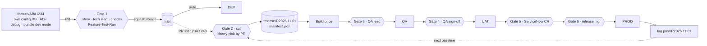

# Shell Data Platform CI/CD: Handoff for the Local Coding Agent

Version 1.0 · 24 Oct 2026 · Owner: Vamshi Singam (lead)

This file is **self-contained**. It holds the full context, target architecture, specifications, conventions,
access requirements and reference code. No other repository or document is needed.

---

## 0. How to use this document

**For Vamshi:** put this file at `PDX_Projects/devops-cicd/HANDOFF.md`, open `PDX_Projects/devops-cicd` in VS Code,
choose Copilot Chat **Agent** mode with your Claude model, and send:

> Read HANDOFF.md completely. Then do Phase 1 only and stop for my review.

After each phase, review and say "Proceed to Phase N".

**For the agent:** work strictly phase by phase (§4). Do not start a phase until the previous one is reviewed.
Section 5 is the target design: implement it, do not redesign it. If the real environment contradicts it,
record the conflict in `DECISIONS.md` and ask.

---

## 1. Mission

Build a new, parallel CI/CD process for a data platform team whose current DevOps process has broken down.
Developers will build on it under Vamshi's lead.

**Three project types, one repository:**

| Type | What it is | Build artifact |
|---|---|---|
| Azure Data Factory (ADF) | Metadata-driven pipelines reading configuration from an Azure SQL DB | ARM template |
| Azure SQL config DB | Standalone Azure SQL database holding ETL configuration (sources, mappings, flags) | DACPAC + idempotent config data scripts |
| Databricks | Notebooks, jobs and Unity Catalog objects; the team already uses Databricks Asset Bundles | Bundle |

**Environments:** DEV, QA (a dedicated QA team tests), UAT (business users test), PROD. Each has its own factory,
config DB and Databricks workspace.

**Platform services:** GitHub + GitHub Actions (CI/CD), Azure Boards (stories), ServiceNow (change requests for
PROD), Microsoft Entra ID (existing managed identities must be reused).

### Problems to fix

1. Everything merges to `main` and is tested on `main`. Then all of `main` moves forward, so one failed story blocks everyone.
2. Cherry-picking to higher environments is done per commit, which is error-prone.
3. Azure SQL config scripts reach a database only after merging to `main`. ADF pipelines that need new config therefore
   cannot be tested end-to-end on a feature branch, and untested work lands in `main`.

### Principles

- **Every feature is fully tested on its own feature branch, isolated per developer.** Only approved, tested PRs reach `main`.
- **A release is a list of PRs**: never individual commits, never all of `main`.
- **Build once, deploy many**: QA, UAT and PROD receive the identical artifact.
- **No Azure secrets in GitHub**: OIDC federated credentials on the existing managed identities.
- Every PR is linked to an Azure Boards story; every PROD deployment is tied to an approved ServiceNow CR.

---

## 2. Rules for the agent (always)

1. **Read-only by default.** Discovery commands (`az … list/show`, `gh api` GET, `databricks … list/get`, `SELECT`)
   are fine. Ask before any command that creates, changes or deletes anything in Azure, Databricks, GitHub settings or a database.
2. **Never touch QA, UAT or PROD resources directly.** They change only through approved release workflows.
3. **Do not grant access** (role assignments, federated credentials, SQL users, Databricks principals, GitHub settings).
   Admins do that. Record what is missing in `environment/ACCESS_GAPS.md`.
4. **No secrets** in files, commits, logs or chat. Redact anything secret-looking you encounter.
5. **All code through branches and PRs.** Branches: `feature/AB#<id>-<desc>` or `chore/<desc>`. Never push to `main`.
6. **Evidence over assumptions.** Every fact you rely on goes in `environment/ENVIRONMENT_FACTS.md` with its source
   (command or file, and date). Unknown → write `UNKNOWN` and ask. Never invent resource names.
7. **Small reviewable steps.** At the end of each phase or step: update `STATUS.md`, list what changed, then stop.
8. Use official CLIs: `az`, `gh`, `databricks`, `sqlpackage`, `dotnet`, `npm`. Pin GitHub Action versions.
9. Do not move, rename or delete existing files in `PDX_Projects/devops-cicd/`; they hold earlier discovery work.

---

## 3. Workspace layout

```
PDX_Projects/devops-cicd/
├── HANDOFF.md                      ← this file (do not edit; propose changes in DECISIONS.md)
├── <existing discovery files>      ← gathered earlier; read, never delete
├── .github/
│   ├── copilot-instructions.md     ← created in Phase 1 from Appendix E
│   └── prompts/                    ← created in Phase 1 from Appendix F
├── STATUS.md                       ← living: done / in progress / blocked / next
├── DECISIONS.md                    ← append-only: date, decision, reason
├── environment/
│   ├── INVENTORY.md                ← Phase 1: what already exists in this folder
│   ├── ENVIRONMENT_FACTS.md        ← Phase 2: discovered facts with evidence
│   ├── CURRENT_PROCESS.md          ← Phase 2: how the team builds and deploys today
│   ├── REQUIREMENTS.md             ← Phase 3: requirement → current state → gap → work item
│   └── ACCESS_GAPS.md              ← Phase 3: needed vs existing access + short admin email
└── shell-data-platform/            ← Phase 4: the new platform repository (git)
```

---

## 4. Phase plan (in order)

### Phase 1: Set up the workspace

1. List every file and folder already in `PDX_Projects/devops-cicd/`. Summarise each in `environment/INVENTORY.md`
   (what it contains, which environment, how current). Note where it already answers a question from §6.
2. Create `STATUS.md`, `DECISIONS.md` and the `environment/` folder if missing.
3. Create `.github/copilot-instructions.md` from Appendix E and the prompt files from Appendix F.
   If a `copilot-instructions.md` already exists, append ours under a heading `## Shell CI/CD handoff`.
4. Stop. Report: the inventory summary, which open questions (§6) already look answered, and what is missing.

### Phase 2: Discover the existing environment (read-only)

Fill `environment/ENVIRONMENT_FACTS.md` with one section per environment (DEV, QA, UAT, PROD), as tables.
Combine the existing files with fresh read-only checks. Record the source for every value.

| Area | Collect | Example commands |
|---|---|---|
| Tenant / subscriptions | tenant ID, subscription per env, resource groups | `az account show`, `az account list`, `az group list` |
| Data Factory | name, RG, location, Git config (repo, collaboration branch, root folder), global parameters, linked services (esp. the config DB one), integration runtimes (Azure / self-hosted / shared), triggers, managed identity type + IDs | `az datafactory list`, `az datafactory show`, `az datafactory linked-service list`, `az datafactory integration-runtime list`, `az datafactory trigger list` |
| Azure SQL config DB | server, database, tier, Entra admin, public network access / firewall / private endpoint, elastic pools, principals in the DB, schema objects, which tables are config vs runtime state | `az sql server list/show`, `az sql db list`, `az sql elastic-pool list`, `az sql server ad-admin list`, `SELECT name,type_desc FROM sys.database_principals`, `SELECT s.name,t.name FROM sys.tables t JOIN sys.schemas s ON s.schema_id=t.schema_id` |
| Databricks | workspace URL per env, metastore, catalogs/schemas per env, SQL warehouses, serverless availability, cluster policies, existing bundles (location, targets, run_as), service principals, Git folder settings | `az databricks workspace list`, `databricks catalogs list`, `databricks warehouses list`, `databricks cluster-policies list`, `databricks service-principals list`, `databricks bundle validate` in existing bundle folders |
| Identities | every managed identity the team uses: name, client ID, object ID, **user- vs system-assigned**, role assignments, existing federated credentials | `az identity list`, `az role assignment list --assignee <objectId> --all`, `az identity federated-credential list` |
| Network | private endpoints, VNets, self-hosted IRs, whether GitHub-hosted runners can reach SQL/Databricks/ARM | `az network private-endpoint list`, `az sql server show --query publicNetworkAccess` |
| Key Vault | vaults used by linked services, access model (RBAC vs policies) | `az keyvault list`, `az keyvault show` |
| GitHub | org, plan (Enterprise?), existing repos for this team, Actions policy, existing workflows, rulesets/branch protection, environments, installed apps (Azure Boards, ADF, Databricks) | `gh api orgs/<org>`, `gh repo list <org>`, `gh api repos/<o>/<r>/rulesets`, `gh api repos/<o>/<r>/environments`, `gh workflow list -R <o>/<r>` |
| Azure Boards | org, project, area path, work-item types and **state names** | `az boards work-item show`, `az devops project show` |
| ServiceNow | instance URL, change model, assignment group, whether API access exists | ask Vamshi if not discoverable |

Also write `environment/CURRENT_PROCESS.md`, covering how the team works today:
- the existing repos and pipelines and their triggers
- how ADF is published
- how the SQL config scripts are deployed (DACPAC? numbered scripts? what tool?)
- how Databricks bundles are deployed
- how promotions and cherry-picks happen today
- pain points seen in pipeline history

At the top of `ENVIRONMENT_FACTS.md`, answer each open question in §6 with: answer, evidence, confidence.
Stop. Report the answers, the top 5 risks, and anything you could not access.

### Phase 3: Requirements and gap analysis

1. Write `environment/REQUIREMENTS.md`: one row per requirement R-01 … from §5 (gates, feature isolation per project type,
   release-by-PR, environments/approvals, ServiceNow, Boards, identities, deploy order). Columns:
   requirement · current state (from Phase 2) · gap · proposed work item · depends on (access / decision).
2. Write `environment/ACCESS_GAPS.md`. For every item in §5.12, check the live state where possible and mark it
   Exists / Missing / Cannot check, with evidence. Then add a **one-page admin email** listing only the
   Missing items, grouped by admin, using real resource names. DEV items come first.
3. List the decisions needed from Vamshi (e.g. reuse the existing repo or create a new one; DACPAC vs existing script tooling;
   self-hosted runners). Record proposals in `DECISIONS.md` as "Proposed".
4. Stop for review.

### Phase 4: Development (each step is a branch + PR; stop after each)

| Step | Deliverable | Acceptance |
|---|---|---|
| 4.1 Repo scaffold | `shell-data-platform` repo layout per §5.2 using real names; import existing ADF/Databricks/SQL content as found in Phase 2; CODEOWNERS; PR template; README | Builds locally: `dotnet build sqlconfig`, `databricks bundle validate -t dev`, ADF `npm run build validate` |
| 4.2 Release tool | Port Appendix A to `scripts/release/`, add the **GitHub provider** (§5.7); port the tests (Appendix B) and add GitHub-provider tests with a mocked API | `pytest` green |
| 4.3 PR validation | `.github/workflows/pr-validation.yml` per §5.6; `docs/branch-protection.md` with the ruleset to request | Workflow green on a test PR; fails without AB# or Feature-Test-Run |
| 4.4 Feature environment | `feature-env.yml`, `feature-cleanup.yml`; ADF `configDb` parameterisation (§5.4); `docs/feature-testing.md` | One branch gets its own DB; ADF debug against it succeeds; DB dropped after PR close |
| 4.5 Deploy DEV | reusable `deploy-env.yml` + `deploy-dev.yml` (§5.6, §5.10) | Merge to main deploys DEV in the right order |
| 4.6 Release | `release.yml` with the `pr_list` input (§5.6–5.9); port Appendix C | Dry-run (`plan`) correct; a real release of one PR reaches QA |
| 4.7 Pilot | One real story end-to-end; `pilot/PILOT_REPORT.md` | Story reaches QA (and UAT if approvers are available) through the new path |

---

## 5. Target architecture (implement this)

### 5.1 Overview



**Service-to-service authentication**

| # | From → To | How | Permission needed |
|---|---|---|---|
| 1 | GitHub workflow → Entra ID | OIDC token exchanged for the environment's **user-assigned** managed identity (federated credential subject `repo:<org>/<repo>:environment:<env>`) | Federated credential on the identity |
| 2 | Deploy identity → ADF | ARM deployment, trigger stop/start | Data Factory Contributor on the factory's RG |
| 2 | Deploy identity → Azure SQL | Entra token (`sqlpackage /AccessToken` or `azure/sql-action`) | Contained user, `db_owner` in the config DB |
| 2 | Deploy identity → Databricks | Databricks CLI `azure-cli` auth after `azure/login` | Workspace service principal; CAN MANAGE on bundle root; UC privileges; CAN USE warehouse |
| 3 | ADF Studio (DEV) / Databricks Git folders ↔ GitHub | Org-approved GitHub apps, per-developer sign-in | Org owner approves apps |
| 4 | Factory MI (existing) → config DB / Databricks / ADLS / Key Vault | Managed identity at runtime | db_datareader/writer + EXECUTE; CAN MANAGE RUN on jobs; Storage Blob Data Contributor; Key Vault Secrets User |
| 5 | Azure Boards ↔ GitHub | Azure Boards app; `AB#<id>` in PR links the story | App installed + project connected |
| 6 | Release workflow → Azure Boards API | Managed identity added to the Azure DevOps org; token for resource `499b84ac-1321-427f-aa17-267ca6975798` | Basic access + Contributor on project/area |
| 7 | Release workflow → ServiceNow | Integration user / OAuth client; secret in the `prod` GitHub environment | Read/update `change_request` |
| 8 | release-bot GitHub App → repo | App installation token (`actions/create-github-app-token`) | Contents RW; ruleset bypass for `release/*` and `prod/*` |

### 5.2 Repository layout

```
shell-data-platform/
├── adf/                         ADF Git root of the DEV factory (pipeline/, dataset/, linkedService/, trigger/, …)
│   ├── package.json             @microsoft/azure-data-factory-utilities
│   ├── arm-template-parameters-definition.json
│   └── arm-parameters/{dev,qa,uat,prod}.json
├── databricks/                  Databricks Asset Bundle (databricks.yml, resources/, src/)
├── sqlconfig/                   SQL project for the config DB
│   ├── EtlConfig.sqlproj
│   ├── Tables/ Procs/ Views/    schema (DACPAC)
│   ├── Data/<area>/<KEY>.sql    one idempotent MERGE per config key
│   └── Scripts/Script.PostDeployment.sql   :r includes for Data files
├── scripts/release/             build_release.py (+ GitHub provider), cr_gate.py
├── tests/
├── releases/                    manifests (only on release/* branches)
├── docs/
└── .github/ (workflows/, CODEOWNERS, pull_request_template.md)
```

### 5.3 Branching and gates

| Gate | When | Checks | Enforced by |
|---|---|---|---|
| 0 Feature test | Before PR | Branch tested end-to-end: ADF debug against the branch's own config DB and the developer's bundle | `feature-env` workflow + PR evidence |
| 1 PR → main | Every PR | `AB#<id>` in title/body; CODEOWNERS (tech lead) approval; checks green (ADF validate, bundle validate, DACPAC build, tests); `Feature-Test-Run: <ADF run id>` in body; conversations resolved; **squash merge only**; no force-push | Ruleset on `main` + `pr-validation` |
| — | Merge to main | Deploys DEV (integration check, not the first test) | `deploy-dev` |
| 2 Release cut | Manual | Listed PRs merged, squash, linked, not in prod; ordered by merge; cherry-picked onto last `prod/*` tag; dependency/conflict check | `release` → `build_release.py` |
| 3 QA | After cut | QA lead approves the `qa` environment | GitHub Environment |
| 4 UAT | After QA | QA sign-off; `uat` environment approval | GitHub Environment |
| 5 Change | Before PROD | CR approved, Scheduled/Implement, inside window, CR PR list == manifest | `cr_gate.py check` |
| 6 PROD | After CR | Release manager approves `prod` environment | GitHub Environment |

Branch names: `feature/AB#<id>-<desc>`, `bugfix/AB#<id>-<desc>`, `hotfix/AB#<id>-<desc>` (branched from the latest `prod/*` tag,
PR into main, then released alone with an emergency CR). `release/<id>` and `prod/<id>` are created only by the release-bot app.

### 5.4 Feature-branch isolation (the key change)

**Azure SQL config DB**
- On push to `feature/**` or `bugfix/**` that touches `sqlconfig/**` (or on manual dispatch), the `feature-env` workflow:
  1. derives `<id>` from `AB#<id>` in the branch name (fails if absent)
  2. drops `sqldb-etlcfg-ft-<id>` if present, then `az sql db copy` from the DEV config DB into it. Use the
     `pool-etlcfg-feature` elastic pool on the DEV server, and tag the copy with `branch` and `createdBy`.
     DEV always equals `main`, so the copy contains every merged change.
  3. builds the branch DACPAC and publishes it to the copy with DEV SQLCMD values (`/p:BlockOnPossibleDataLoss=true`)
  4. grants the developers group `db_datawriter` on the copy. The deploy identity is `db_owner` in DEV, and that user is copied too.
  5. prints the ADF debug parameters to use
- `feature-cleanup` runs on `pull_request: closed` and nightly. It drops `sqldb-etlcfg-ft-*` whose branch is gone or that are older than 14 days.
- Database users created `FROM EXTERNAL PROVIDER` are copied with the DB, so the factory MI keeps access to the copy.

**ADF**
- Only the DEV factory is Git-connected (collaboration branch `main`, root folder `/adf`), with **Disable publish** ON.
- The config DB linked service is parameterised: `"parameters": {"dbName": {"type":"String","defaultValue":"<dev config db>"}}`
  and `Initial Catalog=@{linkedService().dbName}`. Every pipeline that reads config has a `configDb` parameter
  (default = DEV DB) passed through datasets to the linked service. QA/UAT/PROD values come from ARM parameter files.
- Developers debug in ADF Studio on their branch with `configDb = sqldb-etlcfg-ft-<id>`, and paste the run id into the PR.

**Databricks**
- Developers run `databricks bundle deploy -t dev` themselves. The `dev` target uses `mode: development`, which prefixes
  jobs with `[dev <user>]` and uses schema `dev_${workspace.current_user.short_name}`.
- ADF debug runs point the notebook/job path parameter at the developer's deployed bundle.

### 5.5 Azure SQL config DB conventions

| Kind | Location | Deployed by |
|---|---|---|
| Schema (tables, procs, views) | `Tables/`, `Procs/`, `Views/` | DACPAC (`dotnet build` → `sqlpackage /Action:Publish`) |
| Config data | `Data/<area>/<KEY>.sql`: one MERGE per config key; env values via SQLCMD variables (`$(Env)`, etc.) | Post-deployment script, every deploy, idempotent |
| Runtime state (watermarks, run logs) | schema only | **Never** deployed or overwritten |

One file per config key means two PRs rarely touch the same file, so releases cherry-pick cleanly.
If the team's current tooling is not DACPAC (Phase 2), keep the same three-way split with a migration runner and
record the choice in `DECISIONS.md`. Examples are in Appendix D.

### 5.6 GitHub workflows

| Workflow | Trigger | Environment | Identity | Steps |
|---|---|---|---|---|
| `pr-validation` | `pull_request` → main | none | CI identity (federated subject `…:pull_request`) | story-link (AB#) · feature-test-evidence · adf-validate (`npm run build validate`) · bundle-validate · sql-build (DACPAC) · unit-tests · aggregate job `pr-validation` = required check. Path filters per folder. Permissions `id-token: write`, `contents: read`. |
| `feature-env` | push `feature/**`, `bugfix/**` (sqlconfig changes) + dispatch | `dev-feature` | DEV deploy identity | §5.4 |
| `feature-cleanup` | `pull_request: closed` + nightly | `dev-feature` | DEV deploy identity | §5.4 |
| `deploy-dev` | push main (ignore docs/**) | `dev` | DEV deploy identity | calls `deploy-env` with `env: dev` |
| `deploy-env` (reusable) | `workflow_call` (input `env`) | the env | that env's identity | §5.10 order |
| `release` | `workflow_dispatch`: `pr_list` (required), `release_id` (default `R<yyyy.MM.dd>`), `change_request` (default `auto`), `strict_dependencies` (default true) | `release-cut`, `qa`, `uat`, `prod` | per env + release-bot | jobs: `cut` → `build` → `deploy-qa` → `deploy-uat` → `change-gate` → `deploy-prod`; job summary shows the PR table at each stage; stories moved per stage |

GitHub Environments: `dev-feature` (branches `feature/**`, `bugfix/**`), `dev` (main), `release-cut` (main),
`qa`, `uat`, `prod` (branches `release/*`; required reviewers: qa-leads, uat-signoff, release-managers).

### 5.7 Release mechanism (cherry-pick by PR)

Implemented in Appendix A (tested). Behaviour:
1. Parse `pr_list` (comma/space separated). Reject empty or duplicate IDs.
2. Baseline = newest `prod/*` tag (or `--baseline` for the very first release).
3. For each PR, the provider returns: merge commit (must be a single-parent squash commit on main's first-parent history),
   status merged/completed, linked work items, files changed, and position in main's history.
   Fail if not merged, not squash, no work item, or already in production. "Already in production" means the commit is an
   ancestor of the baseline, or it appears in the baseline's `(cherry picked from commit <sha>)` trailers.
4. Sort by merge order on main (typed order is ignored).
5. Dependency check: warn (or fail with `--strict-deps`) when a selected PR touches files changed by an **earlier, unreleased,
   unselected** PR.
6. `git checkout -B release/<id> <baseline>`, then `git cherry-pick -x <commit>` per PR. On conflict: abort cleanly,
   exit 2, and name the likely missing predecessor PRs.
7. Write and commit `releases/<id>/manifest.json`, then optionally push.
8. Exit codes: 0 ok · 1 gate failure · 2 conflict · 3 usage/config error. Under GitHub Actions, write outputs to `$GITHUB_OUTPUT`
   (Appendix A writes Azure DevOps `##vso` lines; replace them).

**GitHub provider (to add in step 4.2).** `GET /repos/{o}/{r}/pulls/{n}` must have `merged == true`, `base.ref == "main"`;
use `merge_commit_sha`. Work items come from `AB#(\d+)` in the title and body. Files come from `GET …/pulls/{n}/files` or `git show`.
GitHub's default squash title is `<title> (#<n>)`, so the offline git provider should also parse `\(#(\d+)\)$`
on the first line, with `AB#` in the body.

Manifest schema:
```json
{ "release_id": "R2026.11.01", "branch": "release/R2026.11.01",
  "baseline": {"ref": "prod/R2026.10.15", "sha": "<sha>"},
  "created_at": "<iso>", "created_by": "<user>",
  "pr_ids": [1234, 1240], "work_items": [5678, 5690],
  "pull_requests": [{"id":1234,"title":"…","merge_commit":"<sha>","squash":true,"work_items":[5678],"files":["…"],"main_position":12,"cherry_sha":"<sha>"}],
  "dependency_warnings": [{"pr":1245,"depends_on_unselected_pr":1234,"title":"…","files":["…"]}],
  "servicenow": {"change_request": null, "state": null}, "promotions": [] }
```

### 5.8 ServiceNow gate

Implemented in Appendix C. The CR description carries `Release-Id: <id>` and `Release-PRs: 1234, 1240`
(or the custom field `u_release_prs`). `--cr auto` finds the open CR by Release-Id.
- `check`: approval = approved; state ∈ {Scheduled (-2), Implement (-1)}; now within start/end; CR PRs == manifest PRs.
- `start`: state → Implement, work note with the run URL.
- `close`: success → state Review (0), close code successful, evidence note; failure → work note only.
Credentials: `SNOW_INSTANCE`, `SNOW_USER`, `SNOW_PASSWORD` (or `SNOW_TOKEN`) as `prod` environment secrets.
Replace `##vso` lines with GitHub Actions equivalents (`::error::`, `$GITHUB_OUTPUT`).

### 5.9 Azure Boards

- The Azure Boards app connects the project to the repo; `AB#<id>` links PRs and commits.
- The release workflow moves stories: after QA deploy → state for "Ready for QA"; after UAT → "Ready for UAT";
  after PROD → "Closed" plus tag `Released-<id>`. Use the real state names from Phase 2.
  Use `az boards work-item update` with `AZURE_DEVOPS_EXT_PAT` set to the managed identity's token for resource `499b84ac-1321-427f-aa17-267ca6975798`.

### 5.10 Deployment order (every environment, from the one build artifact)

1. **Azure SQL config DB**: `sqlpackage /Action:Publish` DACPAC with env SQLCMD values, `/p:BlockOnPossibleDataLoss=true`.
2. **Unity Catalog** DDL, if not managed by the bundle.
3. **Databricks**: `databricks bundle deploy -t <env>` (qa/uat/prod = `mode: production`, `run_as` the env's service principal,
   `permissions` granting the factory MI `CAN_MANAGE_RUN`).
4. **ADF**: export ARM (`npm run build export …` on the build job) → `PrePostDeploymentScript.Ver2.ps1 -predeployment $true`
   (stop triggers) → ARM deployment, incremental, `arm-parameters/<env>.json` → script with `-predeployment $false -deleteDeployment $true`
   (clean up deleted resources, start triggers).
After PROD succeeds, tag `prod/<id>` on `release/<id>`. Rollback = redeploy the previous `prod/*` artifact (ARM is incremental and
config MERGEs are idempotent; destructive SQL needs a backout script attached to the CR).

### 5.11 Naming conventions (adjust to real names found in Phase 2)

| Item | Pattern |
|---|---|
| Feature config DB | `sqldb-etlcfg-ft-<storyId>` |
| Feature elastic pool | `pool-etlcfg-feature` (DEV SQL server) |
| Release id / branch / tag | `R<yyyy.MM.dd>[.n]` · `release/<id>` · `prod/<id>` |
| GitHub environments | `dev-feature`, `dev`, `release-cut`, `qa`, `uat`, `prod` |
| ADF objects | `pl_`, `ds_`, `ls_`, `tr_` prefixes |
| PR body lines | `AB#<id>`, `Feature-Test-Run: <ADF run id>` |
| CR lines | `Release-Id: <id>`, `Release-PRs: <comma list>` |

### 5.12 Access requirements (checklist for Phase 3)

Phase: P1 = needed to start building (DEV), P2 = before the first QA/UAT release, P3 = before the first PROD release.


**GitHub org owner**

| ID | Principal / target | Env | Permission / action | Why | Phase |
|---|---|---|---|---|---|
| GH-01 | Vamshi Singam (lead) | — | Create private/internal repo <shell-org>/shell-data-platform; give the lead Admin role on it during setup | New parallel process needs its own repo with ADF, Databricks and SQL projects side by side | P1 |
| GH-02 | GitHub teams: developers, tech-leads, release-managers, qa-leads, uat-signoff | — | Create or map teams (ideally synced from Entra groups); repo roles: developers = Write, tech-leads = Maintain, release-managers = Maintain | Drives CODEOWNERS review and environment approvers | P1 |
| GH-03 | Repo settings | — | Allow squash merge only (disable merge commits and rebase merge); auto-delete head branches | One PR = one commit on main, which makes releases selectable by PR number | P1 |
| GH-04 | Ruleset on main | — | Require PR; 1 approval from CODEOWNERS (tech-leads); dismiss stale approvals; require status check 'pr-validation'; require conversation resolution; block force-push and deletion; no bypass except org admins | Gate 1: only reviewed, tested PRs reach main | P1 |
| GH-05 | Ruleset on release/* branches and prod/* tags | — | Restrict create/update/delete; bypass list = release-bot GitHub App only | Nobody hand-edits a release branch or moves a production tag | P2 |
| GH-06 | GitHub App 'shell-data-release-bot' | — | Create app (Contents: read & write, Pull requests: read, Metadata: read), install on the repo only; give its App ID and private key to the lead for the 'release-cut' environment secret | Cuts release/<id> branches and pushes prod/<id> tags past the ruleset in GH-05 | P2 |
| GH-07 | GitHub Actions policy | — | Enable Actions on the repo; allow actions: actions/*, azure/login, databricks/setup-cli, Azure/arm-deploy, Azure/sql-action (or allow 'verified creators') | Workflows for validation, feature environments and releases | P1 |
| GH-08 | Workflow permissions / OIDC | — | Default GITHUB_TOKEN = read; workflows may request id-token: write (OIDC). Confirm no org policy blocks OIDC | Passwordless sign-in to Azure with the existing managed identities | P1 |
| GH-09 | GitHub Environments | DEV, QA, UAT, PROD | Create environments: dev-feature, dev, release-cut, qa, uat, prod. Required reviewers: qa = qa-leads, uat = uat-signoff, prod = release-managers. Deployment branches: dev-feature = feature/**, bugfix/**; dev = main; release-cut = main; qa/uat/prod = release/* _(Note: Required reviewers on a private/internal repo need GitHub Enterprise (confirm plan, see OQ-07))_ | Gates 3, 4 and 6 are environment approvals | P1 |
| GH-10 | Environment secrets | UAT, PROD | Store ServiceNow integration credentials as secrets in the 'prod' environment only (and 'uat' if the CR is checked before UAT) | Gate 5 reads and updates the change request | P3 |
| GH-11 | Third-party app access | DEV | Approve the 'Azure Data Factory' and 'Databricks' GitHub apps / OAuth apps for the org (if OAuth app access restrictions are on) _(Note: Blocking for feature testing)_ | DEV factory Git mode and Databricks Git folders must read feature branches: this is what makes feature-branch testing possible | P1 |
| GH-12 | GitHub Actions runners | DEV, QA, UAT, PROD | GitHub-hosted runners if Azure endpoints are public. If ADF/SQL/Databricks are private: self-hosted runners in a VNet with line of sight (or GitHub-hosted runners with Azure private networking), registered to this repo _(Note: Depends on OQ-03)_ | Runners must reach SQL (DACPAC), Databricks and ARM endpoints | P1 |

**Entra ID admin / identity owner**

| ID | Principal / target | Env | Permission / action | Why | Phase |
|---|---|---|---|---|---|
| ID-01 | Existing managed identities | DEV, QA, UAT, PROD | Confirm each identity we reuse is USER-assigned and give: name, client ID, object ID, resource group, tenant ID _(Note: If they are system-assigned, request one user-assigned identity per environment instead (see OQ-04))_ | GitHub can only sign in through a user-assigned identity (or app registration); system-assigned identities (for example the factory's own) cannot take federated credentials | P1 |
| ID-02 | Deploy identity – DEV | DEV | Add federated credentials: issuer https://token.actions.githubusercontent.com, audience api://AzureADTokenExchange, subjects repo:<shell-org>/shell-data-platform:environment:dev and …:environment:dev-feature _(Note: Needs Contributor/Owner on the identity to add)_ | deploy-dev and feature-env workflows | P1 |
| ID-03 | CI identity (read-only) – DEV | DEV | Federated credential subject repo:<shell-org>/shell-data-platform:pull_request (a separate low-privilege identity is preferred; DEV deploy identity acceptable) | pr-validation runs ADF validate and bundle validate against DEV | P1 |
| ID-04 | Deploy identity – QA, UAT | QA, UAT | Federated credentials with subjects …:environment:qa and …:environment:uat (on each environment's identity) | release workflow QA and UAT jobs | P2 |
| ID-05 | Deploy identity – PROD | PROD | Federated credential with subject …:environment:prod | release workflow PROD job (runs only after release-manager approval) | P3 |
| ID-06 | Entra security groups | — | Create or confirm groups: grp-data-developers, grp-data-techleads, grp-data-qa, grp-data-uat-signoff, grp-data-release-managers | Used for Azure RBAC, SQL, Databricks and GitHub team sync | P1 |

**Azure subscription owner (RBAC)**

| ID | Principal / target | Env | Permission / action | Why | Phase |
|---|---|---|---|---|---|
| AZ-01 | Deploy identity – each env | DEV, QA, UAT, PROD | Data Factory Contributor on the resource group that holds that environment's factory | ARM template deployment, stop/start triggers, delete removed pipelines | P1 DEV · P2 QA/UAT · P3 PROD |
| AZ-02 | Deploy identity – DEV | DEV | SQL DB Contributor on the DEV SQL logical server _(Note: DEV only)_ | Create, copy and drop feature databases sqldb-etlcfg-ft-<story> | P1 |
| AZ-03 | DEV SQL logical server | DEV | Create elastic pool 'pool-etlcfg-feature' (small, e.g. GP 2 vCore or 50–100 eDTU) on the DEV server; name a cost owner _(Note: Sizing/cost decision (OQ-05))_ | Feature databases share one capped pool; nightly cleanup keeps it small | P1 |
| AZ-04 | Deploy identity – each env | DEV, QA, UAT, PROD | Reader on the environment's data-platform resource group(s) | Look up resource IDs, run ARM what-if | P1 DEV · P2 QA/UAT · P3 PROD |
| AZ-05 | grp-data-developers | DEV | Data Factory Contributor on the DEV factory only _(Note: No write access to QA/UAT/PROD factories)_ | Author in Git mode and debug pipelines on feature branches | P1 |
| AZ-06 | grp-data-developers | QA, UAT, PROD | Reader (or Data Factory monitoring via Reader) on QA/UAT/PROD factories | Monitor runs without changing anything | P2 |
| AZ-07 | Factory managed identity (existing) – each env | DEV, QA, UAT, PROD | Verify existing: Storage Blob Data Contributor on ADLS; Key Vault Secrets User on the Key Vault used by linked services _(Note: Verification only)_ | Pipelines keep working after deployments | P1 |
| ADF-01 | DEV factory | DEV | Connect the DEV factory to GitHub: repo shell-data-platform, collaboration branch main, root folder /adf; turn ON 'Disable publish' (automated publish) _(Note: Done by the lead once AZ-05 and GH-11 are granted)_ | Feature branches can be debugged; main is deployed by the pipeline, not the Publish button | P1 |

**Azure SQL server Entra admin**

| ID | Principal / target | Env | Permission / action | Why | Phase |
|---|---|---|---|---|---|
| SQL-01 | Each config SQL logical server | DEV, QA, UAT, PROD | Confirm Microsoft Entra admin is set and Entra authentication is enabled; give server and database names | Identities sign in without passwords | P1 |
| SQL-02 | Deploy identity – each env | DEV, QA, UAT, PROD | In the config DB: CREATE USER [<deploy-identity>] FROM EXTERNAL PROVIDER; ALTER ROLE db_owner ADD MEMBER [<deploy-identity>] _(Note: In DEV this user is copied into every feature DB automatically)_ | DACPAC deploys schema, permissions and config rows | P1 DEV · P2 QA/UAT · P3 PROD |
| SQL-03 | Factory managed identity (existing) – each env | DEV, QA, UAT, PROD | Verify it is a user in the config DB with db_datareader, db_datawriter and EXECUTE _(Note: Verification only)_ | ADF reads config and writes watermarks; copied into feature DBs automatically | P1 |
| SQL-04 | grp-data-developers | DEV | db_datareader on sqldb-etlcfg-dev | Inspect config; the feature-env workflow grants write access on each feature DB itself | P1 |

**Databricks account admin**

| ID | Principal / target | Env | Permission / action | Why | Phase |
|---|---|---|---|---|---|
| DBX-01 | Deploy identity – each env | DEV, QA, UAT, PROD | Add the identity (by client ID) as a service principal in the Databricks account; assign it to that environment's workspace with 'Workspace access' | Databricks CLI deploys asset bundles as this identity | P1 DEV · P2 QA/UAT · P3 PROD |

**Databricks workspace admin / UC catalog owner**

| ID | Principal / target | Env | Permission / action | Why | Phase |
|---|---|---|---|---|---|
| DBX-02 | Deploy identity – each env | DEV, QA, UAT, PROD | CAN MANAGE on the bundle root folder (e.g. /Workspace/Shared/shell-data); allowed to create jobs | bundle deploy creates and updates jobs, notebooks and pipelines | P1 DEV · P2 QA/UAT · P3 PROD |
| DBX-03 | Deploy identity – each env | DEV, QA, UAT, PROD | CAN USE on the job cluster policy, or serverless jobs enabled _(Note: Depends on OQ-02)_ | Jobs defined in the bundle can start compute | P1 DEV · P2 QA/UAT · P3 PROD |
| DBX-04 | Deploy identity – each env | DEV, QA, UAT, PROD | If jobs run as an existing run-as service principal: 'Service Principal: User' role on that principal | Bundle sets run_as on production jobs | P2 |
| DBX-05 | Deploy identity – each env | DEV, QA, UAT, PROD | Unity Catalog on the environment catalog: USE CATALOG, USE SCHEMA, CREATE SCHEMA, CREATE TABLE, CREATE FUNCTION, CREATE VOLUME, MODIFY, SELECT (or ownership of bundle-managed schemas) | Bundle-managed DDL and grants | P1 DEV · P2 QA/UAT · P3 PROD |
| DBX-06 | Deploy identity – each env | DEV, QA, UAT, PROD | CAN USE on one SQL warehouse | Run UC SQL steps during deployment | P1 DEV · P2 QA/UAT · P3 PROD |
| DBX-07 | Factory managed identity (existing) – each env | DEV, QA, UAT, PROD | Verify it is a workspace service principal; give its client ID so the bundle grants it CAN MANAGE RUN on the jobs it triggers _(Note: Verification + information)_ | ADF triggers Databricks jobs after every deployment | P1 |
| DBX-08 | grp-data-developers | DEV | DEV workspace access; serverless/cluster use; on dev catalog: USE CATALOG, CREATE SCHEMA (personal dev_<user> schemas) | Developers deploy bundles in development mode: resources prefixed with their name, isolated per developer | P1 |
| DBX-09 | DEV workspace – Git integration | DEV | Allow Git folders to the GitHub org (add repo to the Git allowlist if restricted) | Developers work on feature branches inside the workspace | P1 |

**Azure DevOps (Boards) project admin**

| ID | Principal / target | Env | Permission / action | Why | Phase |
|---|---|---|---|---|---|
| ADO-01 | Azure Boards app | — | Install the Azure Boards app on the GitHub org and connect the ADO project to shell-data-platform (needs ADO project admin + GitHub org owner) | AB#1234 in a PR links it to the story; PR check blocks merges without a story | P1 |
| ADO-02 | Deploy identity (QA/UAT/PROD, or one release identity) | QA, UAT, PROD | Add the managed identity to the Azure DevOps organization (Basic access); Contributor on the project or area path | Release workflow moves stories to Ready for QA / Ready for UAT / Closed and comments the release id | P2 |

**ServiceNow platform admin**

| ID | Principal / target | Env | Permission / action | Why | Phase |
|---|---|---|---|---|---|
| SN-01 | Integration account / OAuth client | PROD | Integration user (or OAuth client credentials) able to read change_request and update state and work_notes for this team's assignment group | Gate 5: CR approved + in window + PR list matches; evidence written back after deploy | P3 |
| SN-02 | Change template | PROD | Add a field (e.g. u_release_prs) or agree the description lines 'Release-Id:' and 'Release-PRs:' on the CR template; confirm change model (Normal/Standard) | Ties each CR to the exact PRs being deployed | P3 |

**Network / cloud platform team**

| ID | Principal / target | Env | Permission / action | Why | Phase |
|---|---|---|---|---|---|
| SQL-05 | Config SQL servers – network | DEV, QA, UAT, PROD | Allow the runners from GH-12 to reach port 1433: private endpoint + VNet runners, or firewall rule for static runner IPs _(Note: Depends on OQ-03)_ | DACPAC deployment and feature-DB setup | P1 |
| SN-03 | ServiceNow instance – network | PROD | If the instance restricts inbound IPs, allow the runner egress IPs _(Note: Conditional)_ | Runners call the ServiceNow Table API | P3 |

**Existing data/DevOps team (information)**

| ID | Principal / target | Env | Permission / action | Why | Phase |
|---|---|---|---|---|---|
| ADF-02 | Integration runtimes | DEV, QA, UAT, PROD | Names/types of integration runtimes (Azure, self-hosted, shared/linked) used by each factory _(Note: Information)_ | ARM parameter files map linked services to the right runtime per environment | P1 |
| ADO-03 | Board process | — | Confirm work-item state names and the area path used by this team _(Note: Information)_ | Workflow uses the exact state names | P2 |

### 5.13 Things that are easy to get wrong

- Federated credentials are **not supported on system-assigned managed identities**. If the identities the team wants to reuse
  are system-assigned (e.g. a factory's own identity), new user-assigned identities are needed (max 20 federated credentials each).
- GitHub Environment **required reviewers on private/internal repos need GitHub Enterprise**. Without it, Gates 3, 4 and 6 have no approval step.
- If SQL/Databricks/ADF use private endpoints, GitHub-hosted runners cannot reach them. Use self-hosted runners in the VNet
  (or GitHub-hosted runners with Azure private networking).
- ADF ARM deployments are incremental: deleted objects stay until the post-deployment script removes them.
- Never edit a released `V`-style schema script or a config MERGE to *remove* rows silently. Add a new change that does it explicitly.
- Long-unreleased PRs on main increase drift. Review the `candidates` list (unreleased PRs) at every release planning.

---

## 6. Open questions (answer in Phase 2 from evidence)

| ID | Question | What it affects | Who can answer |
|---|---|---|---|
| OQ-01 | Is each environment (DEV, QA, UAT, PROD) in its own subscription? Resource group and resource names per env? | Scopes for every Azure role assignment | Vamshi / platform team |
| OQ-02 | Is Databricks serverless (jobs and SQL) allowed, or must jobs use a cluster policy? | DBX-03 and bundle job definitions | Databricks admin |
| OQ-03 | Are ADF, Azure SQL and Databricks behind private endpoints? Which self-hosted integration runtimes exist? | Runner choice (GH-12), SQL-05, ADF-02 | Network team |
| OQ-04 | Are the managed identities we must reuse user-assigned or system-assigned? | If system-assigned, GitHub cannot use them: new user-assigned identities are needed | Entra admin |
| OQ-05 | Elastic pool size and cost owner for feature databases | AZ-03 | Budget owner |
| OQ-06 | How are Azure SQL scripts deployed today (SQL project/DACPAC, numbered scripts, other)? | Decides the SQL project tooling; process stays the same | Existing team |
| OQ-07 | Which GitHub plan does the org have (Enterprise Cloud?) | Environment required reviewers on private/internal repos need GitHub Enterprise | GitHub org owner |
| OQ-08 | ServiceNow: assignment group, change model, and whether CRs can be read/updated via API | SN-01, SN-02 | ServiceNow admin |

---

## Appendix A: `scripts/release/build_release.py` (reference implementation, tested)

Port this as-is, then add the GitHub provider (§5.7) and switch CI output from `##vso` to `$GITHUB_OUTPUT`.

```python
#!/usr/bin/env python3
"""
PR-based release builder ("cherry-pick by PR, never by commit").

Given a comma-separated list of merged Pull Request numbers, this tool:

  1. Resolves every PR to its single squash-merge commit on `main`.
  2. Enforces gates: PR is merged, squash-merged (1 parent), linked to >=1 work item,
     and not already released to production.
  3. Orders PRs by their merge order on main (NOT the order typed by the user),
     which minimises cherry-pick conflicts.
  4. Detects likely missing dependencies: earlier, unreleased, *unselected* PRs that
     touch the same files as a selected PR.
  5. Creates `release/<id>` from the production baseline (latest `prod/*` tag)
     and cherry-picks each PR commit with `-x` (so provenance is recorded).
  6. Writes and commits `releases/<id>/manifest.json` -- the single source of truth
     that the QA, UAT and Prod stages (and the ServiceNow CR) all refer to.

Two PR providers are supported:
  * `ado`  - Azure DevOps REST API (real metadata: status, merge strategy, linked work items)
  * `git`  - offline: parses Azure DevOps default squash messages on main
             ("Merged PR 1234: title" ... "Related work items: #5678").
             Used for local dry-runs and tests.

Exit codes: 0 ok, 1 gate failure, 2 cherry-pick conflict, 3 usage/config error.
"""
from __future__ import annotations

import argparse
import base64
import datetime as dt
import json
import os
import re
import subprocess
import sys
import urllib.request
from dataclasses import asdict, dataclass, field
from pathlib import Path

MERGED_PR_RE = re.compile(r"^Merged PR (\d+):\s*(.*)$", re.MULTILINE)
WORK_ITEM_RE = re.compile(r"(?:Related work items:\s*((?:#\d+[,\s]*)+))|(?:AB#(\d+))")
CHERRY_RE = re.compile(r"\(cherry picked from commit ([0-9a-f]{7,40})\)")


# --------------------------------------------------------------------------- git
def git(*args: str, cwd: str | None = None, check: bool = True) -> str:
    res = subprocess.run(["git", *args], cwd=cwd, capture_output=True, text=True)
    if check and res.returncode != 0:
        raise GitError(f"git {' '.join(args)} failed:\n{res.stderr.strip()}")
    return res.stdout.strip()


class GitError(RuntimeError):
    pass


class GateError(RuntimeError):
    pass


# --------------------------------------------------------------------------- model
@dataclass
class PullRequest:
    id: int
    title: str
    merge_commit: str
    status: str = "completed"
    squash: bool = True
    work_items: list[int] = field(default_factory=list)
    files: list[str] = field(default_factory=list)
    main_position: int = -1          # index in main's first-parent history (0 = oldest)
    cherry_sha: str | None = None


# --------------------------------------------------------------------------- providers
class GitLogProvider:
    """Reads PR metadata from Azure DevOps-style squash commit messages on main."""

    def __init__(self, repo: str, main_ref: str):
        self.repo, self.main_ref = repo, main_ref
        self._index = self._scan()

    def _scan(self) -> dict[int, PullRequest]:
        out = git("log", "--first-parent", "--reverse", "--format=%H%x1f%P%x1f%B%x1e",
                  self.main_ref, cwd=self.repo)
        index: dict[int, PullRequest] = {}
        for pos, rec in enumerate(r for r in out.split("\x1e") if r.strip()):
            sha, parents, body = rec.strip().split("\x1f", 2)
            m = MERGED_PR_RE.search(body)
            if not m:
                continue
            wis: list[int] = []
            for grp, ab in WORK_ITEM_RE.findall(body):
                if grp:
                    wis += [int(x) for x in re.findall(r"\d+", grp)]
                if ab:
                    wis.append(int(ab))
            files = git("show", "--name-only", "--format=", sha, cwd=self.repo).splitlines()
            index[int(m.group(1))] = PullRequest(
                id=int(m.group(1)), title=m.group(2).strip(), merge_commit=sha,
                squash=len(parents.split()) == 1, work_items=sorted(set(wis)),
                files=[f for f in files if f], main_position=pos)
        return index

    def get(self, pr_id: int) -> PullRequest:
        if pr_id not in self._index:
            raise GateError(f"PR {pr_id}: not found as a completed merge on {self.main_ref}")
        return self._index[pr_id]

    def all_merged(self) -> list[PullRequest]:
        return sorted(self._index.values(), key=lambda p: p.main_position)


class AdoProvider(GitLogProvider):
    """Azure DevOps REST provider. Uses git for ordering/files, ADO for authoritative status,
    merge strategy and linked work items."""

    def __init__(self, repo: str, main_ref: str, org_url: str, project: str, repo_name: str, pat: str):
        self.org_url, self.project, self.repo_name = org_url.rstrip("/"), project, repo_name
        self._auth = "Basic " + base64.b64encode(f":{pat}".encode()).decode()
        super().__init__(repo, main_ref)

    def _api(self, path: str) -> dict:
        url = f"{self.org_url}/{self.project}/_apis/git/repositories/{self.repo_name}/{path}"
        url += ("&" if "?" in url else "?") + "api-version=7.1"
        req = urllib.request.Request(url, headers={"Authorization": self._auth})
        with urllib.request.urlopen(req, timeout=30) as r:
            return json.load(r)

    def get(self, pr_id: int) -> PullRequest:
        data = self._api(f"pullrequests/{pr_id}")
        if data.get("status") != "completed":
            raise GateError(f"PR {pr_id}: status is '{data.get('status')}', must be 'completed'")
        if data.get("targetRefName") != "refs/heads/main":
            raise GateError(f"PR {pr_id}: targets {data.get('targetRefName')}, must target main")
        strategy = (data.get("completionOptions") or {}).get("mergeStrategy", "unknown")
        sha = data["lastMergeCommit"]["commitId"]
        wis = [int(w["id"]) for w in self._api(f"pullRequests/{pr_id}/workitems").get("value", [])]
        local = next((p for p in self._index.values() if p.merge_commit == sha), None)
        if local is None:
            raise GateError(f"PR {pr_id}: merge commit {sha[:8]} not on first-parent of {self.main_ref}")
        local.title, local.work_items = data.get("title", local.title), wis
        local.squash = strategy == "squash" and local.squash
        return local


# --------------------------------------------------------------------------- core
def parse_pr_list(raw: str) -> list[int]:
    ids = [int(x) for x in re.split(r"[,\s]+", raw.strip()) if x]
    if not ids:
        raise GateError("PR list is empty")
    dupes = {i for i in ids if ids.count(i) > 1}
    if dupes:
        raise GateError(f"Duplicate PR ids in list: {sorted(dupes)}")
    return ids


def latest_prod_tag(repo: str) -> str | None:
    # Primary key = newest creation date; tie-break (same second) on version-aware tag name.
    tags = git("tag", "--list", "prod/*", "--sort=-v:refname", "--sort=-creatordate", cwd=repo).splitlines()
    return tags[0] if tags else None


def released_commits(repo: str, baseline: str) -> set[str]:
    """Commits from main already in production: either ancestors of baseline or recorded via -x."""
    body = git("log", "--format=%B", baseline, cwd=repo)
    return set(CHERRY_RE.findall(body))


def is_released(repo: str, pr: PullRequest, baseline: str, cherry_set: set[str]) -> bool:
    if any(pr.merge_commit.startswith(c) or c.startswith(pr.merge_commit[:len(c)]) for c in cherry_set):
        return True
    r = subprocess.run(["git", "merge-base", "--is-ancestor", pr.merge_commit, baseline], cwd=repo)
    return r.returncode == 0


def dependency_warnings(selected: list[PullRequest], candidates: list[PullRequest]) -> list[dict]:
    sel_ids = {p.id for p in selected}
    warns = []
    for p in selected:
        for c in candidates:
            if c.id in sel_ids or c.main_position >= p.main_position:
                continue
            overlap = sorted(set(p.files) & set(c.files))
            if overlap:
                warns.append({"pr": p.id, "depends_on_unselected_pr": c.id,
                              "title": c.title, "files": overlap})
    return warns


def build_release(repo: str, pr_list: str, release_id: str, provider, baseline: str | None,
                  strict_deps: bool = False, push: bool = False, dry_run: bool = False) -> dict:
    ids = parse_pr_list(pr_list)
    baseline = baseline or latest_prod_tag(repo)
    if not baseline:
        raise GateError("No prod/* tag found; pass --baseline for the very first release")
    baseline_sha = git("rev-parse", f"{baseline}^{{commit}}", cwd=repo)
    cherry_set = released_commits(repo, baseline_sha)

    # Gates per PR -----------------------------------------------------------
    errors, prs = [], []
    for i in ids:
        try:
            p = provider.get(i)
            if not p.squash:
                raise GateError(f"PR {i}: not squash-merged; one PR must equal one commit on main")
            if not p.work_items:
                raise GateError(f"PR {i}: no linked Azure DevOps work item (story/bug)")
            if is_released(repo, p, baseline_sha, cherry_set):
                raise GateError(f"PR {i}: already in production baseline {baseline}")
            prs.append(p)
        except GateError as e:
            errors.append(str(e))
    if errors:
        raise GateError("Gate failures:\n  - " + "\n  - ".join(errors))

    prs.sort(key=lambda p: p.main_position)
    unreleased = [c for c in provider.all_merged() if not is_released(repo, c, baseline_sha, cherry_set)]
    warns = dependency_warnings(prs, unreleased)
    if warns and strict_deps:
        raise GateError("Possible missing dependencies (strict mode):\n" + json.dumps(warns, indent=2))

    manifest = {
        "release_id": release_id,
        "branch": f"release/{release_id}",
        "baseline": {"ref": baseline, "sha": baseline_sha},
        "created_at": dt.datetime.now(dt.timezone.utc).isoformat(timespec="seconds"),
        "created_by": os.environ.get("BUILD_REQUESTEDFOR", os.environ.get("USER", "unknown")),
        "pr_ids": [p.id for p in prs],
        "work_items": sorted({w for p in prs for w in p.work_items}),
        "pull_requests": [],
        "dependency_warnings": warns,
        "servicenow": {"change_request": None, "state": None},
        "promotions": [],
    }
    if dry_run:
        manifest["pull_requests"] = [asdict(p) for p in prs]
        return manifest

    # Cherry-pick -------------------------------------------------------------
    branch = manifest["branch"]
    git("checkout", "-B", branch, baseline_sha, cwd=repo)
    for p in prs:
        r = subprocess.run(["git", "cherry-pick", "-x", p.merge_commit], cwd=repo,
                           capture_output=True, text=True)
        if r.returncode != 0:
            conflicted = git("diff", "--name-only", "--diff-filter=U", cwd=repo, check=False).splitlines()
            git("cherry-pick", "--abort", cwd=repo, check=False)
            suspects = sorted({c.id for c in unreleased
                               if c.id not in manifest["pr_ids"] and c.main_position < p.main_position
                               and set(c.files) & set(conflicted)})
            raise ConflictError(p.id, conflicted, suspects)
        p.cherry_sha = git("rev-parse", "HEAD", cwd=repo)

    manifest["pull_requests"] = [asdict(p) for p in prs]
    mpath = Path(repo, "releases", release_id, "manifest.json")
    mpath.parent.mkdir(parents=True, exist_ok=True)
    mpath.write_text(json.dumps(manifest, indent=2) + "\n")
    git("add", str(mpath.relative_to(repo)), cwd=repo)
    git("commit", "-m", f"Release {release_id}: PRs {', '.join(map(str, manifest['pr_ids']))}\n\n"
        f"Work items: {', '.join('#'+str(w) for w in manifest['work_items'])}", cwd=repo)
    if push:
        git("push", "-u", "origin", branch, "--force-with-lease", cwd=repo)
    return manifest


class ConflictError(RuntimeError):
    def __init__(self, pr_id: int, files: list[str], suspects: list[int]):
        self.pr_id, self.files, self.suspects = pr_id, files, suspects
        hint = (f" Likely missing predecessor PR(s): {suspects} -- add them to the list or "
                f"defer PR {pr_id}.") if suspects else ""
        super().__init__(f"Cherry-pick conflict on PR {pr_id} in {files}.{hint}")


def candidates(repo: str, provider, baseline: str | None) -> list[dict]:
    baseline = baseline or latest_prod_tag(repo)
    sha = git("rev-parse", f"{baseline}^{{commit}}", cwd=repo)
    cs = released_commits(repo, sha)
    return [{"pr": p.id, "title": p.title, "work_items": p.work_items, "files": p.files}
            for p in provider.all_merged() if not is_released(repo, p, sha, cs)]


# --------------------------------------------------------------------------- cli
def make_provider(a) -> GitLogProvider:
    if a.provider == "ado":
        pat = os.environ.get("ADO_PAT") or os.environ.get("SYSTEM_ACCESSTOKEN")
        missing = [k for k, v in {"--ado-org": a.ado_org, "--ado-project": a.ado_project,
                                  "--ado-repo": a.ado_repo, "ADO_PAT/SYSTEM_ACCESSTOKEN": pat}.items() if not v]
        if missing:
            print(f"Missing ADO settings: {missing}", file=sys.stderr)
            sys.exit(3)
        return AdoProvider(a.repo, a.main_ref, a.ado_org, a.ado_project, a.ado_repo, pat)
    return GitLogProvider(a.repo, a.main_ref)


def vso(name: str, value: str) -> None:
    if os.environ.get("TF_BUILD"):
        print(f"##vso[task.setvariable variable={name};isOutput=true]{value}")


def main(argv: list[str] | None = None) -> int:
    ap = argparse.ArgumentParser(description=__doc__, formatter_class=argparse.RawDescriptionHelpFormatter)
    ap.add_argument("command", choices=["build", "plan", "candidates"])
    ap.add_argument("--prs", help="Comma-separated PR ids, e.g. '1234,1240,1251'")
    ap.add_argument("--release-id", default=dt.date.today().strftime("R%Y.%m.%d"))
    ap.add_argument("--baseline", help="Prod baseline ref (default: latest prod/* tag)")
    ap.add_argument("--repo", default=".")
    ap.add_argument("--main-ref", default="origin/main")
    ap.add_argument("--provider", choices=["git", "ado"], default="git")
    ap.add_argument("--ado-org"), ap.add_argument("--ado-project"), ap.add_argument("--ado-repo")
    ap.add_argument("--strict-deps", action="store_true", help="Fail on dependency warnings")
    ap.add_argument("--push", action="store_true")
    a = ap.parse_args(argv)

    try:
        prov = make_provider(a)
        if a.command == "candidates":
            print(json.dumps(candidates(a.repo, prov, a.baseline), indent=2))
            return 0
        if not a.prs:
            print("--prs is required", file=sys.stderr)
            return 3
        m = build_release(a.repo, a.prs, a.release_id, prov, a.baseline,
                          strict_deps=a.strict_deps, push=a.push, dry_run=a.command == "plan")
        print(json.dumps(m, indent=2))
        for w in m["dependency_warnings"]:
            print(f"WARNING: PR {w['pr']} shares {w['files']} with unselected earlier PR "
                  f"{w['depends_on_unselected_pr']} ({w['title']})", file=sys.stderr)
            if os.environ.get("TF_BUILD"):
                print(f"##vso[task.logissue type=warning]PR {w['pr']} may depend on PR {w['depends_on_unselected_pr']}")
        vso("releaseBranch", m["branch"])
        vso("releaseId", m["release_id"])
        vso("prIds", ",".join(map(str, m["pr_ids"])))
        return 0
    except ConflictError as e:
        print(f"CONFLICT: {e}", file=sys.stderr)
        return 2
    except (GateError, GitError) as e:
        print(f"GATE FAILED: {e}", file=sys.stderr)
        return 1


if __name__ == "__main__":
    sys.exit(main())
```


## Appendix B: `tests/test_build_release.py` (real temporary git repo scenarios)

The tests use Azure DevOps-style squash messages (`Merged PR 101: …`). Add equivalent tests for GitHub-style squash
titles (`<title> (#101)`) and a mocked GitHub API provider.

```python
"""End-to-end tests for PR-based cherry-picking against a real temporary git repo."""
import json
import subprocess
import sys
from pathlib import Path

import pytest

sys.path.insert(0, str(Path(__file__).resolve().parents[1] / "scripts" / "release"))
import build_release as br  # noqa: E402


def sh(repo, *args):
    return subprocess.run(["git", *args], cwd=repo, check=True, capture_output=True, text=True).stdout.strip()


def squash_pr(repo, pr_id, title, files: dict, work_item=None):
    for name, content in files.items():
        p = Path(repo, name)
        p.parent.mkdir(parents=True, exist_ok=True)
        p.write_text(content)
        sh(repo, "add", name)
    msg = f"Merged PR {pr_id}: {title}\n\n"
    if work_item:
        msg += f"Related work items: #{work_item}"
    sh(repo, "commit", "-m", msg)


@pytest.fixture
def repo(tmp_path):
    r = str(tmp_path)
    sh(r, "init", "-b", "main")
    sh(r, "config", "user.email", "ci@example.com")
    sh(r, "config", "user.name", "CI")
    Path(r, "README.md").write_text("base\n")
    sh(r, "add", ".")
    sh(r, "commit", "-m", "initial")
    sh(r, "tag", "prod/R0")
    # PR 101: new ADF pipeline
    squash_pr(r, 101, "Add pl_ingest_sales", {"adf/pipeline/pl_ingest_sales.json": '{"v":1}\n'}, 9001)
    # PR 102: unrelated Databricks notebook
    squash_pr(r, 102, "Add nb_customer_silver", {"databricks/src/notebooks/nb_customer_silver.py": "print(1)\n"}, 9002)
    # PR 103: modifies pl_ingest_sales (depends on 101)
    squash_pr(r, 103, "Tune pl_ingest_sales", {"adf/pipeline/pl_ingest_sales.json": '{"v":2}\n'}, 9003)
    # PR 104: no work item
    squash_pr(r, 104, "Quick fix without story", {"sql/x.sql": "select 1;\n"})
    return r


def prov(repo):
    return br.GitLogProvider(repo, "main")


def test_orders_by_main_and_creates_manifest(repo):
    m = br.build_release(repo, "102, 101", "R1", prov(repo), None)
    assert m["pr_ids"] == [101, 102]                      # merge order, not typed order
    assert m["work_items"] == [9001, 9002]
    assert sh(repo, "rev-parse", "--abbrev-ref", "HEAD") == "release/R1"
    manifest = json.loads(Path(repo, "releases/R1/manifest.json").read_text())
    assert manifest["baseline"]["ref"] == "prod/R0"
    assert not Path(repo, "adf/pipeline/pl_ingest_sales.json").read_text().startswith('{"v":2')


def test_missing_work_item_blocks(repo):
    with pytest.raises(br.GateError, match="no linked Azure DevOps work item"):
        br.build_release(repo, "104", "R1", prov(repo), None, dry_run=True)


def test_unknown_pr_blocks(repo):
    with pytest.raises(br.GateError, match="not found"):
        br.build_release(repo, "999", "R1", prov(repo), None, dry_run=True)


def test_missing_dependency_conflict_names_suspect(repo):
    with pytest.raises(br.ConflictError) as e:
        br.build_release(repo, "103", "R1", prov(repo), None)
    assert e.value.pr_id == 103 and e.value.suspects == [101]
    assert sh(repo, "status", "--porcelain") == ""        # cherry-pick aborted cleanly


def test_dependency_warning_in_plan(repo):
    m = br.build_release(repo, "103", "R1", prov(repo), None, dry_run=True)
    assert m["dependency_warnings"][0]["depends_on_unselected_pr"] == 101


def test_strict_deps_fails_fast(repo):
    with pytest.raises(br.GateError, match="missing dependencies"):
        br.build_release(repo, "103", "R1", prov(repo), None, strict_deps=True, dry_run=True)


def test_already_released_pr_is_rejected_next_time(repo):
    br.build_release(repo, "101,102", "R1", prov(repo), None)
    sh(repo, "tag", "prod/R1")                            # prod deploy tags the release branch
    sh(repo, "checkout", "main")
    with pytest.raises(br.GateError, match="already in production"):
        br.build_release(repo, "101,103", "R2", prov(repo), None, dry_run=True)
    m = br.build_release(repo, "103", "R2", prov(repo), None)   # 101 now in baseline -> no conflict
    assert m["baseline"]["ref"] == "prod/R1" and m["pr_ids"] == [103]


def test_candidates_lists_unreleased(repo):
    br.build_release(repo, "101", "R1", prov(repo), None)
    sh(repo, "tag", "prod/R1")
    sh(repo, "checkout", "main")
    assert [c["pr"] for c in br.candidates(repo, prov(repo), None)] == [102, 103, 104]


def test_duplicate_ids(repo):
    with pytest.raises(br.GateError, match="Duplicate"):
        br.parse_pr_list("1,2,1")
```


## Appendix C: `scripts/servicenow/cr_gate.py` (reference implementation)

```python
#!/usr/bin/env python3
"""
ServiceNow Change Request gate for the Production stage.

  check   - Fails unless the CR is approved, in Scheduled/Implement state, inside its
            planned window, and lists EXACTLY the PRs in the release manifest.
  start   - Moves the CR to Implement and adds a work note (called right before deploy).
  close   - Adds deployment evidence and moves the CR to Review (success) or records failure.

CR convention: the CR description (or custom field u_release_prs) contains a line
    Release-PRs: 1234, 1240, 1251
    Release-Id:  R2026.10.23
This is what ties "the PRs" to "the CR" -- the rule from the Marathon process.

Env: SNOW_INSTANCE (https://shell.service-now.com), SNOW_USER, SNOW_PASSWORD
     (or SNOW_TOKEN for OAuth bearer).
Note: Azure DevOps also offers the "ServiceNow Change Management" extension, which
provides a native environment check; this script is the portable equivalent and adds
the PR-list match the extension does not do.
"""
from __future__ import annotations

import argparse
import base64
import datetime as dt
import json
import os
import re
import sys
import urllib.parse
import urllib.request

# ServiceNow change_request.state values (out-of-box)
STATES = {"-5": "New", "-4": "Assess", "-3": "Authorize", "-2": "Scheduled",
          "-1": "Implement", "0": "Review", "3": "Closed", "4": "Canceled"}
DEPLOYABLE = {"-2", "-1"}
PR_LINE = re.compile(r"Release-PRs:\s*([\d,\s]+)", re.IGNORECASE)


class Snow:
    def __init__(self):
        self.base = os.environ["SNOW_INSTANCE"].rstrip("/")
        if os.environ.get("SNOW_TOKEN"):
            self.auth = "Bearer " + os.environ["SNOW_TOKEN"]
        else:
            cred = f"{os.environ['SNOW_USER']}:{os.environ['SNOW_PASSWORD']}"
            self.auth = "Basic " + base64.b64encode(cred.encode()).decode()

    def _req(self, method: str, path: str, body: dict | None = None) -> dict:
        req = urllib.request.Request(
            self.base + path, method=method,
            data=json.dumps(body).encode() if body else None,
            headers={"Authorization": self.auth, "Accept": "application/json",
                     "Content-Type": "application/json"})
        with urllib.request.urlopen(req, timeout=30) as r:
            return json.load(r)

    def get_cr(self, number: str, release_id: str | None = None) -> dict:
        # "--cr auto": find the open CR whose description carries "Release-Id: <id>"
        query = (f"number={number}" if number != "auto" else
                 f"descriptionLIKERelease-Id: {release_id}^stateNOT IN3,4^ORDERBYDESCsys_created_on")
        q = urllib.parse.urlencode({
            "sysparm_query": query,
            "sysparm_fields": "sys_id,number,state,approval,start_date,end_date,description,u_release_prs,short_description",
            "sysparm_display_value": "false", "sysparm_limit": "1"})
        res = self._req("GET", f"/api/now/table/change_request?{q}")["result"]
        if not res:
            raise SystemExit(f"CR {number} not found")
        return res[0]

    def patch(self, sys_id: str, fields: dict) -> None:
        self._req("PATCH", f"/api/now/table/change_request/{sys_id}", fields)


def evaluate(cr: dict, manifest: dict, now: dt.datetime | None = None) -> list[str]:
    """Pure function (unit-testable): returns list of failures; empty = gate passes."""
    now = now or dt.datetime.now(dt.timezone.utc).replace(tzinfo=None)
    fails = []
    if cr.get("approval") != "approved":
        fails.append(f"approval is '{cr.get('approval')}', must be 'approved'")
    if str(cr.get("state")) not in DEPLOYABLE:
        fails.append(f"state is '{STATES.get(str(cr.get('state')), cr.get('state'))}', must be Scheduled or Implement")
    fmt = "%Y-%m-%d %H:%M:%S"
    try:
        start, end = dt.datetime.strptime(cr["start_date"], fmt), dt.datetime.strptime(cr["end_date"], fmt)
        if not (start <= now <= end):
            fails.append(f"outside change window {cr['start_date']} -> {cr['end_date']} (UTC)")
    except (KeyError, ValueError):
        fails.append("planned start/end dates missing")
    text = (cr.get("u_release_prs") or "") + "\n" + (cr.get("description") or "")
    m = PR_LINE.search(text) if not cr.get("u_release_prs") else re.match(r"([\d,\s]+)", cr["u_release_prs"])
    cr_prs = sorted(int(x) for x in re.findall(r"\d+", m.group(1))) if m else []
    rel_prs = sorted(manifest["pr_ids"])
    if cr_prs != rel_prs:
        fails.append(f"CR PR list {cr_prs} != release manifest {rel_prs}")
    return fails


def main() -> int:
    ap = argparse.ArgumentParser()
    ap.add_argument("command", choices=["check", "start", "close"])
    ap.add_argument("--cr", required=True, help="CHG number, or 'auto' to look up by Release-Id")
    ap.add_argument("--manifest", required=True)
    ap.add_argument("--result", choices=["success", "failed"], default="success")
    ap.add_argument("--evidence-url", default=os.environ.get("BUILD_URL", ""))
    a = ap.parse_args()
    manifest = json.load(open(a.manifest))
    snow = Snow()
    cr = snow.get_cr(a.cr, manifest["release_id"])
    a.cr = cr["number"]
    print(f"##vso[task.setvariable variable=changeRequest;isOutput=true]{a.cr}")

    if a.command == "check":
        fails = evaluate(cr, manifest)
        for f in fails:
            print(f"##vso[task.logissue type=error]CR {a.cr}: {f}")
        print("CR gate PASSED" if not fails else "CR gate FAILED")
        return 1 if fails else 0
    if a.command == "start":
        snow.patch(cr["sys_id"], {"state": "-1", "work_notes":
                   f"Deployment started for release {manifest['release_id']} (PRs {manifest['pr_ids']}). {a.evidence_url}"})
        return 0
    note = (f"Release {manifest['release_id']} deployed to PROD: {a.result.upper()}.\n"
            f"PRs: {manifest['pr_ids']}\nWork items: {manifest['work_items']}\n"
            f"Branch: {manifest['branch']}\nPipeline: {a.evidence_url}")
    fields = {"work_notes": note}
    if a.result == "success":
        fields.update({"state": "0", "close_code": "successful", "close_notes": note})
    snow.patch(cr["sys_id"], fields)
    return 0


if __name__ == "__main__":
    sys.exit(main())
```


## Appendix D: Azure SQL config project examples

Replace these with the team's real tables found in Phase 2; keep the conventions.

`sqlconfig/EtlConfig.sqlproj`
```xml
<Project Sdk="Microsoft.Build.Sql/0.2.0-preview">
  <!-- SDK-style SQL project: `dotnet build` -> bin/Release/EtlConfig.dacpac (schema only).
       Config DATA is applied by Scripts/Script.PostDeployment.sql, which :r-includes one file per source/pipeline. -->
  <PropertyGroup>
    <Name>EtlConfig</Name>
    <DSP>Microsoft.Data.Tools.Schema.Sql.SqlAzureV12DatabaseSchemaProvider</DSP>
    <ModelCollation>1033, CI</ModelCollation>
  </PropertyGroup>
  <ItemGroup>
    <SqlCmdVariable Include="Env"><DefaultValue>dev</DefaultValue></SqlCmdVariable>
    <SqlCmdVariable Include="LandingAccount"><DefaultValue>stshelldatadev</DefaultValue></SqlCmdVariable>
    <SqlCmdVariable Include="UcCatalog"><DefaultValue>dev_shell_data</DefaultValue></SqlCmdVariable>
  </ItemGroup>
  <ItemGroup>
    <PostDeploy Include="Scripts\Script.PostDeployment.sql" />
    <None Include="Data\**\*.sql" />
  </ItemGroup>
</Project>
```
`sqlconfig/Tables/etl.source_config.sql`
```sql
CREATE TABLE [etl].[source_config] (
    [source_code]     VARCHAR(50)   NOT NULL CONSTRAINT [PK_source_config] PRIMARY KEY,
    [source_system]   VARCHAR(50)   NOT NULL,
    [landing_path]    VARCHAR(400)  NOT NULL,
    [file_pattern]    VARCHAR(200)  NULL,
    [target_table]    VARCHAR(200)  NOT NULL,   -- e.g. {catalog}.bronze.sales_raw
    [load_type]       VARCHAR(20)   NOT NULL CONSTRAINT [CK_source_config_load_type] CHECK ([load_type] IN ('full','incremental')),
    [watermark_column] VARCHAR(100) NULL,
    [copy_parallelism] INT          NOT NULL CONSTRAINT [DF_source_config_par] DEFAULT 4,
    [is_active]       BIT           NOT NULL CONSTRAINT [DF_source_config_active] DEFAULT 1,
    [modified_by_pr]  INT           NULL       -- PR that last changed this row (traceability)
);
```
`sqlconfig/Tables/etl.watermark.sql` (runtime state: schema only)
```sql
-- RUNTIME STATE: written by ADF at run time. Schema is deployed, rows are NEVER deployed or overwritten.
CREATE TABLE [etl].[watermark] (
    [source_code]   VARCHAR(50)  NOT NULL CONSTRAINT [PK_watermark] PRIMARY KEY,
    [last_value]    NVARCHAR(100) NULL,
    [last_run_id]   UNIQUEIDENTIFIER NULL,
    [updated_at]    DATETIME2(0) NOT NULL CONSTRAINT [DF_watermark_upd] DEFAULT SYSUTCDATETIME()
);
```
`sqlconfig/Data/sources/SAP_SALES.sql` (one MERGE per config key)
```sql
-- One file per config key => two PRs rarely touch the same file => clean cherry-picks.
MERGE [etl].[source_config] AS t
USING (VALUES
  ('SAP_SALES', 'SAP', 'abfss://landing@$(LandingAccount).dfs.core.windows.net/sap/sales/',
   'sales_*.csv', '$(UcCatalog).bronze.sales_raw', 'incremental', 'order_ts', 8, 1, 1242)
) AS s (source_code, source_system, landing_path, file_pattern, target_table, load_type, watermark_column, copy_parallelism, is_active, modified_by_pr)
ON t.source_code = s.source_code
WHEN MATCHED THEN UPDATE SET source_system=s.source_system, landing_path=s.landing_path, file_pattern=s.file_pattern,
     target_table=s.target_table, load_type=s.load_type, watermark_column=s.watermark_column,
     copy_parallelism=s.copy_parallelism, is_active=s.is_active, modified_by_pr=s.modified_by_pr
WHEN NOT MATCHED THEN INSERT VALUES (s.source_code, s.source_system, s.landing_path, s.file_pattern, s.target_table,
     s.load_type, s.watermark_column, s.copy_parallelism, s.is_active, s.modified_by_pr);
```
`sqlconfig/Scripts/Script.PostDeployment.sql`
```sql
/* Post-deployment: idempotent config DATA. Runs on every deploy, in every environment.
   Environment-specific values come from SQLCMD variables ($(Env), $(LandingAccount), $(UcCatalog)).
   Add one :r line per new Data file. Never include runtime tables (etl.watermark, etl.run_log). */
PRINT 'Applying ETL config for $(Env)';
:r ..\Data\sources\SAP_SALES.sql
```
ADF linked service parameterised by database name (`adf/linkedService/ls_sql_etlconfig.json`)
```json
{
  "name": "ls_sql_etlconfig",
  "properties": {
    "type": "AzureSqlDatabase",
    "parameters": { "dbName": { "type": "String", "defaultValue": "sqldb-etlcfg-dev" } },
    "typeProperties": {
      "connectionString": "Integrated Security=False;Encrypt=True;Connection Timeout=30;Data Source=sqlsrv-shell-etl-dev.database.windows.net;Initial Catalog=@{linkedService().dbName}",
      "authenticationType": "SystemAssignedManagedIdentity"
    }
  }
}
```


## Appendix E: `.github/copilot-instructions.md` (create in Phase 1)

````markdown
# Shell Data Platform CI/CD: agent instructions

The authoritative context is `HANDOFF.md` in the workspace root. Read it before any task. Section 5 is the target
design; do not redesign it. Work phase by phase (HANDOFF §4) and stop for review after each phase or step.

Rules (HANDOFF §2, summary):
- Read-only by default; ask before creating, changing or deleting anything in Azure, Databricks, GitHub settings or databases.
- Never touch QA, UAT or PROD directly. Never grant access; record gaps in environment/ACCESS_GAPS.md.
- No secrets anywhere. All code through branches and PRs; never push to main.
- Every fact goes in environment/ENVIRONMENT_FACTS.md with its source; unknown → UNKNOWN, ask.
- Do not move or delete existing files in this folder.
- After each step: update STATUS.md (done / in progress / blocked / next) and DECISIONS.md (append-only).

Living files: STATUS.md, DECISIONS.md, environment/{INVENTORY,ENVIRONMENT_FACTS,CURRENT_PROCESS,REQUIREMENTS,ACCESS_GAPS}.md.
New platform repo: shell-data-platform/ (Phase 4).
````

## Appendix F: Task prompts (create in Phase 1 under `.github/prompts/`)

Each file starts with front matter. In Copilot Chat (Agent mode), run them by typing `/` and the name.

`.github/prompts/phase1-setup.prompt.md`
````markdown
---
name: phase1-setup
agent: agent
description: 'Phase 1 - inventory devops-cicd and set up living files'
---
Do HANDOFF.md §4 Phase 1 exactly. Read-only except creating the new files listed there. Stop and report.
````

`.github/prompts/phase2-discover.prompt.md`
````markdown
---
name: phase2-discover
agent: agent
description: 'Phase 2 - discover the existing environment (read-only)'
---
Do HANDOFF.md §4 Phase 2. Use the existing files first, then the read-only commands in the table.
Every value needs a source. Answer the §6 open questions at the top of ENVIRONMENT_FACTS.md. Write CURRENT_PROCESS.md.
Stop and report the answers, top 5 risks, and anything you could not access.
````

`.github/prompts/phase3-requirements.prompt.md`
````markdown
---
name: phase3-requirements
agent: agent
description: 'Phase 3 - requirements, gap analysis, access gaps, admin email'
---
Do HANDOFF.md §4 Phase 3: REQUIREMENTS.md from §5 vs Phase 2 facts; ACCESS_GAPS.md checking every §5.12 item
(Exists / Missing / Cannot check, with evidence) plus a one-page admin email of only the Missing items, DEV first;
decisions needed, recorded as "Proposed" in DECISIONS.md. Do not grant anything. Stop for review.
````

`.github/prompts/phase4-step.prompt.md`
````markdown
---
name: phase4-step
agent: agent
description: 'Phase 4 - implement one development step'
argument-hint: 'step number, e.g. 4.1'
---
Implement HANDOFF.md §4 Phase 4 step ${input:step} only, following §5 and using real names from ENVIRONMENT_FACTS.md.
Work on a branch in shell-data-platform/, run the acceptance checks for that step, open a PR, update STATUS.md, then stop.
Ask before any command that changes Azure, Databricks, a database or GitHub settings.
````

`.github/prompts/status.prompt.md`
````markdown
---
name: status
agent: agent
description: 'Refresh STATUS.md and give a 10-line update'
---
Refresh STATUS.md from the workspace, open PRs and recent workflow runs (gh pr list, gh run list), ACCESS_GAPS.md and
DECISIONS.md. Reply in 10 lines: done, in progress, blocked (by whom), next step, open questions still UNKNOWN.
````

