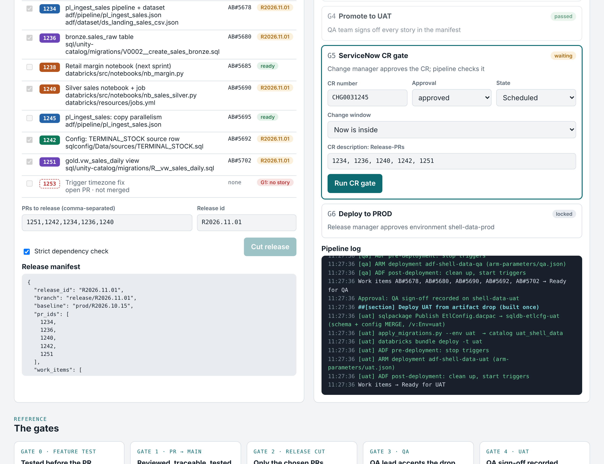
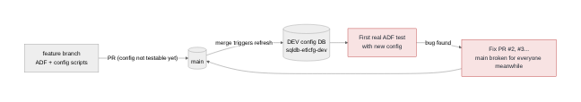
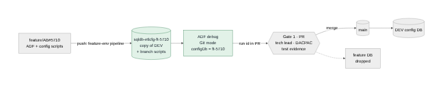
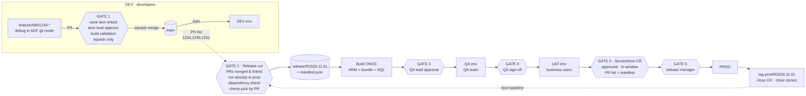
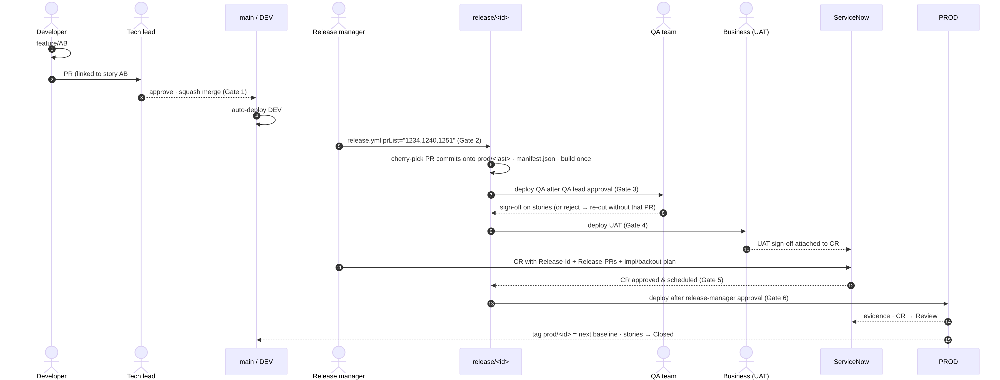
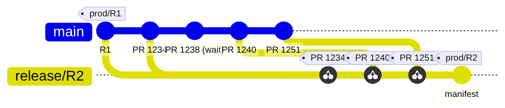
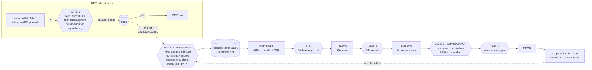

# Shell Data Platform — DevOps reference (ADF + Azure SQL config + Databricks + Unity Catalog)

**▶ Live simulator: https://vamshi455.github.io/enterprisedevops/** · **[Proposal PDF](docs/Release-Process-Config-DB-Proposal.pdf)** · **[Release process and gates](docs/RELEASE-PROCESS.md)** ([PDF](docs/Shell-Data-Release-Process-and-Gates.pdf)) · **[HANDOFF.md](HANDOFF.md)** (self-contained brief for a local coding agent)

A working scaffold for promoting **Azure Data Factory**, **Databricks** and **Unity Catalog SQL**
through **DEV → QA → UAT → PROD**, where the unit of release is a **list of Pull Requests**, never
individual commits and never "all of main".

> Pattern adapted from the stable process running at Marathon (3 environments), extended to Shell's
> 4 environments with a dedicated QA team and ServiceNow change control.

| | |
|---|---|
| Live gate simulator | [`prototype/index.html`](prototype/index.html) — open in a browser, no server needed |
| Full process & RACI | [`docs/process.md`](docs/process.md) |
| Why PR-level cherry-pick | [`docs/cherry-pick-by-pr.md`](docs/cherry-pick-by-pr.md) |
| ServiceNow integration | [`docs/servicenow.md`](docs/servicenow.md) |
| Diagram images (PNG/SVG) | [`docs/diagrams/`](docs/diagrams) |
| Azure SQL config DB | [`sqlconfig/README.md`](sqlconfig/README.md) |

## Release Gate Simulator



`prototype/index.html` is a single self-contained page: download it and open it in any browser
(or enable GitHub Pages on this repo to host it). Pick PRs, cut a release, and walk it through
QA → UAT → ServiceNow CR → PROD. Built-in scenarios: happy path, missing dependency,
story fails QA, CR doesn't match.

## Azure SQL config DB: test on the feature branch

Config scripts for the standalone Azure SQL ETL config DB used to reach a database only after merge to
`main`, so ADF could only be tested after merging. Now each feature branch gets its own DB
(`sqldb-etlcfg-ft-<story>` = copy of DEV + the branch's DACPAC and config rows) via
`pipelines/feature-env.yml`, and ADF is debugged against it before the PR.

| Today | Proposed |
|---|---|
|  |  |

## Release flow



## Who does what



## Cherry-pick by PR



---

## The problem today

* Everything merges to `main`, `main` is tested, then **all of main** moves to Test.
* A story that fails QA blocks every other story behind it.
* Cherry-picking exists but is done **per commit** — easy to miss a commit, drag in someone else's
  half-finished change, or lose track of what is actually in Prod.

## The model



### Six gates

| # | Gate | Enforced by | Blocks when |
|---|------|-------------|-------------|
| 1 | **PR → main** | Azure Repos branch policies + `pr-validation.yml` | no linked story/bug · no tech-lead approval · build/naming/ADF validation fails · not squash |
| 2 | **Release cut** | `build_release.py` | PR not merged · no work item · already in prod · cherry-pick conflict (names the missing predecessor PR) · overlapping files with an earlier unselected PR (strict mode) |
| 3 | **Deploy QA** | ADO environment `shell-data-qa` approval | QA lead hasn't accepted the drop |
| 4 | **Deploy UAT** | ADO environment `shell-data-uat` approval | QA hasn't signed off |
| 5 | **Change request** | `cr_gate.py` / ServiceNow check | CR not approved · outside window · CR's `Release-PRs:` ≠ manifest |
| 6 | **Deploy PROD** | ADO environment `shell-data-prod` approval | release manager hasn't approved |

### Key rules

1. **One PR = one squash commit = one story.** That's what makes PRs safe to cherry-pick.
2. **main = integration (DEV). release/* = what gets tested and shipped.**
3. **Build once, deploy many.** The artifact QA tested is byte-for-byte what reaches Prod.
4. **Prod baseline is a tag** (`prod/<release-id>`). The next release cherry-picks on top of it, so
   only *your* PRs move — nobody else's.
5. **A story that fails QA/UAT is dropped by re-cutting without its PR** — no reverts on main.

---

## Repo layout

```
adf/                      ADF git-integration folder of the DEV factory (pipelines, datasets, ...)
  arm-parameters/         qa.json, uat.json, prod.json — env overrides for the exported ARM template
databricks/               Databricks Asset Bundle, targets dev/qa/uat/prod
sql/unity-catalog/        Versioned (V0001__*.sql) + repeatable (R__*.sql) migrations, ${catalog} templated
pipelines/
  pr-validation.yml       GATE 1 build validation
  ci-main-dev.yml         main -> DEV
  release.yml             PR list -> Cut -> Build -> QA -> UAT -> CR -> PROD -> tag
  templates/              build-artifacts, deploy-env (UC -> Databricks -> ADF), update-work-items
scripts/
  release/build_release.py    PR-list release builder (cherry-pick by PR)
  servicenow/cr_gate.py       CR check / start / close
  sql/apply_migrations.py     UC migration runner with checksum history
  ado/branch_policies.sh      one-time policy setup on main
sqlconfig/                Azure SQL config DB: SQL project (DACPAC) + one MERGE file per config key
pipelines/feature-env.yml Gate 0: per-branch config DB + nightly cleanup
tests/                    pytest: real git repo cherry-pick scenarios, CR gate, migrations
prototype/index.html      interactive gate simulator for team walk-throughs
```

## Try it locally

```bash
pip install -r requirements-dev.txt
pytest -q                                   # 17 tests, includes real cherry-pick scenarios

# Against any Azure DevOps repo clone that uses squash merges:
python scripts/release/build_release.py candidates --main-ref origin/main      # unreleased PRs
python scripts/release/build_release.py plan  --prs "1234,1240" --strict-deps   # dry run
python scripts/release/build_release.py build --prs "1234,1240" --release-id R2026.11.01
```

## Assumptions to confirm with the client team

* Azure Repos + Azure Pipelines (stories already live in Azure DevOps Boards).
* One Azure subscription/resource group, ADF, Databricks workspace and UC catalog per environment
  (`<env>_shell_data`). If UC catalogs share one metastore across workspaces, bind each catalog to its workspace.
* ADF Git integration on **DEV factory only**; QA/UAT/PROD factories are never edited by hand.
* ServiceNow CRs can carry a `Release-PRs:` / `Release-Id:` line (or a custom field `u_release_prs`).
