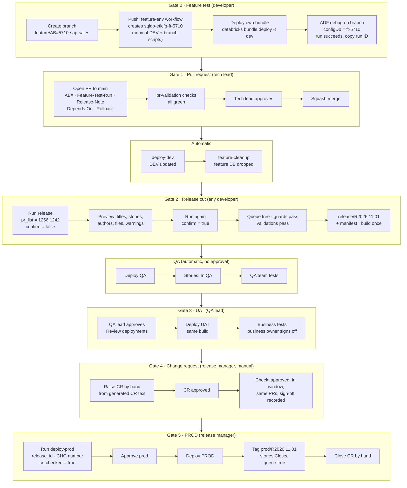
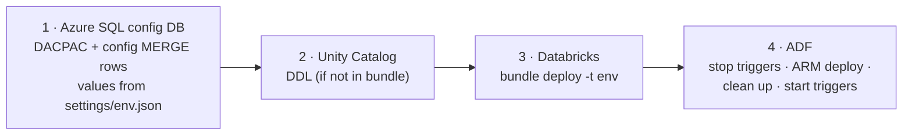
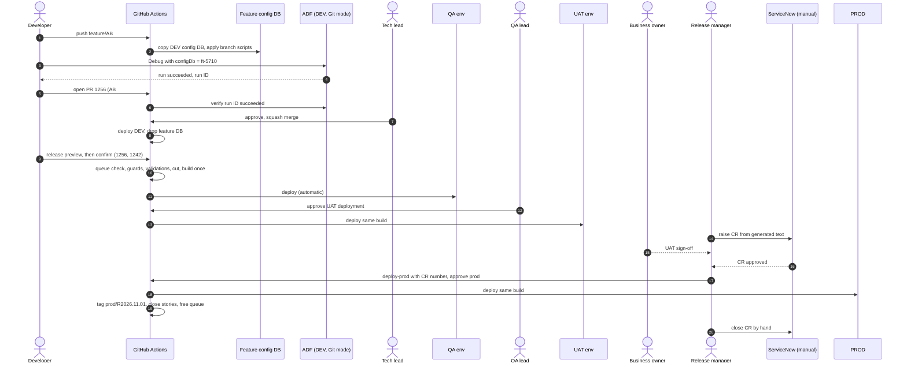

# Shell Data Platform: Release Process and Gates

Version 1.0 · 25 Oct 2026 · Owner: Vamshi Singam · Status: agreed design (edge cases in §9 open for discussion)

This document describes, in one place, how a change moves from a developer's feature branch to PROD for the three project
types: **Azure Data Factory (ADF)**, **Databricks** (Asset Bundles, Unity Catalog) and the **Azure SQL config database** that
drives the metadata-driven ADF pipelines. Sections 1–8 describe the **sunny-day flow** (everything passes). Section 9 lists edge
cases: how they are covered today and ideas still open for discussion.

---

## 1. Principles

1. **Every change is fully tested on its own feature branch**, isolated from other developers, before anyone reviews it.
2. **Only approved, tested PRs reach `main`.** `main` deploys to DEV only; DEV is an integration check, not the first test.
3. **A release is a list of PRs.** Never individual commits, never all of `main`.
4. **One PR = one squash commit = one story** (`AB#<id>` in Azure Boards).
5. **Build once, deploy many.** QA, UAT and PROD receive the identical build.
6. **One release in progress at a time** (the release queue).
7. **Environment-specific values live in Git**, one settings file per environment. Secrets live in Key Vault. Nobody edits
   environment values by hand.
8. **No Azure secrets in GitHub.** GitHub signs in to Azure with the existing (user-assigned) managed identities via OIDC.
9. **Every step leaves evidence**: run IDs, approvals, manifests, tags and story states.

## 2. Environments, tools and roles

| Environment | Purpose | How it gets code | Who tests |
|---|---|---|---|
| Feature (per branch, in DEV) | Developer proves the change end-to-end | Developer's branch: ADF Git mode, own config DB copy, own Databricks bundle | Developer |
| DEV | Integration of everything merged | Automatically on every merge to `main` | Developers |
| QA | Functional and regression testing | Automatically right after a release is cut | QA team |
| UAT | Business acceptance | After the QA lead approves | Business users |
| PROD | Production | After the CR check and release-manager approval | n/a |

Tools: GitHub + GitHub Actions (code, PRs, workflows, approvals; GitHub Enterprise), Azure Boards (stories), ServiceNow (change
requests, raised and checked **by hand**, no integration), Microsoft Entra ID (managed identities), Azure Key Vault (secrets).

| Role | Responsibilities |
|---|---|
| **Developer** | Builds and tests on the feature branch (Gate 0), raises the PR, cuts releases for their own PRs (Gate 2) |
| **Tech lead** | Reviews and approves PRs (Gate 1) as CODEOWNER |
| **QA team / QA lead** | Tests in QA; the QA lead signs off by approving the UAT deployment (Gate 3) |
| **Business owner** | Leads UAT testing and gives business sign-off |
| **Release manager** | Raises the CR by hand, checks it (Gate 4), approves PROD (Gate 5), closes the CR |
| **release-bot** (GitHub App) | The only actor that creates `release/*` branches and `prod/*` / `dropped/*` tags |
| **Platform admins** | Grant access; never part of the day-to-day flow |

## 3. End-to-end flow



**Deployment order inside every environment** (DEV, QA, UAT, PROD), always from the one build:



## 4. Gates at a glance

| # | Gate | Who | Blocking checks | Evidence left behind |
|---|---|---|---|---|
| 0 | Feature test | Developer | Branch tested end-to-end against its own config DB copy and own bundle; ADF debug run **succeeded** | `Feature-Test-Run: <run ID>` in the PR |
| 1 | PR → `main` | Tech lead (CODEOWNER) | 10 checks (§5.2) | Approved PR, green checks, squash commit |
| – | Merge → DEV | Automatic | DEV deploy succeeds | `deploy-dev` run |
| 2 | Release cut | Any developer | Preview confirmed, queue free, cut guards, 6 validations (§5.4) | `release/<id>` branch, manifest, build artifact, CR text |
| – | QA deploy | Automatic | Deploy succeeds | `deploy-qa` job, stories In QA |
| 3 | UAT | QA lead | QA sign-off = approval of the `uat` deployment | GitHub approval record, stories In UAT |
| 4 | Change request | Release manager (manual) | CR approved, in window, same PRs, business sign-off recorded | CR number entered in `deploy-prod` |
| 5 | PROD | Release manager | `prod` environment approval; baseline still the latest PROD tag | `prod/<id>` tag, stories Closed |

## 5. Gate by gate

### 5.1 Gate 0: Feature test (developer, before any PR)

**Purpose:** prove the change works end-to-end before anyone reviews it. This replaces "test it on main".

Steps (sunny day):
1. Create the branch from `main`: `feature/AB#<story>-<short-desc>` (or `bugfix/…`).
2. Make the change: ADF pipeline JSON in `adf/`, Databricks code in `databricks/`, config rows in `sqlconfig/Data/<area>/<KEY>.sql`
   (one MERGE file per config key, environment values as SQLCMD variables, never hardcoded).
3. Push. The `feature-env` workflow:
   - copies the DEV config DB to **`sqldb-etlcfg-ft-<story>`** (a snapshot of DEV, which always equals `main`),
   - publishes the branch's DACPAC and config rows to the copy,
   - grants the developers group write access to the copy,
   - prints the debug parameters to use.
4. Deploy the Databricks bundle in development mode: `databricks bundle deploy -t dev`. Jobs get the developer's prefix and a
   personal `dev_<user>` schema.
5. In ADF Studio (Git mode, branch selected), click **Debug** with:
   - `configDb = sqldb-etlcfg-ft-<story>`,
   - the developer's bundle job/notebook path,
   - a per-branch output target (e.g. lake folder `…/_feature/<story>/`, schema `dev_<user>`),
   - if needed, a watermark set back in the copy so a real load is tested.
6. The run succeeds. Copy the **run ID** from the Output tab (or Monitor → Pipeline runs → Debug).

Exit: a successful run ID. Nothing shared (DEV config DB, DEV watermarks, other developers) was touched.

### 5.2 Gate 1: Pull request to `main` (tech lead)

The PR template asks for these lines:
```
AB#5710
Feature-Test-Run: 3f9c2a1e-…            (ADF debug run ID)
Release-Note: Adds SAP sales source and its config row
Depends-On: none                        (or #<pr>)
Rollback: delete etl.source_config row 'SAP_SALES'
```

All ten checks must pass:
1. **Description** follows the template: what changed, why, how it was tested, per project type touched.
2. **Linked story**: `AB#<id>`, one story per PR.
3. **Feature test proof**: the pipeline calls the ADF API and confirms the run ID exists in the DEV factory, **succeeded**, and is recent.
4. **Reviewer**: the tech lead (CODEOWNERS) approves. The author cannot approve their own PR; a new push resets the approval.
5. **Automated checks**: ADF validate, `databricks bundle validate`, SQL project (DACPAC) build, unit tests, settings files have identical keys.
6. **No secrets and no hardcoded environment values** (server names, storage accounts, URLs): a scan blocks the PR.
7. **Release note** line present (it feeds the manifest and the CR text).
8. **Dependencies** stated (`Depends-On:`).
9. **Rollback note** for any config or schema change.
10. Branch **up to date with `main`**, all conversations resolved, **squash merge only**.

Exit: the PR is squash-merged as one commit on `main`. The story moves to "Done in DEV" (or the team's equivalent state).

### 5.3 Merge to `main` → DEV (automatic)

- `deploy-dev` deploys `main` to DEV in the standard order (§3). DEV now contains the change.
- `feature-cleanup` drops `sqldb-etlcfg-ft-<story>` because the PR is closed.
- Nothing in QA, UAT or PROD changes. The PR now waits on `main` until a developer lists it in a release.

### 5.4 Gate 2: Release cut (any developer, for their own PRs)

**Step 1: Preview.** Run the `release` workflow with `pr_list` (e.g. `1256,1242`) and `confirm = false`. Nothing is cut. The
summary shows each PR's number, title, story, author, merge date and files, plus any warnings. The developer checks the list.
This catches a mistyped PR number.

**Step 2: Cut.** Run again with `confirm = true`. The workflow checks, in this order:

| # | Check | Blocks? |
|---|---|---|
| a | **Release queue**: no other release is in progress (cut but not yet tagged in PROD or dropped). Two cuts started at the same moment run one after the other, so the second sees the first | Yes: refused, naming the release in progress, its PRs and who started it |
| b | **Failed-PR label**: no listed PR carries `failed-qa` / `failed-uat` unless its fix PR is in the same list | Yes |
| c | **Ownership**: the person cutting authored each PR, and its story is in the current sprint | Warning only |
| 1 | Every PR is **merged into `main`** as a **squash** commit | Yes |
| 2 | Every PR has a **linked story** (`AB#`) | Yes |
| 3 | No PR is **already in PROD** (compared with the latest `prod/*` tag) | Yes |
| 4 | PRs are **ordered by merge order** on `main` (typed order is ignored) | n/a |
| 5 | **Dependencies**: no earlier, unreleased, unlisted PR touches the same files (strict mode) | Yes, names the missing PR |
| 6 | **Clean cherry-pick** of each squash commit onto the latest `prod/*` tag, with no conflicts | Yes, names the likely missing PR |

On success:
- `release/<id>` branch (e.g. `release/R2026.11.01`) with `releases/<id>/manifest.json`: PRs, stories, commits, baseline, notes.
- **One build**: ADF ARM template, config DACPAC, Databricks bundle, UC SQL, all from the release branch.
- **CR text** in the run summary, ready to paste into ServiceNow: release ID, PR list, stories, release notes, rollback notes,
  components.

### 5.5 QA deploy (automatic, no approval)

- Immediately after the cut, the same build deploys to QA in the standard order.
- Stories move to **In QA**.
- The QA team tests. Because of the queue, nothing else can overwrite QA while this release is under test.

### 5.6 Gate 3: UAT (QA lead)

- The `release` run is paused at the `uat` environment. The QA lead opens it, clicks **Review deployments** and approves.
  That approval is the QA sign-off. GitHub records who approved and when; nobody outside the QA sign-off group can approve.
- The **same build** deploys to UAT; stories move to **In UAT**.
- Business users test; the **named business owner signs off**, recorded on the stories or the CR.
- During UAT, the release manager raises the CR (Gate 4) so it can be approved in parallel.

*UAT details are working assumptions until the team confirms its current practice (OQ-10).*

### 5.7 Gate 4: Change request (release manager, manual)

There is **no ServiceNow integration**. The release manager:
1. raises the CR by hand using the generated CR text, during UAT,
2. gets it approved through the normal change process,
3. before PROD, confirms in ServiceNow that the CR is **approved**, **inside its change window**, lists **exactly the release's PRs**,
   and has **UAT business sign-off** recorded.

### 5.8 Gate 5: PROD (release manager)

1. Run `deploy-prod` with `release_id`, `change_request` (`CHG` + digits) and `cr_checked = true`.
2. The workflow confirms the release passed UAT and that its baseline is still the latest `prod/*` tag.
3. It pauses at the `prod` environment; a release manager approves.
4. The same build deploys to PROD in the standard order.
5. The release-bot tags **`prod/<id>`** (CR number in the tag message and the manifest). This is the baseline for the next release.
6. Stories move to **Closed**, tagged `Released-<id>`. The release queue is free again.
7. The release manager closes the CR by hand, using the evidence in the run summary.

PROD is a separate workflow because CR approval and scheduling can take days, longer than one run should wait.

## 6. Sunny-day scenario, end to end

Example: story **AB#5710** adds a SAP sales source. It changes an ADF pipeline, adds a config row and adds a Databricks
notebook. A second, already-merged PR **#1242** (story AB#5692) adds a terminal-stock config row and ships in the same release.

| Step | Who | What happens | Evidence |
|---|---|---|---|
| 1 | Developer | Creates `feature/AB#5710-sap-sales` from `main`; adds `pl_ingest_sap_sales`, `Data/sources/SAP_SALES.sql` (server name as SQLCMD variable), notebook + job in the bundle | Commits on the branch |
| 2 | feature-env | Copies DEV config DB → `sqldb-etlcfg-ft-5710`; publishes the branch DACPAC + SAP_SALES row | Workflow run |
| 3 | Developer | `databricks bundle deploy -t dev` → personal jobs and `dev_<user>` schema | Bundle deployment |
| 4 | Developer | ADF Debug with `configDb = sqldb-etlcfg-ft-5710`, own output folder; run succeeds | Run ID `3f9c2a1e…` |
| 5 | Developer | Opens PR **#1256** with AB#5710, Feature-Test-Run, Release-Note, Depends-On: none, Rollback | PR |
| 6 | pr-validation | All checks green, including ADF API confirmation that run `3f9c2a1e…` succeeded | Check runs |
| 7 | Tech lead | Reviews and approves; PR squash-merged | Approval, squash commit |
| 8 | deploy-dev / cleanup | DEV updated; `sqldb-etlcfg-ft-5710` dropped | Workflow runs |
| 9 | Developer | Runs `release` with `pr_list = 1256,1242`, `confirm = false`; reviews the preview | Preview summary |
| 10 | Developer | Runs again with `confirm = true`; queue free, guards and validations pass; `release/R2026.11.01` cut and built | Manifest, artifact, CR text |
| 11 | release | Deploys QA automatically; stories AB#5710 and AB#5692 → In QA | Deploy job |
| 12 | QA team | Tests; QA lead approves the `uat` deployment | Approval record |
| 13 | release | Deploys the same build to UAT; stories → In UAT | Deploy job |
| 14 | Release manager | Raises **CHG0034567** by hand from the CR text; it gets approved | CR in ServiceNow |
| 15 | Business owner | Signs off UAT | Sign-off on stories/CR |
| 16 | Release manager | Checks the CR (approved, in window, PRs 1242 + 1256, sign-off); runs `deploy-prod` with CHG0034567 | deploy-prod inputs |
| 17 | Release manager | Approves `prod`; PROD deployed | Deploy job |
| 18 | release-bot | Tags `prod/R2026.11.01`; stories → Closed; queue free | Tag, story states |
| 19 | Release manager | Closes CHG0034567 by hand with the run evidence | Closed CR |



**Release lifecycle (sunny day):**

```mermaid
stateDiagram-v2
  direction LR
  [*] --> Preview: release (confirm=false)
  Preview --> Cut: release (confirm=true)
  Cut --> InQA: automatic deploy
  InQA --> InUAT: QA lead approves
  InUAT --> AwaitingPROD: business sign-off + CR approved
  AwaitingPROD --> InPROD: deploy-prod + prod approval
  InPROD --> [*]: tagged prod/id, queue free
```



## 7. Story states in Azure Boards

| Event | Story state (adjust to the team's real state names) |
|---|---|
| PR merged to `main` | Done in DEV |
| Release deployed to QA | In QA |
| QA lead approves UAT; deployed | In UAT |
| Deployed to PROD | Closed (tag `Released-<id>`) |

## 8. Names, conventions and evidence trail

| Item | Convention |
|---|---|
| Feature branch | `feature/AB#<story>-<desc>`, `bugfix/AB#<story>-<desc>` |
| Feature config DB | `sqldb-etlcfg-ft-<story>` (elastic pool on the DEV SQL server) |
| PR body lines | `AB#`, `Feature-Test-Run:`, `Release-Note:`, `Depends-On:`, `Rollback:` |
| Release ID / branch | `R<yyyy.MM.dd>[.n]` · `release/<id>` (release-bot only) |
| Tags | `prod/<id>` (shipped), `dropped/<id>` (abandoned) (release-bot only) |
| PR labels | `failed-qa`, `failed-uat` |
| GitHub environments | `dev-feature`, `dev`, `release-cut`, `qa` (no approval), `uat` (QA lead), `prod` (release managers) |
| Workflows | `pr-validation`, `feature-env`, `feature-cleanup`, `deploy-dev`, `release`, `drop-release`, `deploy-prod` |
| Settings | `settings/{dev,qa,uat,prod}.json`, same keys; secrets in Key Vault |

Evidence for audit: PR (story, test run, approval) → manifest (PRs, commits, baseline) → workflow runs (each deploy) →
environment approvals (who, when) → `prod/<id>` tag (with CR number) → stories Closed → CR closed in ServiceNow.

## 9. Edge cases: how we cover them, and open ideas

Status: **Decided** = agreed and in the design · **Proposed** = suggested, needs agreement · **Open** = needs discussion.

### 9.1 Development and PR

| Scenario | How it's covered | Status / open idea |
|---|---|---|
| Feature run pulls zero rows (copy has DEV's current watermarks) | Developer resets the watermark in their copy; documented in feature-testing guide | Decided |
| Feature copy goes stale on a long-lived branch | Re-run `feature-env` manually to refresh | Decided; idea: warn when the copy is older than N days |
| Feature runs write to shared DEV lake paths/tables | Feature runs must write to a per-branch folder / personal schema | **Open (OQ-09)**: how outputs are separated today |
| ADF debug run ID expired or wrong | ADF API check fails the PR; developer re-runs debug | Decided |
| PR touches the same pipeline as another open PR | Second PR must rebase on `main`; release cut catches dependency later | Decided; idea: CODEOWNERS per pipeline folder |
| Secrets or hardcoded server names in code | Scan blocks the PR | Decided |
| DEV deploy fails after merge | Fix forward with a new PR; revert if it blocks others | Decided |

### 9.2 Release cut

| Scenario | How it's covered | Status / open idea |
|---|---|---|
| Mistyped PR number | Preview step before every cut | Decided |
| A release is already in progress | New cut refused, naming the release in progress | Decided |
| Two developers cut at the same moment | Concurrency group runs them one after the other; second is refused | Decided |
| Listed PR depends on an unlisted earlier PR | Cut stops and names the missing PR | Decided |
| Cherry-pick conflict | Cut stops, nothing is fixed by hand; developer adds the missing PR or waits | Decided |
| PR previously failed QA/UAT listed again | `failed-qa` / `failed-uat` label blocks it unless the fix PR is listed | Decided |
| Developer releases a teammate's PR | Ownership warning; allowed after acknowledgement | Decided |
| A release sits in UAT for weeks and blocks everyone (queue starvation) | Not covered yet | **Open**: maximum time in progress (e.g. 10 working days) before the release manager must ship or drop it |
| PR on `main` needed urgently but is not ready to go with others | Only listed PRs move | Decided |

### 9.3 QA and UAT

| Scenario | How it's covered | Status / open idea |
|---|---|---|
| One or more stories fail QA | `drop-release` (labels failed PRs, tag `dropped/<id>`, frees queue); re-cut the passing PRs; new build goes through QA again | Decided |
| Story fails UAT | Same as QA failure: drop, re-cut without it, back through QA | Decided (assumption, OQ-10) |
| Remaining PRs depend on the failed ones | Re-cut stops and names the failed PR; those PRs wait for the fix | Decided |
| Rework of a failed PR | New fix PR (same story, `Depends-On: #old`), Gates 0–1 again; next release lists both | Decided |
| Bad PR should leave `main` | Fix forward by default; revert only if story abandoned, DEV broken, or another cut blocked; config rows need an explicit delete script | Decided; suggested fix-or-revert target ~1 week (**confirm**) |
| QA wants to re-test after a drop | New build always goes through QA before UAT | Decided |
| Approval left pending too long | GitHub cancels a run waiting on approval after its maximum wait | **Open**: alerting/re-run procedure for expired approvals |

### 9.4 Change request and PROD

| Scenario | How it's covered | Status / open idea |
|---|---|---|
| CR not approved or change window missed | `deploy-prod` is simply not started; release stays in UAT | Decided; idea: reminder when a release waits > N days |
| CR lists different PRs than the release | Release manager's manual check (Gate 4) | Decided; idea: CR text generated from the manifest reduces mismatch |
| Someone shipped to PROD since this release was cut (stale baseline) | `deploy-prod` refuses if the baseline is not the latest `prod/*` tag | Decided |
| PROD deploy fails part-way | Workflow stops; release manager redeploys the same build or redeploys the previous `prod/*` build | **Open**: written rollback runbook per component (ADF ARM incremental, idempotent config rows, Databricks bundle) |
| Destructive SQL schema change | DACPAC `BlockOnPossibleDataLoss` stops it; needs an explicit migration and backout script in the CR | Decided; idea: separate approval for destructive changes |
| ADF triggers or Databricks jobs running during deploy | ADF pre/post scripts stop and restart triggers | **Open**: deploy window and how to handle long-running jobs |
| Emergency hotfix while a release is in progress | Not covered: the queue would refuse it | **Open**: options are (a) drop the in-progress release, ship the hotfix, re-cut; or (b) a hotfix lane that bypasses the queue, after which the in-progress release must be re-cut on the new `prod/*` tag (the stale-baseline check enforces this) |

### 9.5 Environment and platform

| Scenario | How it's covered | Status / open idea |
|---|---|---|
| Environment value differs per environment (e.g. source server) | `settings/<env>.json` in Git, fed to ADF, bundle and SQL | Decided |
| Settings files drift (missing keys) | PR check fails if keys differ | Decided |
| Someone edits a value in an environment by hand | Next deploy overwrites it from Git; portal write access limited | Decided; idea: periodic drift report |
| `main` drifts far ahead of PROD | Review unreleased PRs at each release planning | Decided; idea: weekly report of PRs merged > N days ago and not released |
| ADF debug cannot prove triggers, production IR or volume | First proven in QA | Decided (accepted caveat) |
| Managed identity / access missing | Access checklist (admin request) and Phase 3 gap check | Decided |
| GitHub-hosted runners cannot reach private endpoints | Self-hosted runners in the VNet if needed | **Open (OQ-03)** |

## 10. Open questions

| ID | Question |
|---|---|
| OQ-01 | Is each environment in its own subscription? |
| OQ-02 | Is Databricks serverless allowed? |
| OQ-03 | Are ADF, SQL and Databricks behind private endpoints (runner choice)? |
| OQ-04 | Are the managed identities to reuse user-assigned? |
| OQ-05 | Feature elastic pool size and cost owner |
| OQ-06 | How SQL scripts are deployed today (DACPAC or numbered scripts)? |
| OQ-09 | Where do feature (debug) runs write data today; shared or per developer? |
| OQ-10 | How UAT works today: who signs off, when the CR is raised, what happens on failure |
| New | Maximum time a release may stay in progress; hotfix lane; fix-or-revert time limit; rollback runbook |

Answered: OQ-07 GitHub Enterprise · OQ-08 no ServiceNow integration (manual CRs).
