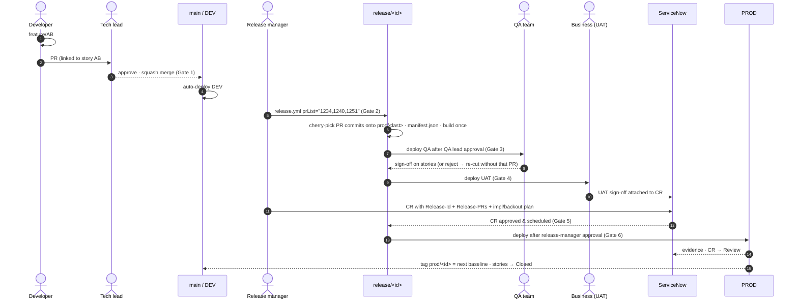

# End-to-end process

## Environments

| Env | Purpose | Who tests | Deployed from | Approval to enter |
|-----|---------|-----------|---------------|-------------------|
| DEV | Build + developer testing, integration of all merged work | Developers | `main` (every merge) | none (Gate 1 on the PR) |
| QA  | Functional / regression / data validation | Shell QA team | `release/<id>` artifact | QA lead |
| UAT | Business acceptance | Business users / focals | same artifact | QA sign-off |
| PROD | Production | — | same artifact | Approved ServiceNow CR + release manager |

## Swimlane

## RACI

| Activity | Dev | Tech lead | Release mgr | QA | Business | Change mgr |
|---|---|---|---|---|---|---|
| Feature branch + dev test | R/A | C | | | | |
| PR review & merge | R | A | | | | |
| Choose PRs for release | C | C | R/A | C | C | |
| QA testing & sign-off | C | | I | R/A | | |
| UAT testing & sign-off | | | I | C | R/A | |
| Raise CR | | C | R | | C | A |
| Approve CR | | | C | | A | R |
| Prod deployment | | C | R/A | | I | I |

## Branch & naming conventions

* `feature/AB#<workitem>-short-desc`, `bugfix/AB#<id>-...`
* Squash commit message (ADO default): `Merged PR 1234: <title>` + `Related work items: #5678`
* `release/<release-id>` — created by the pipeline only, never by hand
* `prod/<release-id>` — annotated tag, created only after a successful Prod deploy

## What happens when…

**A story fails QA.** Re-queue `release.yml` with the PR list minus that PR (new release id). Nothing
is reverted on main; the PR simply waits for a later release.

**PR B depends on PR A but only B was selected.** The cut stage fails with
`Cherry-pick conflict on PR B ... Likely missing predecessor PR(s): [A]`, or in strict mode fails
earlier because B and A touch the same files. Add A or defer B.

**Hotfix.** Branch `hotfix/AB#id` from the latest `prod/*` tag, fix, PR into `main` (Gate 1 as
usual), then run `release.yml` with just that PR and an *Emergency* CR. Same path, smaller list.

**Rollback.** Re-run the deploy stages from the previous `prod/*` tag's artifact (ARM is incremental
and DAB/migrations are idempotent; data-destructive SQL needs an explicit backout script in the CR).

**Drift between main and prod.** PRs merged but never released stay listed by
`build_release.py candidates`. Review that list at every release planning session.

## ADF specifics

* Only the DEV factory is Git-connected (collaboration branch `main`). Developers debug in their
  feature branch in Git mode — that is "testing in the feature branch".
* No manual **Publish** button: ARM templates are exported by the pipeline with
  `@microsoft/azure-data-factory-utilities` from the release branch, so the ARM contains *only* the
  cherry-picked changes on top of prod.
* Triggers are stopped/started by `PrePostDeploymentScript.Ver2.ps1`; deleted resources are cleaned up.
* Environment differences live in `adf/arm-parameters/<env>.json` and global parameters; never
  hard-code URLs in pipelines.

## Databricks / Unity Catalog specifics

* Notebooks, jobs and clusters are deployed with **Databricks Asset Bundles** (`databricks bundle deploy -t <env>`), running as an env-specific service principal.
* Catalog per environment (`dev_shell_data`, `qa_shell_data`, …). Code reads the catalog from a
  parameter/widget — the same notebook runs everywhere.
* DDL lives in `sql/unity-catalog/migrations`: `V####__` scripts run once, in order, and may never be
  edited after release; `R__` scripts (views, functions) re-run when changed.
