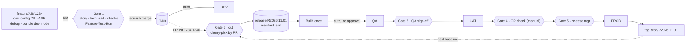

# Shell Data Platform CI/CD: Handoff for the Local Coding Agent

Version 1.4 · 24 Oct 2026 · Owner: Vamshi Singam (lead)

This file is **self-contained**. It holds the full context, target architecture, specifications, conventions,
access requirements and reference code. No other repository or document is needed.

---

## 0. How to use this document

**For Vamshi:** put this file at `PDX_Projects/devops-cicd/HANDOFF.md`, open `PDX_Projects/devops-cicd` in VS Code,
choose Copilot Chat **Agent** mode with your Claude model, and send:

> Read HANDOFF.md completely. Then do Phase 1 only and stop for my review.

After each phase, review and say "Proceed to Phase N".

**For the agent:** work strictly phase by phase (§4). Do not start a phase until the previous one is reviewed.
Section 5 is the target design: implement it, do not redesign it. If the real environment contradicts it,
record the conflict in `DECISIONS.md` and ask.

---

## 1. Mission

Build a new, parallel CI/CD process for a data platform team whose current DevOps process has broken down.
Developers will build on it under Vamshi's lead.

**Three project types, one repository:**

| Type | What it is | Build artifact |
|---|---|---|
| Azure Data Factory (ADF) | Metadata-driven pipelines reading configuration from an Azure SQL DB | ARM template |
| Azure SQL config DB | Standalone Azure SQL database holding ETL configuration (sources, mappings, flags) | DACPAC + idempotent config data scripts |
| Databricks | Notebooks, jobs and Unity Catalog objects; the team already uses Databricks Asset Bundles | Bundle |

**Environments:** DEV, QA (a dedicated QA team tests), UAT (business users test), PROD. Each has its own factory,
config DB and Databricks workspace.

**Platform services:** GitHub + GitHub Actions (CI/CD), Azure Boards (stories), ServiceNow (change requests for
PROD), Microsoft Entra ID (existing managed identities must be reused).

### Problems to fix

1. Everything merges to `main` and is tested on `main`. Then all of `main` moves forward, so one failed story blocks everyone.
2. Cherry-picking to higher environments is done per commit, which is error-prone.
3. Azure SQL config scripts reach a database only after merging to `main`. ADF pipelines that need new config therefore
   cannot be tested end-to-end on a feature branch, and untested work lands in `main`.

### Principles

- **Every feature is fully tested on its own feature branch, isolated per developer.** Only approved, tested PRs reach `main`.
- **A release is a list of PRs**: never individual commits, never all of `main`.
- **Build once, deploy many**: QA, UAT and PROD receive the identical artifact.
- **No Azure secrets in GitHub**: OIDC federated credentials on the existing managed identities.
- Every PR is linked to an Azure Boards story; every PROD deployment is tied to an approved ServiceNow CR (raised and checked by hand; no integration).

---

## 2. Rules for the agent (always)

1. **Read-only by default.** Discovery commands (`az … list/show`, `gh api` GET, `databricks … list/get`, `SELECT`)
   are fine. Ask before any command that creates, changes or deletes anything in Azure, Databricks, GitHub settings or a database.
2. **Never touch QA, UAT or PROD resources directly.** They change only through approved release workflows.
3. **Do not grant access** (role assignments, federated credentials, SQL users, Databricks principals, GitHub settings).
   Admins do that. Record what is missing in `environment/ACCESS_GAPS.md`.
4. **No secrets** in files, commits, logs or chat. Redact anything secret-looking you encounter.
5. **All code through branches and PRs.** Branches: `feature/AB#<id>-<desc>` or `chore/<desc>`. Never push to `main`.
6. **Evidence over assumptions.** Every fact you rely on goes in `environment/ENVIRONMENT_FACTS.md` with its source
   (command or file, and date). Unknown → write `UNKNOWN` and ask. Never invent resource names.
7. **Small reviewable steps.** At the end of each phase or step: update `STATUS.md`, list what changed, then stop.
8. Use official CLIs: `az`, `gh`, `databricks`, `sqlpackage`, `dotnet`, `npm`. Pin GitHub Action versions.
9. Do not move, rename or delete existing files in `PDX_Projects/devops-cicd/`; they hold earlier discovery work.

---

## 3. Workspace layout

```
PDX_Projects/devops-cicd/
├── HANDOFF.md                      ← this file (do not edit; propose changes in DECISIONS.md)
├── <existing discovery files>      ← gathered earlier; read, never delete
├── .github/
│   ├── copilot-instructions.md     ← created in Phase 1 from Appendix E
│   └── prompts/                    ← created in Phase 1 from Appendix F
├── STATUS.md                       ← living: done / in progress / blocked / next
├── DECISIONS.md                    ← append-only: date, decision, reason
├── environment/
│   ├── INVENTORY.md                ← Phase 1: what already exists in this folder
│   ├── ENVIRONMENT_FACTS.md        ← Phase 2: discovered facts with evidence
│   ├── CURRENT_PROCESS.md          ← Phase 2: how the team builds and deploys today
│   ├── REQUIREMENTS.md             ← Phase 3: requirement → current state → gap → work item
│   └── ACCESS_GAPS.md              ← Phase 3: needed vs existing access + short admin email
└── shell-data-platform/            ← Phase 4: the new platform repository (git)
```

---

## 4. Phase plan (in order)

### Phase 1: Set up the workspace

1. List every file and folder already in `PDX_Projects/devops-cicd/`. Summarise each in `environment/INVENTORY.md`
   (what it contains, which environment, how current). Note where it already answers a question from §6.
2. Create `STATUS.md`, `DECISIONS.md` and the `environment/` folder if missing.
3. Create `.github/copilot-instructions.md` from Appendix E and the prompt files from Appendix F.
   If a `copilot-instructions.md` already exists, append ours under a heading `## Shell CI/CD handoff`.
4. Stop. Report: the inventory summary, which open questions (§6) already look answered, and what is missing.

### Phase 2: Discover the existing environment (read-only)

Fill `environment/ENVIRONMENT_FACTS.md` with one section per environment (DEV, QA, UAT, PROD), as tables.
Combine the existing files with fresh read-only checks. Record the source for every value.

| Area | Collect | Example commands |
|---|---|---|
| Tenant / subscriptions | tenant ID, subscription per env, resource groups | `az account show`, `az account list`, `az group list` |
| Data Factory | name, RG, location, Git config (repo, collaboration branch, root folder), global parameters, linked services (esp. the config DB one), integration runtimes (Azure / self-hosted / shared), triggers, managed identity type + IDs | `az datafactory list`, `az datafactory show`, `az datafactory linked-service list`, `az datafactory integration-runtime list`, `az datafactory trigger list` |
| Azure SQL config DB | server, database, tier, Entra admin, public network access / firewall / private endpoint, elastic pools, principals in the DB, schema objects, which tables are config vs runtime state | `az sql server list/show`, `az sql db list`, `az sql elastic-pool list`, `az sql server ad-admin list`, `SELECT name,type_desc FROM sys.database_principals`, `SELECT s.name,t.name FROM sys.tables t JOIN sys.schemas s ON s.schema_id=t.schema_id` |
| Databricks | workspace URL per env, metastore, catalogs/schemas per env, SQL warehouses, serverless availability, cluster policies, existing bundles (location, targets, run_as), service principals, Git folder settings | `az databricks workspace list`, `databricks catalogs list`, `databricks warehouses list`, `databricks cluster-policies list`, `databricks service-principals list`, `databricks bundle validate` in existing bundle folders |
| Identities | every managed identity the team uses: name, client ID, object ID, **user- vs system-assigned**, role assignments, existing federated credentials | `az identity list`, `az role assignment list --assignee <objectId> --all`, `az identity federated-credential list` |
| Network | private endpoints, VNets, self-hosted IRs, whether GitHub-hosted runners can reach SQL/Databricks/ARM | `az network private-endpoint list`, `az sql server show --query publicNetworkAccess` |
| Key Vault | vaults used by linked services, access model (RBAC vs policies) | `az keyvault list`, `az keyvault show` |
| GitHub | org, plan (Enterprise?), existing repos for this team, Actions policy, existing workflows, rulesets/branch protection, environments, installed apps (Azure Boards, ADF, Databricks) | `gh api orgs/<org>`, `gh repo list <org>`, `gh api repos/<o>/<r>/rulesets`, `gh api repos/<o>/<r>/environments`, `gh workflow list -R <o>/<r>` |
| Azure Boards | org, project, area path, work-item types and **state names** | `az boards work-item show`, `az devops project show` |
| ServiceNow (manual) | change model, CR template, who approves, typical lead time, change windows; no API integration (D-27) | ask Vamshi / the team |
| Environment-specific values | every value that differs per environment: source server names (QA reads the test source, UAT the UAT source, …), storage accounts and paths, Databricks workspace and catalog, Key Vault names, integration runtime names. Record where each lives today (ADF parameter files, global parameters, config DB rows, bundle files, pipeline variables) | ADF ARM parameter files and global parameters, `SELECT` on config tables, bundle `targets`, existing pipeline variables |
| Feature-run outputs | where ADF/Databricks runs write data in DEV (lake paths, catalogs/schemas) and whether developers share the same targets | linked services, datasets, bundle variables; ask the team |

Also write `environment/CURRENT_PROCESS.md`, covering how the team works today:
- the existing repos and pipelines and their triggers
- how ADF is published
- how the SQL config scripts are deployed (DACPAC? numbered scripts? what tool?)
- how Databricks bundles are deployed
- how promotions and cherry-picks happen today
- pain points seen in pipeline history

At the top of `ENVIRONMENT_FACTS.md`, answer each open question in §6 with: answer, evidence, confidence.
Stop. Report the answers, the top 5 risks, and anything you could not access.

### Phase 3: Requirements and gap analysis

1. Write `environment/REQUIREMENTS.md`: one row per requirement R-01 … from §5 (gates, feature isolation per project type,
   release-by-PR, environments/approvals, ServiceNow, Boards, identities, deploy order). Columns:
   requirement · current state (from Phase 2) · gap · proposed work item · depends on (access / decision).
2. Write `environment/ACCESS_GAPS.md`. For every item in §5.12, check the live state where possible and mark it
   Exists / Missing / Cannot check, with evidence. Then add a **one-page admin email** listing only the
   Missing items, grouped by admin, using real resource names. DEV items come first.
3. List the decisions needed from Vamshi (e.g. reuse the existing repo or create a new one; DACPAC vs existing script tooling;
   self-hosted runners). Record proposals in `DECISIONS.md` as "Proposed".
4. Stop for review.

### Phase 4: Development (each step is a branch + PR; stop after each)

| Step | Deliverable | Acceptance |
|---|---|---|
| 4.1 Repo scaffold | `shell-data-platform` repo layout per §5.2 using real names; import existing ADF/Databricks/SQL content as found in Phase 2; `settings/<env>.json` per §5.13 plus a script that renders ADF ARM parameters, bundle variables and SQLCMD variables from it; CODEOWNERS; PR template; README | Builds locally: `dotnet build sqlconfig`, `databricks bundle validate -t dev`, ADF `npm run build validate` |
| 4.2 Release tool | Port Appendix A to `scripts/release/`, add the **GitHub provider** (§5.7); port the tests (Appendix B) and add GitHub-provider tests with a mocked API | `pytest` green |
| 4.3 PR validation | `.github/workflows/pr-validation.yml` per §5.6; `docs/branch-protection.md` with the ruleset to request | Workflow green on a test PR; fails without AB# or Feature-Test-Run |
| 4.4 Feature environment | `feature-env.yml`, `feature-cleanup.yml`; ADF `configDb` parameterisation (§5.4); `docs/feature-testing.md` | One branch gets its own DB; ADF debug against it succeeds; DB dropped after PR close |
| 4.5 Deploy DEV | reusable `deploy-env.yml` + `deploy-dev.yml` (§5.6, §5.10) | Merge to main deploys DEV in the right order |
| 4.6 Release | `release.yml` (preview + confirm, queue, cut guards, CR text), `deploy-prod.yml` and `drop-release.yml` (§5.6–5.9, §5.7a–d). Do **not** port Appendix C (ServiceNow integration deferred) | Dry-run (`plan`) correct; a real release of one PR reaches QA |
| 4.7 Pilot | One real story end-to-end; `pilot/PILOT_REPORT.md` | Story reaches QA (and UAT if approvers are available) through the new path |

---

## 5. Target architecture (implement this)

### 5.1 Overview



**Service-to-service authentication**

| # | From → To | How | Permission needed |
|---|---|---|---|
| 1 | GitHub workflow → Entra ID | OIDC token exchanged for the environment's **user-assigned** managed identity (federated credential subject `repo:<org>/<repo>:environment:<env>`) | Federated credential on the identity |
| 2 | Deploy identity → ADF | ARM deployment, trigger stop/start | Data Factory Contributor on the factory's RG |
| 2 | Deploy identity → Azure SQL | Entra token (`sqlpackage /AccessToken` or `azure/sql-action`) | Contained user, `db_owner` in the config DB |
| 2 | Deploy identity → Databricks | Databricks CLI `azure-cli` auth after `azure/login` | Workspace service principal; CAN MANAGE on bundle root; UC privileges; CAN USE warehouse |
| 3 | ADF Studio (DEV) / Databricks Git folders ↔ GitHub | Org-approved GitHub apps, per-developer sign-in | Org owner approves apps |
| 4 | Factory MI (existing) → config DB / Databricks / ADLS / Key Vault | Managed identity at runtime | db_datareader/writer + EXECUTE; CAN MANAGE RUN on jobs; Storage Blob Data Contributor; Key Vault Secrets User |
| 5 | Azure Boards ↔ GitHub | Azure Boards app; `AB#<id>` in PR links the story | App installed + project connected |
| 6 | Release workflow → Azure Boards API | Managed identity added to the Azure DevOps org; token for resource `499b84ac-1321-427f-aa17-267ca6975798` | Basic access + Contributor on project/area |
| 7 | ServiceNow | **No integration (D-27).** The release manager raises and checks the CR by hand; the workflow only produces the CR text and records the CR number | None now |
| 8 | release-bot GitHub App → repo | App installation token (`actions/create-github-app-token`) | Contents RW; ruleset bypass for `release/*` and `prod/*` |

### 5.2 Repository layout

```
shell-data-platform/
├── settings/{dev,qa,uat,prod}.json   single source of environment-specific values (§5.13)
├── adf/                         ADF Git root of the DEV factory (pipeline/, dataset/, linkedService/, trigger/, …)
│   ├── package.json             @microsoft/azure-data-factory-utilities
│   ├── arm-template-parameters-definition.json
│   └── arm-parameters/{dev,qa,uat,prod}.json
├── databricks/                  Databricks Asset Bundle (databricks.yml, resources/, src/)
├── sqlconfig/                   SQL project for the config DB
│   ├── EtlConfig.sqlproj
│   ├── Tables/ Procs/ Views/    schema (DACPAC)
│   ├── Data/<area>/<KEY>.sql    one idempotent MERGE per config key
│   └── Scripts/Script.PostDeployment.sql   :r includes for Data files
├── scripts/release/             build_release.py (+ GitHub provider); cr_gate.py only if ServiceNow integration is approved later
├── tests/
├── releases/                    manifests (only on release/* branches)
├── docs/
└── .github/ (workflows/, CODEOWNERS, pull_request_template.md)
```

### 5.3 Branching and gates

| Gate | When | Checks | Enforced by |
|---|---|---|---|
| 0 Feature test | Before PR | Branch tested end-to-end: ADF debug against the branch's own config DB and the developer's bundle. Evidence = the ADF debug **run ID** in the PR | `feature-env` workflow + PR check |
| 1 PR → main | Every PR | See "Gate 1 checks" below | Ruleset on `main` + `pr-validation` |
| — | Merge to main | Deploys DEV (integration check, not the first test) | `deploy-dev` |
| 2 Release cut | Manual, **any developer** for their own PRs | **Release queue: refused if another release is in progress** (§5.7a); listed PRs merged, squash, linked, not in prod; ordered by merge; cherry-picked onto the latest `prod/*` tag; dependency/conflict check | `release` → `build_release.py` |
| — | After cut | **Deploys to QA automatically, no approval** (decision D-17) | `release` → `deploy-env` |
| 3 UAT | After QA | QA lead signs off by approving the `uat` deployment ("Review deployments" on the paused run); GitHub records who and when | GitHub Environment |
| 4 Change (manual) | Before PROD | **No ServiceNow integration.** The CR is raised by hand. The release manager checks in ServiceNow that the CR is approved, inside its window, lists the same PRs as the manifest, and that UAT business sign-off is recorded; then enters the CR number when starting `deploy-prod` | Release manager + `deploy-prod` inputs |
| 5 PROD | After CR check | Release manager approves the `prod` environment on the `deploy-prod` run | GitHub Environment |

**Where the Gate 0 run ID comes from.** When the developer clicks **Debug** in ADF Studio (Git mode, on their branch), the run
appears in the Output tab with its run ID. It is also under **Monitor → Pipeline runs → Debug**. The developer copies it into the PR
as `Feature-Test-Run: <run id>`. The `pr-validation` check calls the ADF API for that run ID in the DEV factory and fails unless the
run exists, **succeeded**, and is recent (debug runs are kept only for a limited time). The tech lead can open the run in Monitor.

**Gate 1 checks (all required on every PR to `main`)**
1. **Description** follows the PR template: what changed, why, how it was tested, per project type touched (ADF / Databricks / SQL config).
2. **Linked story**: `AB#<id>` from Azure Boards, one story per PR.
3. **Feature test proof**: `Feature-Test-Run: <run id>`, verified by the pipeline as a successful ADF run (above).
4. **Reviewer**: tech lead from CODEOWNERS approves; the author cannot approve their own PR; new pushes after approval reset it.
5. **Automated checks pass**: ADF validate, `databricks bundle validate`, SQL project (DACPAC) build, unit tests, settings files have identical keys (§5.13).
6. **No secrets and no hardcoded environment values** (server names, storage accounts, URLs) in code: a scan blocks the PR.
7. **Release notes line** in the description (`Release-Note: …`); it feeds the release manifest and the ServiceNow CR.
8. **Dependencies called out**: `Depends-On: #<pr>` when this PR needs another PR released first (or `Depends-On: none`).
9. **Rollback note** for any config or schema change (`Rollback: …`).
10. Branch **up to date with main**, all conversations resolved, then **squash merge only**; no force-push.

**Gate 2: who can cut.** Developers are empowered to cut a release for their own PRs; it is **not** restricted to release managers
(decision D-20). The release queue (§5.7a) prevents parallel releases from colliding.

**Gate 2 proposal (not yet confirmed; ask before implementing):** check that every listed PR has a recorded feature test.

Branch names: `feature/AB#<id>-<desc>`, `bugfix/AB#<id>-<desc>`, `hotfix/AB#<id>-<desc>` (branched from the latest `prod/*` tag,
PR into main, then released alone with an emergency CR). `release/<id>` and `prod/<id>` are created only by the release-bot app.

### 5.4 Feature-branch isolation (the key change)

**Azure SQL config DB**
- On push to `feature/**` or `bugfix/**` that touches `sqlconfig/**` (or on manual dispatch), the `feature-env` workflow:
  1. derives `<id>` from `AB#<id>` in the branch name (fails if absent)
  2. drops `sqldb-etlcfg-ft-<id>` if present, then `az sql db copy` from the DEV config DB into it. Use the
     `pool-etlcfg-feature` elastic pool on the DEV server, and tag the copy with `branch` and `createdBy`.
     DEV always equals `main`, so the copy contains every merged change.
  3. builds the branch DACPAC and publishes it to the copy with DEV SQLCMD values (`/p:BlockOnPossibleDataLoss=true`)
  4. grants the developers group `db_datawriter` on the copy. The deploy identity is `db_owner` in DEV, and that user is copied too.
  5. prints the ADF debug parameters to use
- `feature-cleanup` runs on `pull_request: closed` and nightly. It drops `sqldb-etlcfg-ft-*` whose branch is gone or that are older than 14 days.
- Database users created `FROM EXTERNAL PROVIDER` are copied with the DB, so the factory MI keeps access to the copy.

**How the feature copy behaves (read before building)**
- The database itself never branches; only the scripts in Git do. The copy is a snapshot of DEV *at the moment it is taken*:
  source system details, column lists, flags **and the current watermarks**. The branch's schema changes and config MERGE
  scripts are applied on top.
- While testing, ADF debug runs read and advance watermarks **only in the copy**. DEV's watermarks are never touched.
- At merge, **nothing flows back from the copy**. Only the scripts merge to `main` and are applied to DEV by `deploy-dev`.
  The copy is then dropped.
- **Watermarks may need resetting.** The copy starts where DEV left off, so a feature run can pull zero rows.
  `docs/feature-testing.md` must show developers how to set a watermark back in their copy to test a real load.
- **Copies go stale.** A copy does not see config changes merged after it was taken. Re-run `feature-env` (manual dispatch)
  to refresh it on long-lived branches.
- **Only the config is isolated, not where data lands.** If feature runs write to the same DEV lake paths or tables as everyone
  else, they collide. Feature runs must write to a per-branch or per-developer target (e.g. lake folder `…/_feature/<storyId>/`
  and the developer's `dev_<user>` schema), passed as pipeline parameters. Open question OQ-09.
- **Runtime tables (watermarks, run logs) must never appear in deploy scripts**, or a release would overwrite QA/UAT/PROD state.

**ADF**
- Only the DEV factory is Git-connected (collaboration branch `main`, root folder `/adf`), with **Disable publish** ON.
- The config DB linked service is parameterised: `"parameters": {"dbName": {"type":"String","defaultValue":"<dev config db>"}}`
  and `Initial Catalog=@{linkedService().dbName}`. Every pipeline that reads config has a `configDb` parameter
  (default = DEV DB) passed through datasets to the linked service. QA/UAT/PROD values come from ARM parameter files.
- Developers debug in ADF Studio on their branch with `configDb = sqldb-etlcfg-ft-<id>`, and paste the run id into the PR.

**Databricks**
- Developers run `databricks bundle deploy -t dev` themselves. The `dev` target uses `mode: development`, which prefixes
  jobs with `[dev <user>]` and uses schema `dev_${workspace.current_user.short_name}`.
- ADF debug runs point the notebook/job path parameter at the developer's deployed bundle.

### 5.5 Azure SQL config DB conventions

| Kind | Location | Deployed by |
|---|---|---|
| Schema (tables, procs, views) | `Tables/`, `Procs/`, `Views/` | DACPAC (`dotnet build` → `sqlpackage /Action:Publish`) |
| Config data | `Data/<area>/<KEY>.sql`: one MERGE per config key; env values via SQLCMD variables (`$(Env)`, etc.) | Post-deployment script, every deploy, idempotent |
| Runtime state (watermarks, run logs) | schema only | **Never** deployed or overwritten |

One file per config key means two PRs rarely touch the same file, so releases cherry-pick cleanly.
**Config rows contain environment-specific values** (for example source server names: QA reads the test source, UAT the UAT
source). Never hardcode them in MERGE files. Use SQLCMD variables whose values come from `settings/<env>.json` (§5.13).
If the team's current tooling is not DACPAC (Phase 2), keep the same three-way split with a migration runner and
record the choice in `DECISIONS.md`. Examples are in Appendix D.

### 5.6 GitHub workflows

| Workflow | Trigger | Environment | Identity | Steps |
|---|---|---|---|---|
| `pr-validation` | `pull_request` → main | none | CI identity (federated subject `…:pull_request`) | pr-template fields (Release-Note, Depends-On, Rollback) · story-link (AB#) · feature-test-evidence (ADF API: run succeeded) · secrets/hardcoded-values scan · settings-keys-match · adf-validate (`npm run build validate`) · bundle-validate · sql-build (DACPAC) · unit-tests · aggregate job `pr-validation` = required check. Path filters per folder. Permissions `id-token: write`, `contents: read`. |
| `feature-env` | push `feature/**`, `bugfix/**` (sqlconfig changes) + dispatch | `dev-feature` | DEV deploy identity | §5.4 |
| `feature-cleanup` | `pull_request: closed` + nightly | `dev-feature` | DEV deploy identity | §5.4 |
| `deploy-dev` | push main (ignore docs/**) | `dev` | DEV deploy identity | calls `deploy-env` with `env: dev` |
| `deploy-env` (reusable) | `workflow_call` (input `env`) | the env | that env's identity | §5.10 order |
| `drop-release` | `workflow_dispatch`: `release_id`, `reason` | `release-cut` | release-bot | tag `dropped/<id>`, delete `release/<id>`, comment on stories, free the queue (§5.7a) |
| `release` | `workflow_dispatch`: `pr_list` (required), `release_id` (default `R<yyyy.MM.dd>`), `strict_dependencies` (default true), `confirm` (default false = preview only, §5.7b) | `release-cut`, `qa`, `uat` | per env + release-bot | queue check (§5.7a) and cut guards (§5.7b), then jobs: `cut` → `build` → `deploy-qa` (automatic) → `deploy-uat` (QA lead approval). Job summary shows the PR table and a **ready-to-paste CR description** (§5.8). Stories moved per stage. The run ends after UAT |
| `deploy-prod` | `workflow_dispatch`: `release_id` (required), `change_request` (required, format `CHG` + digits), `cr_checked` (boolean: "CR approved, in window, PR list matches, business sign-off recorded", must be true) | `prod` (release managers) | PROD identity + release-bot | verify the release is in UAT and its baseline is the latest `prod/*` tag → wait for `prod` approval → deploy-env → tag `prod/<id>` (CR number in the tag message and manifest) → stories Closed → summary with CR number for the release manager to close the CR by hand |

GitHub Environments: `dev-feature` (branches `feature/**`, `bugfix/**`), `dev` (main), `release-cut` (main),
`qa`, `uat`, `prod` (branches `release/*`). Required reviewers: **none on `qa`** (QA deploys automatically after the cut), `uat` = QA lead, `prod` = release managers.
PROD is a separate workflow (`deploy-prod`) because CR approval and scheduling can take days, longer than a run should wait.

### 5.7 Release mechanism (cherry-pick by PR)

Implemented in Appendix A (tested). Behaviour:
1. Parse `pr_list` (comma/space separated). Reject empty or duplicate IDs.
2. Baseline = newest `prod/*` tag (or `--baseline` for the very first release).
3. For each PR, the provider returns: merge commit (must be a single-parent squash commit on main's first-parent history),
   status merged/completed, linked work items, files changed, and position in main's history.
   Fail if not merged, not squash, no work item, or already in production. "Already in production" means the commit is an
   ancestor of the baseline, or it appears in the baseline's `(cherry picked from commit <sha>)` trailers.
4. Sort by merge order on main (typed order is ignored).
5. Dependency check: warn (or fail with `--strict-deps`) when a selected PR touches files changed by an **earlier, unreleased,
   unselected** PR.
6. `git checkout -B release/<id> <baseline>`, then `git cherry-pick -x <commit>` per PR. On conflict: abort cleanly,
   exit 2, and name the likely missing predecessor PRs.
7. Write and commit `releases/<id>/manifest.json`, then optionally push.
8. Exit codes: 0 ok · 1 gate failure · 2 conflict · 3 usage/config error. Under GitHub Actions, write outputs to `$GITHUB_OUTPUT`
   (Appendix A writes Azure DevOps `##vso` lines; replace them).

**GitHub provider (to add in step 4.2).** `GET /repos/{o}/{r}/pulls/{n}` must have `merged == true`, `base.ref == "main"`;
use `merge_commit_sha`. Work items come from `AB#(\d+)` in the title and body. Files come from `GET …/pulls/{n}/files` or `git show`.
GitHub's default squash title is `<title> (#<n>)`, so the offline git provider should also parse `\(#(\d+)\)$`
on the first line, with `AB#` in the body.

Manifest schema:
```json
{ "release_id": "R2026.11.01", "branch": "release/R2026.11.01",
  "baseline": {"ref": "prod/R2026.10.15", "sha": "<sha>"},
  "created_at": "<iso>", "created_by": "<user>",
  "pr_ids": [1234, 1240], "work_items": [5678, 5690],
  "pull_requests": [{"id":1234,"title":"…","merge_commit":"<sha>","squash":true,"work_items":[5678],"files":["…"],"main_position":12,"cherry_sha":"<sha>"}],
  "dependency_warnings": [{"pr":1245,"depends_on_unselected_pr":1234,"title":"…","files":["…"]}],
  "change_request": null, "promotions": [] }
```

### 5.7a Release queue (decision D-21): one release in progress at a time

Rule, stated explicitly:
1. A release is **in progress** from the moment it is cut until it is **tagged in PROD** (`prod/<id>`) or **dropped**.
2. **If a release is in progress, a new cut is refused**, with a message naming the in-progress release, its PRs and who started it.
   The developer runs the cut again after that release ships or is dropped. Cuts are refused, never left waiting: GitHub keeps only
   one pending run per concurrency group and cancels older pending runs, so silent waiting would lose people's requests.
3. **Every cut starts from the latest `prod/*` tag**, so PROD never goes backwards.
4. Safety net: the UAT and PROD deploy jobs stop if the release's baseline is no longer the latest `prod/*` tag.

Implementation:
- The `cut` job runs under `concurrency: { group: release-cut, cancel-in-progress: false }`, so two cuts started at the same moment run
  one after the other; the second then finds the first in progress and is refused.
- "In progress" = a `release/<id>` branch exists with no matching `prod/<id>` tag and no `dropped/<id>` tag.
- **Dropping** a release (e.g. a story failed QA or UAT): a `drop-release` workflow (`workflow_dispatch`, input `release_id`, reason)
  pushes tag `dropped/<id>` via the release-bot app, deletes `release/<id>`, comments on the stories, and frees the queue.
  The PRs that passed are then cut again in a new release without the failed PR.
- Because only one release exists at a time, QA is never overwritten by a second release.

### 5.7b Cut guards against human error (decision D-26)

People mistype PR numbers and pick the wrong PRs. The cut catches this instead of relying on a release manager's memory:
1. **Preview first (blocking).** `release` with `confirm=false` (the default) only runs `plan`: it shows each listed PR's number,
   title, story, author, merge date, files and any dependency warnings, and cuts nothing. The developer reads it and re-runs with
   `confirm=true`. This catches a typo like 1240 instead of 1204.
2. **Failed PRs are blocked (blocking).** When a release is dropped because a PR failed QA or UAT, that PR gets the GitHub label
   `failed-qa` or `failed-uat`. The cut refuses a labelled PR unless its fix PR (one whose body says `Depends-On: #<that PR>`) is in the same
   list. The label is removed when the fix ships to PROD or the PR is reverted.
3. **Ownership check (warning only).** If the person cutting is not the author of a listed PR, or its story is not in the current
   sprint, the preview shows a warning that must be acknowledged. Developers can still release a teammate's PR when it makes sense.

### 5.7c Failures, rework and reverts (decisions D-23 to D-25)

**A story fails QA or UAT.** Drop the release (`drop-release`, which labels the failed PRs). Cut the remaining PRs again from the
latest `prod/*` tag. The cut proves the remaining PRs do not depend on the failed ones; if one does, it stops and names the failed
PR. The new build goes to QA automatically and QA re-checks it before approving UAT, because it is a different build.

**Rework.** The failed PR is already merged into `main`, so it is never reopened or edited. The developer opens a **new fix PR**
from `main`, linked to the same story, with `Depends-On: #<old PR>`. It goes through Gate 0 and Gate 1 again. The next release lists
**both** PRs; listing only the fix fails the cut (dependency check). The story stays open in Azure Boards until both ship.

**Fix forward by default; revert only when:**
1. the story is abandoned for good,
2. the PR breaks DEV for other developers, or
3. it blocks another developer's cut (their PR needs the same files).
A PR left on `main` is harmless to QA/UAT/PROD because releases only take listed PRs (and the failed label blocks it).
Suggested target, to confirm with the team: a failed PR gets a fix or a revert within about a week.

**How a revert works.** Use GitHub's **Revert** button on the merged PR. It opens a new PR containing the exact opposite change
(one squash commit, so it reverts cleanly). It goes through Gate 1 and is squash-merged; DEV then returns to its previous state.
History keeps both the change and its undo. If later PRs touched the same files, the revert must be resolved by hand.
**Config DB rows do not undo themselves:** removing a MERGE file only stops future deploys. If rows were already applied, the revert
PR must include a script that deletes them. That is what the PR's `Rollback:` line is for.

### 5.7d UAT working assumptions (decision D-22; confirm with the team in Phase 2)

The current UAT practice is not yet known, so build on these defaults and record what the team actually does in `CURRENT_PROCESS.md`:
1. The **QA lead** approves the move to UAT (Gate 3).
2. **Business users** test in UAT and a **named business owner** signs off (recorded in the stories or the CR).
3. The **CR is raised by hand during UAT**; PROD cannot start until business sign-off is recorded.
4. A story that **fails UAT** is handled like a QA failure: drop, re-cut without it, back through QA.

### 5.8 Change request (manual; decision D-27)

There is **no ServiceNow integration**. Integrating ServiceNow with the CI/CD platform takes too long at Shell, so CRs are raised and
approved by hand, and the check before PROD is done by a person:
- The `release` run summary produces a **ready-to-paste CR description** from the manifest: release id, PR list, stories,
  each PR's `Release-Note`, `Rollback` notes, components (ADF / Databricks / SQL config) and the QA/UAT run links.
- The release manager raises the CR in ServiceNow with that text and gets it approved.
- Before PROD, the release manager confirms in ServiceNow that the CR is **approved, inside its change window, lists exactly the
  release's PRs, and has UAT business sign-off**, then starts `deploy-prod` with the CR number and `cr_checked=true`.
- After PROD, the workflow summary shows the result and evidence; the release manager closes the CR by hand.
- Appendix C (`cr_gate.py`) is kept **for later**, if ServiceNow integration is approved. Do not build it now.

### 5.9 Azure Boards

- The Azure Boards app connects the project to the repo; `AB#<id>` links PRs and commits.
- The release workflow moves stories: after QA deploy → state for "Ready for QA"; after UAT → "Ready for UAT";
  after PROD → "Closed" plus tag `Released-<id>`. Use the real state names from Phase 2.
  Use `az boards work-item update` with `AZURE_DEVOPS_EXT_PAT` set to the managed identity's token for resource `499b84ac-1321-427f-aa17-267ca6975798`.

### 5.10 Deployment order (every environment, from the one build artifact)

1. **Azure SQL config DB**: `sqlpackage /Action:Publish` DACPAC with env SQLCMD values, `/p:BlockOnPossibleDataLoss=true`.
2. **Unity Catalog** DDL, if not managed by the bundle.
3. **Databricks**: `databricks bundle deploy -t <env>` (qa/uat/prod = `mode: production`, `run_as` the env's service principal,
   `permissions` granting the factory MI `CAN_MANAGE_RUN`).
4. **ADF**: export ARM (`npm run build export …` on the build job) → `PrePostDeploymentScript.Ver2.ps1 -predeployment $true`
   (stop triggers) → ARM deployment, incremental, `arm-parameters/<env>.json` → script with `-predeployment $false -deleteDeployment $true`
   (clean up deleted resources, start triggers).
After PROD succeeds, tag `prod/<id>` on `release/<id>`. Rollback = redeploy the previous `prod/*` artifact (ARM is incremental and
config MERGEs are idempotent; destructive SQL needs a backout script attached to the CR).

### 5.11 Naming conventions (adjust to real names found in Phase 2)

| Item | Pattern |
|---|---|
| Feature config DB | `sqldb-etlcfg-ft-<storyId>` |
| Feature elastic pool | `pool-etlcfg-feature` (DEV SQL server) |
| Release id / branch / tag | `R<yyyy.MM.dd>[.n]` · `release/<id>` · `prod/<id>` |
| GitHub environments | `dev-feature`, `dev`, `release-cut`, `qa`, `uat`, `prod` |
| ADF objects | `pl_`, `ds_`, `ls_`, `tr_` prefixes |
| PR body lines | `AB#<id>`, `Feature-Test-Run: <ADF run id>` |
| CR lines | `Release-Id: <id>`, `Release-PRs: <comma list>` |

### 5.12 Access requirements (checklist for Phase 3)

Phase: P1 = needed to start building (DEV), P2 = before the first QA/UAT release, P3 = before the first PROD release.
